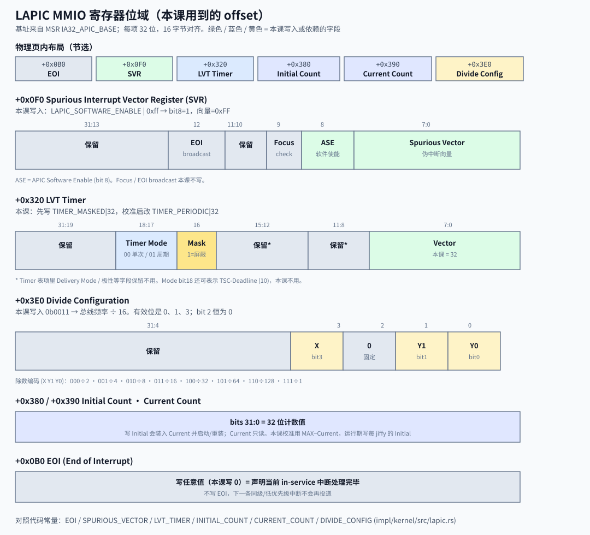
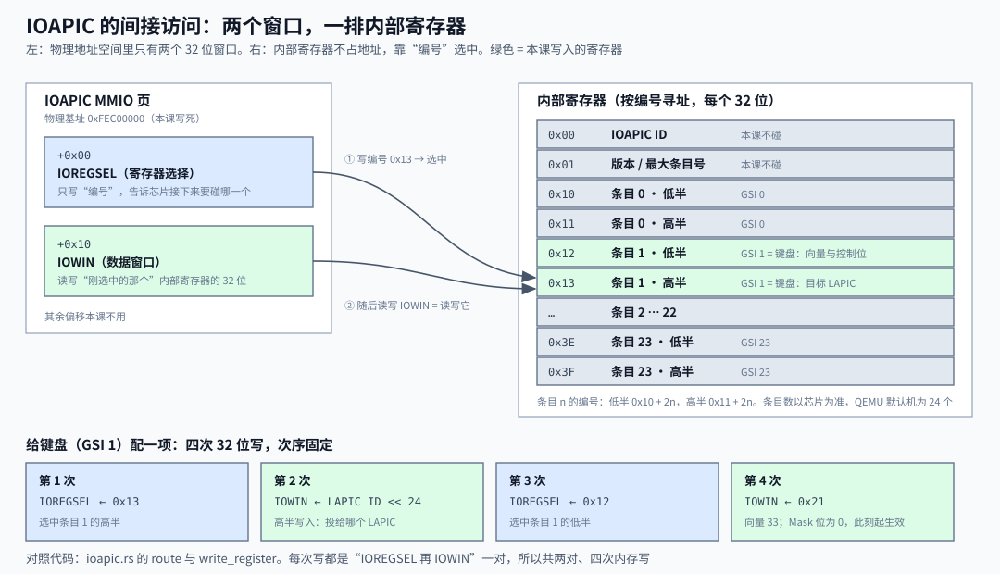
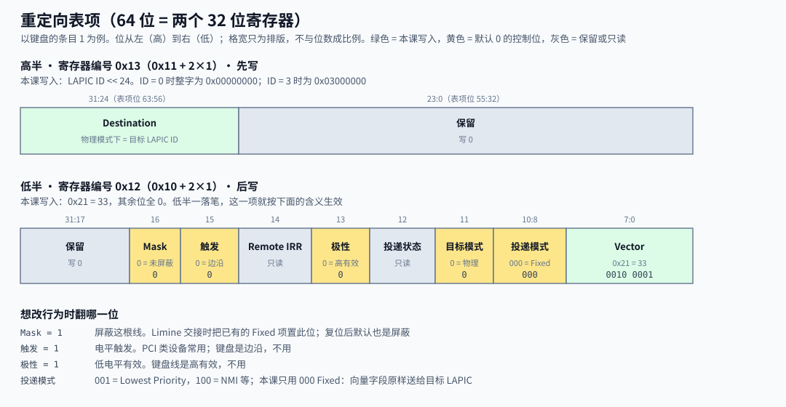

Lead: 8259 PIC 汇集传统外中断。LAPIC 是每颗 CPU 本地的中断控制器，自带定时器。IOAPIC 把外设 IRQ 路由到某颗 LAPIC。100 Hz tick 由 LAPIC timer 直接产生向量 32，不经 IOAPIC。键盘是外设，必须经 IOAPIC：IRQ1 → 重定向表第 1 项 → 向量 33 → LAPIC → IDT。

> 概念深读（M3 Bite1 引入，Bite2 扩写 IOAPIC）。面向第一次见到这些硬件名词的读者。

读完你应能完成三件事：

1. 说出 PIC / LAPIC / IOAPIC / PIT 各管什么，判断一个中断源走 LAPIC 本地还是经 IOAPIC。
2. 给定 GSI、向量、LAPIC ID，写出向 IOREGSEL / IOWIN 依次写的四个值。
3. 指出重定向表项里向量、目标、屏蔽位在哪，说出默认全 0 的位各意味着什么。

## 一句话

四个名字经常混着说，其实管四件不同的事：

| 名字 | 全称 | 一句话职责 |
|---|---|---|
| PIC | 8259 Programmable Interrupt Controller | 把传统外设 IRQ 线汇集后交给 CPU |
| LAPIC | Local APIC | 每颗 CPU 本地的中断控制器，自带定时器 |
| IOAPIC | I/O APIC | 把外设 IRQ 路由到指定 LAPIC |
| PIT | Programmable Interval Timer | 可编程定时器；本课只当 10 ms 秒表 |

**IDT 始终负责按向量号找入口。** 换的是中断从哪来、谁投递给 CPU，不是废弃 IDT。

## 四者怎么串

```flow LR
[键盘 IRQ1] -> [IOAPIC]: 外设线
[IOAPIC] -> [LAPIC]: 按表项路由
[LAPIC timer] -> [LAPIC]: 本地定时
[LAPIC] -> [CPU]: 向量号
[CPU] -> [IDT]: 查入口
[PIT] --> [校准秒表]: 不投递 IRQ
[PIC] --> [已屏蔽]: 不用
```

本课有两条路：

- 定时器：`LAPIC timer → LAPIC → CPU → IDT → 向量 32`。源头在 LAPIC 内部，不需要 IOAPIC。
- 键盘：`键盘 IRQ1 → IOAPIC → LAPIC → CPU → IDT → 向量 33`。源头是外部设备线，LAPIC 的本地寄存器接不到它。

PIC 在初始化时整片屏蔽。键盘要么走 PIC，要么走 IOAPIC。本课选后者，所以 IOAPIC 必须配好才有键盘中断。

## IRQ、GSI 与向量号

三个号码容易混。**IRQ 是外设侧的线号；GSI 是 IOAPIC 输入引脚的全局编号；向量号是 CPU 查 IDT 用的下标。** 三者不必相等。

| 中断源 | IRQ | GSI | 向量号 | 谁决定向量 |
|---|---|---|---|---|
| LAPIC 定时器 | 无（本地源） | 无 | 32 | LAPIC 的 LVT Timer 寄存器 |
| PS/2 键盘 | 1 | 1 | 33 | IOAPIC 重定向表第 1 项 |

QEMU 默认机上，ISA 键盘 IRQ1 接到 IOAPIC 引脚 1，所以 GSI = IRQ = 1。个别线会错位：PIT 的 IRQ0 在 IOAPIC 上落在引脚 2。本课不用 PIT 中断，键盘不受影响。

向量区间怎么分：

| 区间 | 谁占用 | 本课怎么用 |
|---|---|---|
| 0–31 | CPU 异常（`#DE`、`#PF` 等） | 异常入口仍打印后停机 |
| 32–255 | 可给外设 / LAPIC 本地源 | 定时器 32，键盘 33 |

**CPU 异常与 PIC 无关。** 执行除零时，CPU 自己产生 `#DE`，固定走 **IDT[0]**。这条路径不经过 PIC / LAPIC / IOAPIC。哪怕 PIC 也被编成「IRQ0 → 向量 0」，除零仍然是异常入口；撞车的坏处是：硬件 IRQ 与异常共用同一表项，分不清来源，栈帧约定还可能不一致。

**PIC 的默认基址是 BIOS 配的，不是 0。** PC 上主片 IRQ0–7 常见落在向量 `0x08`–`0x0F`，从片在 `0x70` 起。保护模式下这正好压在 CPU 保留的异常区（0–31）里，例如 IRQ0 与 `#DF`（向量 8）同号。所以仍用 PIC 的内核会做 **remap**：把主片基址改到 32、从片到 40，让外设 IRQ 避开 0–31。

**Limine 不做这次 remap。** 协议约定：交接时 legacy PIC 各线已全部屏蔽；IOAPIC 里 Fixed / Lowest Priority 项也会被屏蔽。本课同样整片屏蔽 PIC（`lapic.rs:136-139`），定时器用 LAPIC 的 LVT 直接写成向量 32（`TIMER_VECTOR = 32`，`lapic.rs:11`）。键盘向量 33 则由 IOAPIC 表项给出（`KEYBOARD_VECTOR = 33`，`keyboard.rs:10`）。课文里的「IRQ32」「IRQ33」指进 IDT 的向量号，不是 PIC 线号。

## PIC 与 PIT 不是同一个设备

```callout warn 常见混淆
屏蔽 legacy PIC 不等于停用 PIT。PIC 是中断控制器；PIT 是可编程定时器。二者独立。
```

本课初始化先屏蔽两片 8259（`outb(0x21, 0xff)` / `outb(0xa1, 0xff)`，`impl/kernel/src/lapic.rs:136-139`）。这样旧的 PIC 投递路径安静下来，避免和 LAPIC 抢向量。

校准仍用 PIT channel 2：门控端口给出已知 10 ms 脉冲，量 LAPIC 在这段时间里数了多少（`impl/kernel/src/lapic.rs:119-134`）。PIT 在这里不产生运行期 tick，也不需要 PIC 转发。

## LAPIC 本课用到什么

LAPIC 对每个 CPU 一份。寄存器住在一段物理 MMIO（基址常为 `0xFEE00000`，以 MSR `IA32_APIC_BASE` 为准）。本课用到的 offset 与位域如下：



本课用到的动作：

1. **全局使能**：必要时置 MSR bit 11（`APIC_ENABLE`）。
2. **软件使能**：写 Spurious Vector 寄存器（偏移 `0xF0`），置 bit 8（`LAPIC_SOFTWARE_ENABLE`），低 8 位选伪中断向量 `0xFF`。
3. **映射 MMIO**：HHDM 不保证覆盖设备页，按需补一页（见 [map_mmio_page](mmio-page-mapping.html)）。
4. **校准并开周期定时器**：divider=16，LVT 写周期模式与向量 32，最后 `sti`。
5. **每次 tick**：handler 只给 `jiffies` 加一，再写 EOI（偏移 `0xB0`）。

对应入口：`enable_lapic` 与 `init`（`impl/kernel/src/lapic.rs:60-117`）。MSR 细节见 [x86 的 MSR](x86-msr.html)。

```callout info 两道使能开关
MSR 的 APIC Global Enable 与 SVR 的 Software Enable 是两道开关。只开其一，LAPIC 仍可能不接中断。本课两处都写。
```

键盘路由还要用到 LAPIC 的另一个寄存器：**LAPIC ID**，偏移 `0x20`，位 31:24。`lapic::id()` 把它读出来（`lapic.rs:100-104`），交给 IOAPIC 当投递目标。

## IOAPIC：键盘 IRQ1 怎样变成向量 33

### 它收线，LAPIC 不收

定时器是 LAPIC 自己的部件，向量写在 LAPIC 自己的 LVT 寄存器里。键盘控制器是外部芯片，它的 IRQ1 线接到 IOAPIC 的输入引脚。IOAPIC 每根引脚有一个**重定向表项**，记着三件事：这根线触发后用哪个向量、投给哪个 LAPIC、现在是否放行。

没有配表项，这根线就不会产生向量。Limine 交接时屏蔽了 IOAPIC 里已有的 Fixed 项，PIC 也已屏蔽，键盘就没有任何出路。

### MADT 发现基址与页映射

IOAPIC 的寄存器也是 MMIO。LAPIC 能从 `IA32_APIC_BASE` MSR 读基址（`lapic.rs:106-114`），IOAPIC 没有这种通用 MSR。因此 `acpi::keyboard_route` 读取 MADT 取得基址，再用 ISO 条目确认 IRQ 与 GSI 的接线（`acpi.rs:25-50`）。QEMU 默认机实测发现 `0xFEC00000` / GSI 1，但这些值不再写死。详见 [ACPI MADT 硬件发现](acpi-madt.html)。

RSDP、根表和 MADT 的物理页不一定已被 HHDM 覆盖，因此 `map_physical` 也复用 `mmio::map_page`（`acpi.rs:54-57`）。D18 已在 Bite3 收敛；D17 的通用页表改造仍留到 M5。

HHDM 不保证覆盖这一页，所以 `route` 对 MADT 给出的基址调用 `mmio::map_page`（`ioapic.rs:23`）。机制与 LAPIC 页完全相同：补缺页表层级，叶子项关缓存，返回物理地址加 HHDM 偏移得到的虚拟地址。详见 [map_mmio_page](mmio-page-mapping.html) 与 [HHDM](hhdm.html)。IOAPIC 页与 LAPIC 页不在同一个 2 MiB 内，所以多补一张页表。

### 间接访问：两个窗口，一排内部寄存器

IOAPIC 在地址空间里只露出两个 32 位寄存器，其余寄存器靠编号选中：



读写任何内部寄存器都是两步：

1. 把寄存器**编号**写进 IOREGSEL（`+0x00`）。
2. 读或写 IOWIN（`+0x10`），碰到的就是刚选中的那个寄存器。

重定向表从编号 `0x10` 开始，每项占两个连续编号：第 n 项低半 `0x10 + 2n`，高半 `0x11 + 2n`（`ioapic.rs:14`、`:26`）。QEMU 默认机的键盘 GSI = 1，所以低半是 `0x12`，高半是 `0x13`。

代码里的 `write_register` 就是这一对写（`ioapic.rs:41-47`）。两次都用 `write_volatile`：它告诉编译器这是真实的设备写，不许合并或删掉。

### 重定向表项：64 位，两半

一项 64 位，拆成两个 32 位寄存器。位域如下：



本课写入这些字段（`ioapic.rs:22-37`）：

- **Vector**（低半位 7:0）：写 `33 = 0x21`。
- **Destination**（高半位 31:24）：写 `LAPIC ID << 24`。物理目标模式下，这个字段就是目标 LAPIC 的 ID。
- **Polarity / Trigger**：按 MADT 的 ISO flags 设置位 13 / 15；QEMU 默认机是高电平、边沿，所以这两位为 0。
- 其余位为 0：Fixed 投递、物理目标、未屏蔽。

投递状态（位 12）与 Remote IRR（位 14）是只读位，写入无效。电平触发还需要处理后清 Remote IRR，当前只验收边沿键盘。

### 为什么先写高半、后写低半

Mask 位在低半。复位后表项处于屏蔽状态，低半一写入，Mask = 0，这一项立刻生效。若先写低半，生效的那一刻高半还是旧值，向量会投给错误的 LAPIC。先写高半，生效时目标已经就位（`ioapic.rs:35-37`）。

### 手算一次：键盘这一项

输入：QEMU 默认机发现的 GSI = 1，向量 33，LAPIC ID = 0（QEMU 单核时通常如此【合理推断】）。`route` 依次做四次写：

| 次序 | 目标 | 值 | 作用 |
|---|---|---|---|
| 1 | IOREGSEL | `0x13` | 选中第 1 项高半 |
| 2 | IOWIN | `0 << 24 = 0x00000000` | 目标 LAPIC 0 |
| 3 | IOREGSEL | `0x12` | 选中第 1 项低半 |
| 4 | IOWIN | `0x00000021` | 向量 33，其余默认，生效 |

若 LAPIC ID 是 3，第 2 次写的值变成 `0x03000000`，其余不变。

### 一次按键走完全程

`keyboard::init` 先清空键盘控制器里残留的字节，再把 `acpi::keyboard_route()` 的结果交给 `ioapic::route`（`keyboard.rs:34-40`）。调用时 IDT 里必须已有向量 33 的入口，所以 `idt::init` 排在前面（`idt.rs:308`、`:329`）。

之后每按一次键：

1. 键盘控制器拉高 IRQ1 线，IOAPIC 引脚 1 收到一个边沿。
2. IOAPIC 查第 1 项：未屏蔽，Fixed，向量 `0x21`，目标 LAPIC 0。
3. IOAPIC 向该 LAPIC 发出一条中断消息，LAPIC 把向量 33 交给 CPU。
4. CPU 查 IDT[33]，进 `keyboard_entry`，再到 `irq_dispatch` 的 `KEYBOARD_VECTOR` 分支（`idt.rs:316`）。
5. handler 读扫描码，结束后统一写 **LAPIC 的 EOI**（`idt.rs:320`，实现在 `lapic.rs:94-98`）。键盘是边沿触发，EOI 只发给 LAPIC，不用碰 IOAPIC。

对照 Bite1：定时器的第 1–3 步不存在，LAPIC 自己数满就直接交向量 32。第 4–5 步两条路完全共用。

### 边界

- **只实测一个 IOAPIC、一根键盘线。** MADT / ISO 发现已实现；多 IOAPIC 的完整范围管理、多核目标与 Lowest Priority 尚未覆盖。
- **电平触发要多一步。** ISO 的电平属性能写入表项，但处理后还要清 IOAPIC Remote IRR；当前只验收边沿键盘。

## 本课有 / 没有

| 能力 | 本课 | 说明 |
|---|---|---|
| LAPIC timer 100 Hz | ok | 直接产生向量 32 |
| 屏蔽 legacy PIC | ok | 避免旧路径干扰 |
| PIT 作校准秒表 | ok | 不负责运行期 tick |
| IOAPIC 路由键盘 IRQ1 | ok | MADT 给出基址与 GSI |
| MADT 发现 IOAPIC / 中断源覆盖 | ok | Bite3 已收敛 D18 |
| 多 IOAPIC、多核目标、电平触发完整处理 | no | 当前只验收单 IOAPIC 边沿键盘 |
| PIC 投递外中断 | no | 已整片屏蔽 |

## 回到项目

| 用点 | 代码 | 本页哪里讲 |
|---|---|---|
| 屏蔽 PIC、PIT 只校准 | `lapic.rs:61`、`:119-139` | PIC 与 PIT；本课有/没有 |
| 向量 32 / 33 与 IRQ、GSI | `lapic.rs:11`、`keyboard.rs:10` | IRQ、GSI 与向量号 |
| MSR 全局使能 + SVR 软件使能 | `lapic.rs:106-117` | LAPIC 本课用到什么 |
| timer → IDT，不经 IOAPIC | `lapic.rs:60-83` | 四者怎么串；一次按键走完全程 |
| MADT 基址、GSI 与页映射 | `acpi.rs:25-57`、`ioapic.rs:23` | MADT 发现基址与页映射 |
| IOREGSEL / IOWIN 间接访问 | `ioapic.rs:10-11`、`:41-47` | 间接访问 |
| 表项编号 `0x10 + 2*gsi` | `ioapic.rs:14`、`:26` | 间接访问 |
| 先写高半（`ID << 24`）再写低半（向量与 flags） | `ioapic.rs:18-19`、`:35-37` | 重定向表项；为什么先写高半 |
| LAPIC ID 来源 | `lapic.rs:100-104` | LAPIC 本课用到什么 |
| 键盘 IRQ1 → 向量 33 | `keyboard.rs:34-40` | 一次按键走完全程 |
| 向量 33 入口与 EOI | `idt.rs:308`、`:316-320`、`:329` | 一次按键走完全程 |
| MADT / ISO 发现已收敛 | `spec/deviations.md` D18 | 边界 |

更完整的课文见 [M3 Bite1 · LAPIC 定时器](../m03-interrupts/b01-lapic-timer.html)。相关概念：[x86 的 MSR](x86-msr.html)、[HHDM](hhdm.html)、[map_mmio_page](mmio-page-mapping.html)。

## 去学

想继续深入时再看。删掉本节，上面的用点仍应能对上。

1. [从零开始自制操作系统 EP8-1 外中断与APIC (P1)](https://www.bilibili.com/video/BV1mq4y1i7b4/)
   - **看哪一段：** 从 8259 PIC 过渡到 APIC 的概念讲解；寄存器细节可先略过。
   - **看完能回答：** 为什么教程用 APIC 接管外中断，而不是继续只用 8259？

2. [OSDev Notes：APIC](https://github.com/dreamportdev/Osdev-Notes/blob/master/02_Architecture/07_APIC.md)
   - **看哪一段：** “I/O APIC”下的“I/O APIC Registers”“Reading data from I/O APIC”“IO Redirection Table (IOREDTBL)”，以及“Interrupt source overrides”。
   - **看完能回答：** 真机上 IOAPIC 基址和 GSI 从哪里查？ISO flags 怎样映射到重定向表项？

3. [OSDev Notes：Timer](https://github.com/dreamportdev/Osdev-Notes/blob/master/02_Architecture/08_Timers.md)
   - **看哪一段：** “Types and Characteristics”“Calibrating Timers”，以及“Local APIC Timer”开头。
   - **看完能回答：** PIT 不再负责周期 tick 后，为什么仍能作为校准参考？

## 自测

1. 既然 legacy PIC 已被屏蔽，为什么 `calibrate()` 仍能用 PIT channel 2？
2. 本课的「IRQ32」是外设线号，还是 IDT 向量号？它是谁写进 LVT 的？
3. 为什么定时器不需要配 IOAPIC，键盘却必须配？
4. 读图题：看重定向表项位域图。低半写入 `0x00010021` 会怎样？
5. 预测题：要把 GSI 4 路由到向量 `0x24`，投给 LAPIC ID 2。写出四次写的目标与值。

### 参考答案

1. PIC 是中断控制器，PIT 是计时器，二者独立。屏蔽 PIC 只断了 PIT 的 IRQ 投递路径；`calibrate()` 靠门控端口读脉冲，不依赖中断。
2. 是 IDT 向量号。它由 `lapic.rs` 的 `init` 写进 LAPIC 的 LVT Timer 寄存器低 8 位。
3. 定时器源在 LAPIC 内部，向量由 LVT 给出。键盘线在 LAPIC 外面，只有 IOAPIC 的重定向表项能把这根线变成向量并指定目标；PIC 已屏蔽，IOAPIC 是唯一出路。
4. `0x00010021` 的位 16 = 1，即 Mask = 1。向量字段仍是 `0x21`，但这一项被屏蔽，按键不会产生中断。依据：图中 Mask 在低半位 16，`0x10000 = 1 << 16`。
5. 低半编号 `0x10 + 2×4 = 0x18`，高半 `0x19`。顺序：IOREGSEL ← `0x19`；IOWIN ← `2 << 24 = 0x02000000`；IOREGSEL ← `0x18`；IOWIN ← `0x00000024`。
