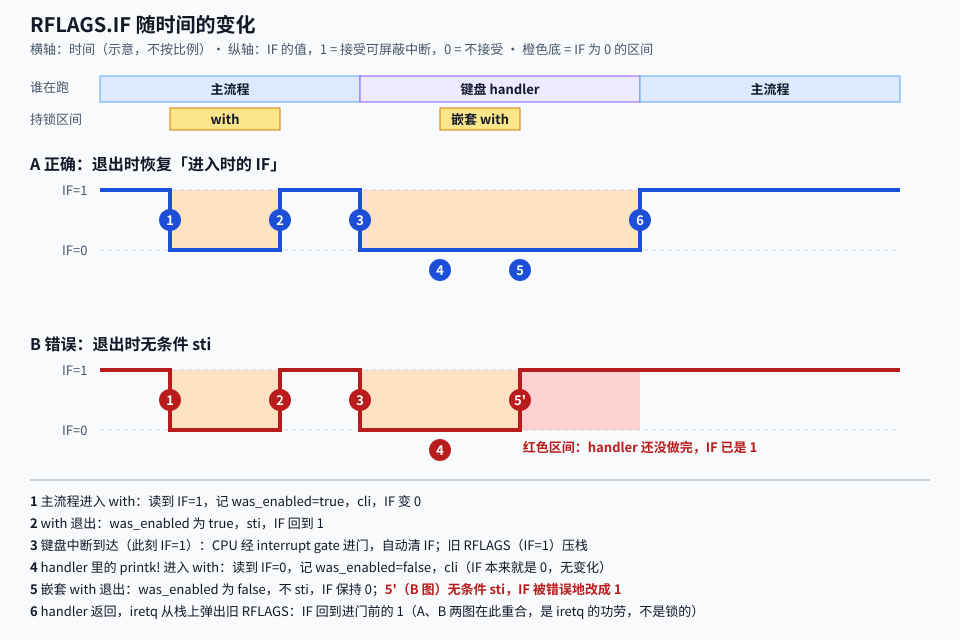
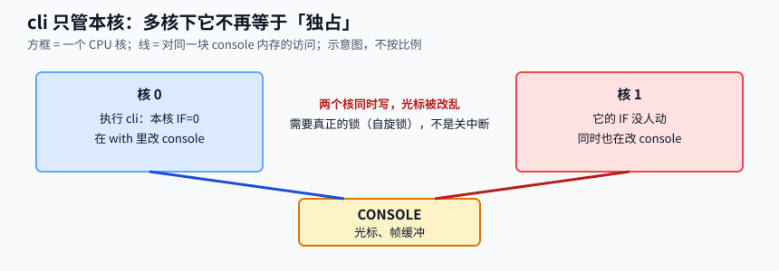

Lead: 单核下，另一个能碰 console 的执行流只有 IRQ handler。`IrqLock::with` 进门时读 RFLAGS.IF 并 `cli`，出门时只在「进来时 IF 为 1」才 `sti`。handler 里 IF 本来就是 0，所以它拿锁、放锁都不改 IF。

> 概念深读（M3 Bite2 背景卡片承诺）。面向没写过内核锁、也不熟 Rust 的读者。
> 读完你应能：① 给定进入时的 IF，预测 `with` 退出后的 IF，并说出无条件 `sti` 错在哪；② 说清 `printk!` 如何让主流程与键盘 handler 互不打断，以及 timer handler 为何不碰 console；③ 判断多核、持锁等待、嵌套 `with` 时这把锁是否还成立。

```callout ok 一句话结论
**锁住的不是 console，是「被打断的可能」。** 主流程 `cli` 之后没有 handler 能进来；handler 里 IF 已被硬件清掉，不会被可屏蔽中断打断。所以 `with` 的退出动作只有一条规则：**还原，不要设置。**
```

## 1. 不加锁会怎样

console 里有两份共享状态：光标位置 `cursor_x` / `cursor_y`，和帧缓冲里的像素。主流程 `printk!` 和键盘 handler 的 `printk!` 都改它们。

先看没有锁的后果。一次打印里，「画字形」和「光标右移」是两步。中断恰好落在两步之间：

```sequence
participants: 主流程, 键盘 handler, 光标 cursor_x
主流程 -> 光标 cursor_x: 在 x=0 画字符 a
note 主流程, 键盘 handler: 键盘中断到达，此刻 IF=1
键盘 handler -> 光标 cursor_x: 在 x=0 画字符 k，盖掉 a
键盘 handler -> 光标 cursor_x: 光标右移，x=8
键盘 handler --> 主流程: iretq 返回
主流程 -> 光标 cursor_x: 继续右移（读到 8 得 16，或沿用旧值得 8）
```

读图要点：`a` 已经被 `k` 盖掉，光标位置是多跳一格还是沿用旧值，取决于编译器有没有把 `cursor_x` 缓存在寄存器里。两种结果都是错的。

Rust 还多一层问题：同一时刻存在两个 `&mut Console`，这在 Rust 里本身就是未定义行为。上面「沿用旧值」就是编译器按「没人会同时改它」做的优化。

## 2. 要用到的四个硬件名词

| 名词 | 含义 | 本页用它做什么 |
|---|---|---|
| RFLAGS.IF | RFLAGS 的 bit 9。1 = CPU 接受可屏蔽外部中断，0 = 不接受 | 锁的开关 |
| `cli` | 清 IF（只影响执行它的这个核） | 进临界区 |
| `sti` | 置 IF | 出临界区 |
| `pushfq` + `pop` | 把 RFLAGS 压栈再弹进寄存器，读出 IF | 记住「进来时的 IF」 |

IF 为 0 时到达的可屏蔽中断不会丢：LAPIC 把它记成「待处理」，等 IF 回到 1 再投递。同一向量连续到达几次，只记一份【合理推断：LAPIC 的 IRR 每个向量一位】。

**中断门进门会自动清 IF。** 这是 M2/M3 Bite1 已讲过的结论，见 [IDT 与异常栈帧](idt-exception-frame.html)。本页只用它的两个后果：handler 一开始 IF=0；`iretq` 会从栈上弹出旧 RFLAGS，IF 回到进门前的值。

## 3. with 做了什么

```rust src=impl/kernel/src/irq_lock.rs lines=33-47 hl=34,36,42,44
```

```flow TB
(进入 with) -> [pushfq 读 IF 存入 was_enabled]
[pushfq 读 IF 存入 was_enabled] -> [cli]
[cli] -> *[f 访问内部值]
*[f 访问内部值] -> {was_enabled 为真吗}
{was_enabled 为真吗} -> [sti]: 是
{was_enabled 为真吗} -> [IF 保持 0]: 否
[sti] -> (返回结果)
[IF 保持 0] -> (返回结果)
```

三条规则：

1. 进门先**读**再 `cli`。顺序反了，读到的永远是 0。
2. 关中断期间才碰数据。
3. 出门**还原**。`was_enabled` 为 false 时什么都不做。

这几行用到的 Rust 语法：

| 写法 | 含义 |
|---|---|
| `f: impl FnOnce(&mut T) -> R` | 参数 `f` 是一个只会被调用一次的闭包：收到内部值的 `&mut T`，返回 `R` |
| `\|slot\| ...` | 闭包写法：竖线里是参数，后面是函数体。见 [Rust Book：闭包](https://doc.rust-lang.org/book/ch13-01-closures.html) |
| `UnsafeCell<T>` | 让「只有 `&self`」的函数也能拿到 `*mut T`。Rust 里想绕过「共享即不可变」只能经它 |
| `unsafe impl Sync` | 程序员向编译器保证「多个执行流同时持有 `&IrqLock` 是安全的」。编译器无法验证，担保来自单核加关中断 |
| `asm!("cli", options(nostack))` | 内联汇编。没写 `nomem`，编译器就当它会读写内存，不会把临界区内的访存挪到 `cli` 前后 |
| `unsafe { ... }` | 标记「这里的安全性由我保证」，注释里的 `SAFETY:` 写明保证了什么 |

## 4. 为什么不能无条件 sti

三个调用点，`with` 进来时的 IF 各不相同：

| 调用点 | 进来时 IF | 退出时该是 | 无条件 `sti` 的后果 |
|---|---|---|---|
| 主流程的 `printk!`（`lapic::init` 之后） | 1 | 1 | 恰好没错 |
| 主流程的早期 `printk!`（`main.rs:43` 起，`sti` 在 `lapic.rs:81`） | 0 | 0 | 提前开中断，此时 IDT 还没装（`idt::init` 在 `main.rs:61`） |
| handler 里的 `printk!` | 0（硬件刚清） | 0 | handler 还没做完就开中断（图中 B 的红色区间） |

第二行的前提：Limine 交接时 IF=0。项目代码没有断言它，但「`sti` 才开中断」的写法（`lapic.rs:81`）和 Limine 协议对入口状态的约定一致【合理推断】。



**还原规则对三行都对**：进来是几，出去就是几。图中 A 的圈 4 到圈 5 就是第三行：`was_enabled=false`，`cli` 是空操作，退出不 `sti`。

```callout warn 容易读错的两处
**① handler 里的 `with` 并没有「等别人放锁」。** 中断只在 IF=1 时到达，而主流程在 `with` 里时 IF=0。所以 handler 开始执行的那一刻，主流程一定不在 `with` 里。handler 一侧的 `cli` 是空操作。
**② 真正起保护作用的是主流程那一侧的 `cli`。** handler 也走 `with`，是因为 `printk!` 只有一条路径，Rust 也要求只能经 `IrqLock` 拿到 `&mut Console`。
```

**图中 6 号点（`iretq`）会把 IF 改回 1，A、B 两图在这里重合。** 重合靠的是 `iretq`，不是锁。B 的错误出在 5' 到 6 之间：这段时间 handler 在 IF=1 下继续跑，还没发 EOI。

本项目里 B 的后果暂时被 LAPIC 挡住。键盘（向量 33）与定时器（向量 32）同属优先级类 2。发 EOI 前，LAPIC 不再投递同类向量【合理推断：SDM Vol.3 第 10 章的优先级规则，未实测】。一旦以后出现更高优先级类的向量，handler 就会被嵌套。这是巧合，不是设计。

## 5. console 怎么用这把锁

```rust src=impl/kernel/src/console.rs lines=94-113
```

| 点 | 做法 | 原因 |
|---|---|---|
| 全局 console | `static CONSOLE: IrqLock<Option<Console>>` | `static` 要求 `Sync`，所以才需要 `unsafe impl Sync`。`Option` 为 `None` 表示未初始化 |
| 访问入口 | 只有 `CONSOLE.with(...)` | 编译器强制：不经锁拿不到 `&mut Console` |
| 一次打印 | `_print` 把整次 `write_fmt` 放进一个 `with` | 一次 `printk!` 的输出是一个整体，不会被别的 `printk!` 切开。这是 D15（`spec/deviations.md`）的收敛点，决策见 `decisions/0003` |
| 键盘 handler | `keyboard.rs:50` 调 `printk!` | 与主流程走同一把锁，同一个 `with` |
| timer handler | `lapic.rs:90-92` 只做 `JIFFIES.fetch_add` | 不碰 console，用原子计数，不需要锁 |

`if let Some(cons) = slot`：`slot` 是 `&mut Option<Console>`。`Some` 时，`cons` 得到内部的 `&mut Console`，`None` 时整次打印直接丢弃。

代价：整次 `printk!`（格式化、画像素、写串口，滚屏时还要搬整屏）都在 IF=0 下完成。定时器 10 ms 一次，关中断超过 10 ms 就会合并掉一次 tick【合理推断，未测量】。这也是 timer handler 不打印的原因之一，见 `decisions/0001`。

## 6. 什么时候这把锁不够用



| 场景 | 为什么不成立 | 本项目现状 |
|---|---|---|
| 多核 | `cli` 只清本核的 IF，别的核照常运行，可以同时写 console。要换成自旋锁 | 单核，没有启动其他核 |
| 持锁等待 | `with` 里 IF=0。在里面等键盘、磁盘、睡眠，等的那个中断永远到不了，`hlt` 也叫不醒 | `with` 里只有格式化与画像素，不等任何东西 |
| 同一执行流嵌套 `with` | 内层 `was_enabled=false`，IF 的还原没错，但会产生第二个 `&mut Console`，等于别名。`with` 管的是「别的执行流」，不管「自己重入」 | 注释写明禁止；没有机制检查 |
| 不可屏蔽的打断 | NMI 不受 IF 控制。`with` 内部触发的 CPU 异常（如缺页）会进异常 handler 再 `printk!`，也会形成嵌套 | 登记在 D15 的残留里：持锁期间 panic 再 `printk!` 仍可能别名 |

判断口诀：**要等什么，或有第二个核，或会自己调自己，就不能靠关中断。**

## 回到项目

| 用点 | 代码 | 本页哪里讲 |
|---|---|---|
| `with`：读 IF → `cli` → 访问 → 按进入时 IF 决定 `sti` | `irq_lock.rs:33-47`、`:50-55` | 第 3 节 |
| 中断门进门清 IF；handler 内再拿锁是嵌套关中断，不能无条件 `sti` | `irq_lock.rs:29-32`、`idt.rs:19-21` | 第 2、4 节 |
| 全局 `IrqLock<Option<Console>>`；`_print` 整次格式化在锁内（D15） | `console.rs:95`、`:104-113` | 第 5 节 |
| 键盘 handler 经 `printk!` 走同一把锁；timer handler 不碰 console | `keyboard.rs:45-52`、`lapic.rs:88-92`、`idt.rs:313-321` | 第 5 节 |
| 失效：多核、持锁等待、嵌套 `with` | `irq_lock.rs:1-6`、`:38-39`；`decisions/0003` 失效边界 | 第 6 节 |

课文见 [M3 Bite2](../m03-interrupts/b02-keyboard-console-lock.html)（成稿后链接生效）。相关概念：[IDT 与异常栈帧](idt-exception-frame.html)、[PIC、LAPIC 与 IOAPIC](apic-vs-pic.html)。

## 去学

想继续深入时再看。删掉本节，上面的用点仍应能对上。

1. [The Linux Kernel documentation：Unreliable Guide To Locking](https://docs.kernel.org/kernel-hacking/locking.html)
   - **看哪一段：** 「Hard IRQ Context」一节，以及全文里 `spin_lock_irqsave()` 出现的地方。
   - **看完能回答：** 成熟内核同时要挡中断和别的核时怎么做？为什么它们的接口名里带 `irqsave`？

2. [Rust 标准库：UnsafeCell](https://doc.rust-lang.org/std/cell/struct.UnsafeCell.html)
   - **看哪一段：** 页首说明。
   - **看完能回答：** 为什么 Rust 要求「共享可变」必须经过 `UnsafeCell`？

3. [The Rust Programming Language：闭包](https://doc.rust-lang.org/book/ch13-01-closures.html)
   - **看哪一段：** 闭包语法和 `FnOnce` 的介绍。
   - **看完能回答：** `CONSOLE.with(|slot| ...)` 里的 `slot` 是谁传进来的？

## 自测

**1. 内核启动早期，`lapic::init` 还没执行时，主流程调用 `printk!`。`with` 返回后 IF 是多少？如果实现改成无条件 `sti`，会多出什么问题？**

```html
<details><summary>第 1 题答案与解析</summary><p><strong>IF=0。</strong>进入时 IF=0（<code>sti</code> 要到 <code>lapic.rs:81</code> 才执行），<code>was_enabled=false</code>，退出不 <code>sti</code>。无条件 <code>sti</code> 会在 IDT 还没装好（<code>idt::init</code> 在 <code>main.rs:61</code>）时就开中断。这是还原规则的第二个例子，不只 handler 才需要它。</p></details>
```

**2. 读图：图 A 里，键盘中断恰好在圈 1 和圈 2 之间（主流程已在 `with` 里）到达。handler 什么时候开始跑？会丢吗？**

```html
<details><summary>第 2 题答案与解析</summary><p><strong>圈 2 的 <code>sti</code> 之后才开始跑，不丢。</strong>IF=0 期间中断被 LAPIC 记为待处理，IF 回到 1 才投递。这正是主流程那一侧 <code>cli</code> 起保护作用的原因：handler 被推迟到整次 <code>printk!</code> 完成之后。同一向量连续到达几次会合并成一次。</p></details>
```

**3. 有人说：「handler 里 IF 已经是 0，所以 handler 里的 `printk!` 根本不需要走 `with`。」这句话哪里不成立？**

```html
<details><summary>第 3 题答案与解析</summary><p><strong>保护确实来自主流程那一侧，但 handler 也必须走 <code>with</code>。</strong>handler 一侧的 <code>cli</code> 是空操作，这点没错。不成立的是「不需要走」：Rust 只允许经 <code>IrqLock::with</code> 拿到 <code>&mut Console</code>，<code>printk!</code> 又只有一条路径。如果 handler 绕开它，就得退回 <code>static mut</code>，D15 就没收敛。</p></details>
```

**4. 在 `with` 的闭包里再调用一次 `printk!`。IF 的还原会出错吗？还有别的问题吗？**

```html
<details><summary>第 4 题答案与解析</summary><p><strong>IF 不会出错，别名会出错。</strong>内层进入时 IF=0，<code>was_enabled=false</code>，退出不 <code>sti</code>；外层退出时仍按外层记下的值还原，所以 IF 是对的。但内层与外层同时持有指向同一个 <code>Console</code> 的 <code>&mut</code>，违反 Rust 的别名规则，光标状态也可能被内层改乱。<code>with</code> 只防「别的执行流」，不防自己重入。</p></details>
```

**5. 在 `with` 的闭包里执行 `hlt`，等键盘输入再继续。会发生什么？**

```html
<details><summary>第 5 题答案与解析</summary><p><strong>CPU 停在 <code>hlt</code>，不会醒来。</strong>闭包里 IF=0，键盘中断（可屏蔽）到不了 CPU。<code>hlt</code> 只会被中断、NMI 或复位唤醒。这就是「持锁等待」为什么超出关中断锁的边界：要等中断的事，必须先离开临界区。</p></details>
```
