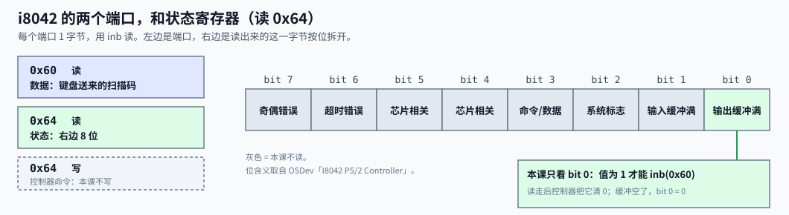
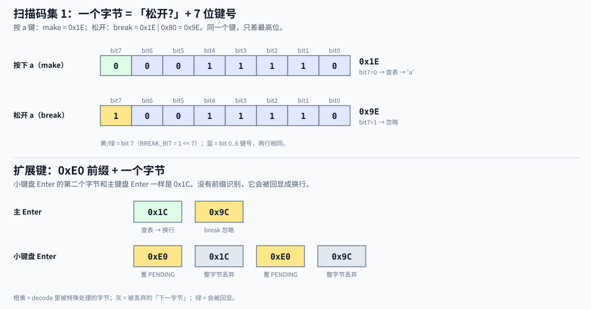
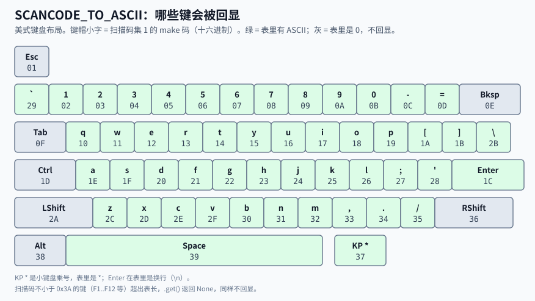

Lead: 按下一个键，键盘把一个字节交给 PS/2 控制器。控制器拉起 IRQ1。CPU 进入 handler 后用 `inb` 读走这个字节，查表得到 ASCII，再用 `printk!` 回显。松开、扩展键和没有字形的键，都在 `decode` 里被丢掉。

> 概念深读（M3 Bite2 背景卡片承诺）。只讲本 Bite 用到的 PS/2 与扫描码集 1。
> 读完你应能：① 给一串扫描码字节，预测屏幕回显什么；② 说出 `init` 为什么先清缓冲、handler 为什么读到空；③ 指出一次按键从键盘到 `keyboard::interrupt` 经过哪几站。

## 一条链

```flow LR
(按下 a) -> [键盘]: 串行发 0x1E
[键盘] -> [PS/2 控制器]: 字节进输出缓冲
[PS/2 控制器] -> [IOAPIC]: 拉 IRQ1
[IOAPIC] -> [LAPIC]: 投向量 33
[LAPIC] -> [CPU / IDT]: 查入口
[CPU / IDT] -> *[keyboard::interrupt]: irq_dispatch
[keyboard::interrupt] -> [decode]: inb 0x60
[decode] -> [printk]: 'a'
```

- **键盘 → 控制器**：键盘自己把按键变成字节，PS/2 控制器（经典型号 i8042）收下后放进「输出缓冲区」，并拉起 IRQ1。
- **控制器 → CPU**：IRQ1 经 IOAPIC、LAPIC 变成向量 33，进 IDT。这一段在 [PIC、LAPIC 与 IOAPIC](apic-vs-pic.html) 里讲过，本页只当黑盒用。
- **CPU → 屏幕**：handler 读字节、`decode`、`printk!`。这一段是本页的主体。

## 两个端口

PS/2 控制器占两个 I/O 端口，各 1 字节。读写它们的 `inb` / `outb` 是 M3 已经用过的那两条 `in` / `out` 指令封装，不再展开。



| 端口 | 读 | 写 | 本课 |
|---|---|---|---|
| `0x60` | 键盘送来的一个字节 | 发给键盘或控制器的数据 | 只读 |
| `0x64` | 状态寄存器 | 控制器命令 | 只读 |

写 `0x64` 能让控制器自检、开关端口、改翻译位。本课不写，沿用固件与 QEMU 留下的默认状态。

**bit 0 是「输出缓冲满」。** 它为 1 时，`0x60` 里才有新字节。代码里叫 `STATUS_OUTPUT_FULL`：

```rust src=impl/kernel/src/keyboard.rs lines=14-17
```

- `1 << 0` 是把 1 左移 0 位，值就是 `0b0000_0001`。
- `inb(STATUS_PORT) & STATUS_OUTPUT_FULL` 按位与：只留下 bit 0。结果不为 0，就是缓冲里有字节。
- 不先查就读 `0x60`，会读到过期字节。

## 扫描码集 1：一个字节说清「哪个键、按下还是松开」

**扫描码是键的编号，不是字符。** 它不关心你按的是 `a` 还是 `A`，也不关心键盘布局。同一个键会发两次字节：



- 按下发 **make 码**，例如 `a` 是 `0x1E`。
- 松开发 **break 码** = make 码 | `0x80`，例如 `0x9E`。
- 最高位（bit 7）就是「松开」标志。代码里叫 `BREAK_BIT`：

```rust src=impl/kernel/src/keyboard.rs lines=21-22
```

- 判断松开：`scancode & BREAK_BIT != 0`。
- 按住不放，硬件会不断重发 make 码。回显也就重复出现，这是预期行为。

**为什么是「集 1」。** 现代键盘本身发的是集 2。PS/2 控制器默认带翻译功能，把集 2 翻译成集 1，再交给软件（OSDev：i8042 的「Translation」）。本课不写 `0x64`，就沿用这个默认翻译。如果翻译被关掉，软件拿到集 2 的码，下面的表全部对不上。

## 0xE0：扩展键的前缀

方向键、右 Ctrl、小键盘 Enter 等「扩展键」，发两个字节：先 `0xE0`，再一个字节。

问题在第二个字节。小键盘 Enter 的第二个字节是 `0x1C`，和主键盘 Enter 一样。如果不认前缀，小键盘 Enter 会被当成主键盘 Enter，也回显成换行。

本课的做法很粗：见到 `0xE0`，记下「下一个字节要丢」，下一个字节无论是什么都丢掉。

```rust src=impl/kernel/src/keyboard.rs lines=30-32
```

- `EXTENDED_PENDING` 必须是 `static`。`0xE0` 和后面那个字节可能落在两次 handler 调用里，普通局部变量活不过一次调用。
- `AtomicBool` 是「可以安全读写的布尔值」。这里选它只是为了不写 `static mut`，不是为了多线程。
- `store(true)` 写入；`swap(false)` 一步完成「取出旧值，同时写回 false」。

Pause 键发 6 个字节，以 `0xE1` 开头。逐字节过一遍 `decode`，结果全是 `None`，所以也不会回显。

## decode：一个字节的去向

```flow TB
(收到一个字节) -> {是 0xE0?}
{是 0xE0?} -> [置 PENDING]: 是
[置 PENDING] -> [None]
{是 0xE0?} -> {PENDING 为真?}: 否
{PENDING 为真?} -> [清 PENDING]: 是
[清 PENDING] -> [None]
{PENDING 为真?} -> {bit 7 = 1?}: 否
{bit 7 = 1?} -> [None]: 是，松开
{bit 7 = 1?} -> {表里有非 0 ASCII?}: 否
{表里有非 0 ASCII?} -> *[Some ASCII]: 是
{表里有非 0 ASCII?} -> [None]: 否
```

```rust src=impl/kernel/src/keyboard.rs lines=56-71
```

- 返回类型 `Option<u8>`：要么 `Some(字节)`，要么 `None`（什么也不回显）。
- 关卡顺序有意义：先认 `0xE0`，再处理「上一个是 `0xE0`」，然后才看 break 位。所以 `E0 9C` 里的 `9C`，由前缀规则丢掉，break 规则轮不到它。
- `.get(i)` 查表，下标越界返回 `None`，不会崩溃。`Some(&ascii) if ascii != 0` 的意思是：查到了，并且值不是 0。

## 查表：哪些键会回显

`SCANCODE_TO_ASCII` 是一张 `0x3A` 字节的表：**下标是 make 码，内容是 ASCII，0 表示不回显。**

```rust src=impl/kernel/src/keyboard.rs lines=24-28
```



- 只映射可打印字符、空格和回车（`0x1C` → `\n`）。
- Esc、Backspace、Tab 是 0：字体里没有它们的字形。
- Shift、Ctrl、Alt 是 0：本课不做修饰键。按 Shift+`a`，Shift 的 make 码被忽略，`a` 照常回显小写 `a`。
- 小键盘的 `*` 键 make 码是 `0x37`，表里就是 `*`。
- 编号不小于 `0x3A` 的键（F1 到 F12 等）超出表长，查不到，不回显。
- 表的类型是 `&[u8; 0x3a]`，一个定长数组的引用。长度写错，编译器直接报错。

## 中断侧：从 IRQ1 到 handler

键盘是外设，IRQ 要经 IOAPIC 才能到 CPU，这和 LAPIC 定时器直接走本地入口不同。本课只用 `ioapic::route` 这一个入口：

```rust src=impl/kernel/src/keyboard.rs lines=34-42
```

- 参数 `KEYBOARD_GSI = 1`：QEMU 默认机上，ISA IRQ1 对应的全局中断线号也是 1。
- `KEYBOARD_VECTOR = 33`：紧挨定时器的 32。IOAPIC 内部怎么记这条路由，见 [PIC、LAPIC 与 IOAPIC](apic-vs-pic.html)，本页不展开。
- 必须在 IDT 装好向量 33 之后再调用，否则中断来了没有入口。

**为什么 `init` 要先清缓冲再 `route`。** 注释写得直白：残留字节不清掉，输出缓冲区一直满着，控制器不会再触发新的 IRQ1。路由一打开，如果缓冲里正好有开机遗留的字节，键盘就永远「哑」了。

**handler 读到空为止。**

```rust src=impl/kernel/src/keyboard.rs lines=44-53
```

- 进入这个函数前，调度层已经按向量 33 选中它；返回之后，调度层统一写 LAPIC 的 EOI（`irq_dispatch`，`idt.rs:313-322`）。handler 自己不发 EOI。
- 一次中断可能积了多个字节，所以用 `while` 反复读，直到状态 bit 0 变 0。OSDev 说中断里可以不查 bit 0，直接读一个字节；本代码多查一次，是为了得到「读到空」的退出条件。
- 中断门进入时硬件已清 IF，handler 里不会再被同类中断打断。机制见 [IDT 与异常栈帧](idt-exception-frame.html)。

**`printk!` 直接在中断里调用。** 主流程若正好在 `printk!` 中途被键盘打断，两条打印会撞在同一个控制台上。M3 Bite2 用关中断临界区收敛这个问题（决定 0003），机制见 [关中断临界区](irq-critical-section.html)，本页不展开。

## 跑一遍：预测回显

设控制器依次送来这 10 个字节：`2A 1E 9E AA E0 1C E0 9C 39 1C`。`EXTENDED_PENDING` 一开始是 false。

| 字节 | 命中的关卡 | 回显 |
|---|---|---|
| `2A` | 表里 `0x2A` 是 0（左 Shift） | 无 |
| `1E` | 表里是 `a` | `a` |
| `9E` | bit 7 = 1，松开 | 无 |
| `AA` | bit 7 = 1，松开 | 无 |
| `E0` | 前缀，置 PENDING | 无 |
| `1C` | PENDING 为真，丢弃并清除 | 无 |
| `E0` | 前缀，置 PENDING | 无 |
| `9C` | PENDING 为真，丢弃并清除 | 无 |
| `39` | 表里是空格 | 空格 |
| `1C` | 表里是 `\n` | 换行 |

屏幕上只多出三个字符：`a`、空格、换行。

## 本课不做

| 能力 | 本课 | 说明 |
|---|---|---|
| Shift / Caps Lock | no | 修饰键的码映射为 0，大小写不变 |
| 行规程（Backspace 删字、行缓冲） | no | handler 来一个字符回显一个 |
| 写 `0x64` 发控制器命令 | no | 沿用默认状态；自检、开关翻译位等是后置话题 |
| 鼠标（IRQ12） | no | 只接 IRQ1 |
| 在非 QEMU 默认机上运行 | no | IOAPIC 基址与 GSI 固定（决定 0004） |

## 回到项目

| 用点 | 代码 | 本页哪里讲 |
|---|---|---|
| 端口 `0x60` 数据、`0x64` 状态；bit 0 | `keyboard.rs:14-17` | 两个端口 |
| `init` 排空、`interrupt` 读到空 | `keyboard.rs:36-42`、`:45-53` | 中断侧 |
| `BREAK_BIT`：松开忽略 | `keyboard.rs:21-22`、`:64-66` | 扫描码集 1 |
| `0xE0` 丢下一字节 | `keyboard.rs:20`、`:30-32`、`:57-63` | 0xE0 前缀；decode |
| `SCANCODE_TO_ASCII` 只映射可打印 + 回车 | `keyboard.rs:24-28`、`:67-70` | 查表 |
| 中断来自 IOAPIC、向量 33 | `keyboard.rs:10-12`、`:41`；`idt.rs:308-329` | 中断侧；[PIC、LAPIC 与 IOAPIC](apic-vs-pic.html) |
| `printk!` 在 IRQ 里 | `keyboard.rs:50` | 中断侧末段 |

## 去学

想继续深入时再看。删掉本节，上面的用点仍应能对上。

1. [姗姗来迟的系列引入与介绍 - 从零开始自制操作系统 EP-INTRO](https://www.bilibili.com/video/BV1zv4y1g7J3/)
   - **看哪一段：** 右侧选集里的「9 手搓键盘驱动」（约 17 分钟）。
   - **看完能回答：** 视频里的键盘中断处理，和本页 handler 的流程有哪些相同、哪些不同？

2. [I8042 PS/2 Controller - OSDev Wiki](https://wiki.osdev.org/I8042_PS/2_Controller)
   - **看哪一段：** 「Status Register」「Translation」和初始化里的「Flush The Output Buffer」。
   - **看完能回答：** 为什么真键盘发集 2，内核却按集 1 查表？

3. [PS/2 Keyboard - OSDev Wiki](https://wiki.osdev.org/PS/2_Keyboard)
   - **看哪一段：** 「Scan Code Set 1」。
   - **看完能回答：** Pause 键为什么要发 6 个字节？

## 自测

1. 字节流 `23 12 E0 48 26 26 A6` 会回显什么？
2. `init` 如果不清缓冲就直接 `route`，最坏会怎样？
3. 删掉 `EXTENDED_PENDING` 的 `swap` 判断，按一下小键盘 Enter，屏幕多出什么？
4. 为什么 `SCANCODE_TO_ASCII` 里 `0x0E`（Backspace）是 0，而不是 `\x08`？

## 自测解析

1. 回显 `hell`。`23`=h，`12`=e，`E0 48` 是方向键，两个字节都丢，`26`=l 出现两次，`A6` 是松开。
2. 缓冲里若恰有开机遗留字节，bit 0 一直为 1，控制器不再触发新的 IRQ1。路由虽然通了，键盘看起来没反应。
3. 多出一个换行。`E0` 之后的 `1C` 没有被丢，按主键盘 Enter 的规则查到了 `\n`。
4. 控制台字体里没有 Backspace 的字形，回显它没有意义；删字属于行规程，本课不做。
