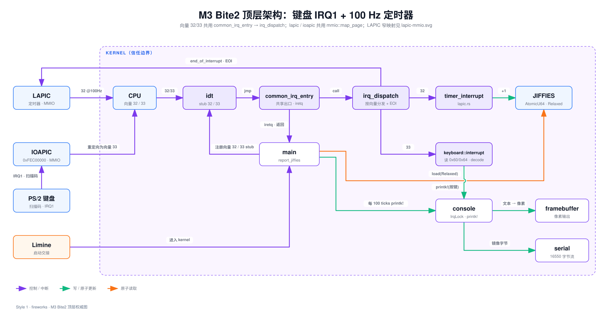
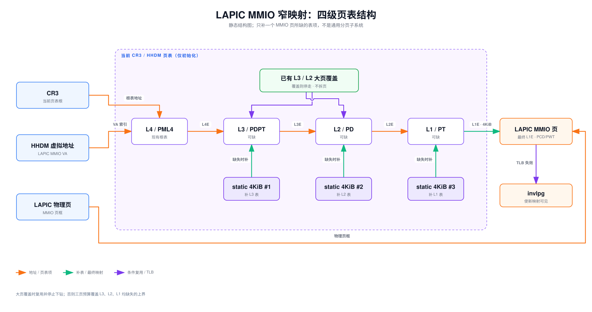

Lead: LAPIC 定时器以 100 Hz 投递 IRQ32。中断上下文只做两件事：原子计数加一、写 EOI。恢复寄存器后 `iretq` 返回，普通上下文每累计 100 tick 打印一行。宿主时钟两次独立测量为 99.77 Hz 与 99.49 Hz。

## 问题

M2 结束时，内核只会主动打印。屏幕上是启动时那几行固定文本，没有任何东西随时间变化。要看出 CPU 被外部事件打断后还能继续往下跑，需要两样东西。一个是自己到来的中断源，另一个是中断返回后还能被主流程读到的计数器。

M2 的异常入口帮不上这个忙。`exception_handler` 打印现场后 `hlt` 停机（`impl/kernel/src/idt.rs:311-347`），它假设异常不可返回。定时器中断必须返回：它打断的可能是任意一段普通内核代码，返回后那段代码要原样继续。

这一课要交付的就是这条通路：

- LAPIC 定时器以 100 Hz 投递 IRQ32。
- 向量 32 有独立的可返回入口。
- 中断上下文只做最小工作。
- 普通上下文每 100 tick 打印一行。

## 背景

```callout info 谁负责产生 tick
8259 PIC 汇集传统外中断。LAPIC 是 CPU 本地控制器，自带定时器。IOAPIC 把外设 IRQ 路由给 LAPIC。本课的 100 Hz tick 由 LAPIC timer 直接产生，不经过 IOAPIC。
```

定时器、IOAPIC、IRQ 编号规则都是这一课第一次出现的硬件名词。更细的对照见 [PIC、LAPIC 与 IOAPIC](../concepts/apic-vs-pic.md)。LAPIC 寄存器的基址要靠 MSR 读出来，MSR 是什么见 [x86 的 MSR：型号特定寄存器](../concepts/x86-msr.html)。

一句提醒：屏蔽 legacy PIC 不等于停用 PIT。PIC 是中断控制器，PIT 是可编程定时器，两者不是同一个设备。

### 先修知识：页表怎样把虚拟地址翻译成物理地址

后面的 `map_mmio_page` 会直接修改页表。先把这一段代码用到的分页知识补齐；这里只讲本课需要的四级分页，不涉及缺页处理和通用内存管理。

**物理地址与虚拟地址不是同一件事。** 物理地址选中实际的内存或设备寄存器，虚拟地址是程序 load/store 使用的地址。开启分页后，CPU 每次访问内存都会查当前页表，把虚拟地址翻译成物理地址。LAPIC 寄存器位于 `physical_base` 这个物理地址；内核想通过 `virtual_base = physical_base + hhdm_offset` 访问它，就必须先在页表中建立“这个虚拟页对应那个物理页”的映射。

**页是地址转换的粒度。** 本课使用 4 KiB（4096 字节）小页，所以虚拟地址低 12 位是页内偏移，翻译时原样保留；高位用来逐级查表。x86-64 四级分页把高位再分成四段，每段 9 位：

```text
47        39 38        30 29        21 20        12 11         0
+------------+------------+------------+------------+------------+
| L4 索引    | L3 索引    | L2 索引    | L1 索引    | 页内偏移   |
+------------+------------+------------+------------+------------+
```

四级表依次叫 PML4（L4）、PDPT（L3）、PD（L2）、PT（L1）。每张表正好占一个 4 KiB 页，含 512 个 64 位表项，因此索引范围是 0～511，掩码是 `0x1ff`。这就是代码反复出现 `((virtual_base >> shift) & 0x1ff)` 的原因：右移把对应字段移到最低位，再用掩码取出本级的表项下标。

**CR3 给出查表起点。** 控制寄存器 CR3 保存当前 PML4 的物理地址。前三级表项通常保存下一级页表的物理地址，最后一级表项保存目标物理页的地址；两者还带有权限和属性位。本课会用到的位是：

- `PAGE_PRESENT`：表项有效；为 0 时，沿这条路径访问会触发缺页异常 `#PF`。
- `PAGE_WRITABLE`：允许写入。
- `PAGE_LARGE`：在 L3/L2 中表示大页映射，地址翻译到此结束，不再进入下一级。
- `PAGE_WRITE_THROUGH` 与 `PAGE_CACHE_DISABLE`：控制缓存行为；MMIO 是设备寄存器，不能像普通内存一样缓存读写。

**为什么代码能用普通指针读写页表？** CPU 查页表需要物理地址，而 Rust 指针使用虚拟地址。Limine 提供的 HHDM（Higher Half Direct Map，高半区直接映射）让“物理地址 + `hhdm_offset`”成为访问同一物理页的虚拟地址。因此，代码从表项取出下一级表的物理地址后，加上 `hhdm_offset`，才能构造 `entry_ptr` 去读写那张表。新分配的静态页表则通过内核的物理/虚拟基址换算出物理地址，再写回上级表项。

**TLB 是地址转换结果的缓存。** CPU 不必每次访存都真的走四级页表，最近用过的转换会缓存在 TLB 中。修改某个虚拟页的映射后，`invlpg` 使这个虚拟地址的旧 TLB 项失效，避免 CPU 继续使用旧翻译。

想先看这套过程跑起来的样子，看 [map_mmio_page：把设备的一页映射进虚拟地址空间](../concepts/mmio-page-mapping.html)。它把「虚拟地址 → 页表 → 物理页」和「这一页被改成了什么」并排画了出来。

## 设计



### 一、把 LAPIC 变成 100 Hz 的时钟

```flow TB
[屏蔽 legacy PIC] -> [使能 APIC]
[使能 APIC] -> [映射 LAPIC MMIO 页]
[映射 LAPIC MMIO 页] -> [divider 16 且 LVT 屏蔽]
[divider 16 且 LVT 屏蔽] -> [PIT channel 2 给 10 ms 参照]: 参照
[PIT channel 2 给 10 ms 参照] -> [量出这 10 ms 的计数值]: 测量
[量出这 10 ms 的计数值] -> [LVT 改周期模式并写 INITIAL_COUNT]
[LVT 改周期模式并写 INITIAL_COUNT] -> [sti 开可屏蔽中断]
```

寄存器写入的顺序有讲究。divider 先设成 16，LVT 先保持屏蔽，校准完成才改成周期模式并写 INITIAL_COUNT，最后 `sti`（`impl/kernel/src/lapic.rs:116`）。在 `sti` 之前，IDT、LAPIC 地址和 handler 都必须就绪，否则第一个 IRQ 会落到空入口。

PIT 在这里只当秒表用。channel 2 输出一个已知 10 ms 的脉冲，PIT 的重装值由 1.193182 MHz 频率除以 100 得到（`impl/kernel/src/lapic.rs:32-33`）。校准函数让 LAPIC 计数从最大值往下走，等脉冲到达，再用 `u32::MAX - CURRENT_COUNT` 算出这 10 ms 内的计数差（`impl/kernel/src/lapic.rs:193-208`）。这个差值就是以后一个 jiffy 的 INITIAL_COUNT。

### 二、IRQ32 来了以后发生什么

```sequence
participants: LAPIC, CPU, IDT, timer_entry, timer_interrupt, main
LAPIC -> CPU: IRQ32 每 10 ms 一次
CPU -> IDT: 按向量 32 查表
IDT -> timer_entry: 跳转
timer_entry -> timer_interrupt: call
timer_interrupt -> timer_interrupt: jiffies 原子加一
timer_interrupt -> LAPIC: 写 EOI
timer_interrupt --> timer_entry: 返回
timer_entry --> CPU: iretq
CPU --> main: 继续 report_jiffies
main -> main: 每 100 tick 打印一行
```

CPU 拿向量号查 IDT，落到 `timer_entry`。入口压栈保存 15 个通用寄存器，调用 Rust handler。handler 加计数，再向 LAPIC 写 EOI（End of Interrupt，通知控制器"这条处理完了"）。入口还原寄存器，用 `iretq` 回到被打断的位置，主流程从原处继续。

EOI 这一步不能省。LAPIC 用 in-service 位记录"哪条中断正在处理"，不写 EOI，下一个 IRQ 就不会投递。

### 三、代码要点

**计数器是一个原子整数**（`impl/kernel/src/lapic.rs:120-129`）。

```rust src=impl/kernel/src/lapic.rs lines=120-129 hl=121,126
```

计数器本体是 `static JIFFIES: AtomicU64 = AtomicU64::new(0);`（`impl/kernel/src/lapic.rs:46`）。`static` 是整个程序期间都存在的全局变量；`AtomicU64` 是 64 位无符号原子整数，`new(0)` 给出初值。`fetch_add(1, Ordering::Relaxed)` 原子地加一并返回加之前的旧值。

`Ordering::Relaxed`（松弛序）是内存序里最弱的一个。它只保证这次加减本身不会读到写了一半的值，不保证它与别的内存操作谁先谁后。这里只需要"不丢计数"，不需要别的顺序，所以选最弱的那个。普通上下文用 `load(Ordering::Relaxed)` 读。

`pub extern "C" fn timer_interrupt()` 是中断处理函数。`pub` 让 `idt` 模块能引用它；`extern "C"` 指定 C 调用约定，让汇编入口能按固定方式调它。函数体只有两行有效代码，就是前面说的加计数和写 EOI。它不格式化、不打印，也不碰 console。

**中断入口单独写一个，因为它必须能返回**（`impl/kernel/src/idt.rs:242-261`）。

```rust src=impl/kernel/src/idt.rs lines=242-261
```

`#[unsafe(naked)]` 表示这个函数体只能写汇编，编译器不生成函数序言和尾声。`unsafe extern "C" fn` 是裸汇编函数的固定写法。`naked_asm!` 是放汇编的宏。

入口先把 `rax` 到 `r15` 共 15 个通用寄存器压栈，被打断的现场就存在栈上。接着 `mov rbx, rsp` 记住帧的位置。`rbx` 是 callee-saved 寄存器，Rust 约定函数必须替调用者保存它，所以 Rust handler 不会动它。

**还原现场并返回**（`impl/kernel/src/idt.rs:262-283`）。

```rust src=impl/kernel/src/idt.rs lines=262-283 hl=280
```

`and rsp, -16` 把栈顶对齐到 16 字节，这是 Rust 的 ABI 要求。`call {handler}` 调用 Rust handler。回来后 `mov rsp, rbx` 把栈指针拨回寄存器帧，`pop` 逆序还原 15 个寄存器。最后 `iretq` 弹出 `rip`、`cs`、`rflags`，回到被打断的位置。

异常入口不一样，它末尾是 `hlt` 停机（`impl/kernel/src/idt.rs:155-157`）。异常返回路径还没做，这一课只让向量 32 可返回。

**打印发生在普通上下文**（`impl/kernel/src/main.rs:67-80`）。

```rust src=impl/kernel/src/main.rs lines=67-80 hl=72
```

`fn report_jiffies() -> !` 的返回类型 `!` 是"永不返回"，表示这个函数不会把控制流交回调用者。`let mut next_report = 100;` 声明一个可变的下次打印阈值。`lapic::jiffies()` 读原子计数，`if observed >= next_report` 判断是否到了阈值。

`printk!` 是宏，参数里的 `{}` 按顺序填入 `observed`。它把同一段文本同时写到屏幕和串口。else 分支执行 `hlt`：没有调度器时，让 CPU 停到下一个中断唤醒是最省事的等待方式。

**MMIO 映射只补一页**（`impl/kernel/src/lapic.rs:146-190`）。下面把前面的分页知识对应到代码。入口先算出要建立的虚拟地址，读取 CR3 得到 L4 根表的物理地址；`EXTRA_PAGE_TABLES` 是预先保留的三张空表，分别用于补齐可能缺失的 L3、L2、L1。L4 根表已经由 Limine 建立，不在此处分配。

```rust src=impl/kernel/src/lapic.rs lines=146-178
```

循环里的 `[39, 30, 21]` 分别对应 L4、L3、L2 索引的移位量。`index as u64 * 8` 把表项下标换成字节偏移，因为每个表项是 8 字节的 `u64`。`table_physical` 始终是当前表的物理地址，加上 `hhdm_offset` 后才是 Rust 可以解引用的虚拟地址。

如果当前表项的 `PAGE_PRESENT` 为 0，说明下一级表不存在。代码取一张静态页并清零，再把它的虚拟地址换算成物理地址，写入上级表项。换算公式是 `table_virtual - kernel_virtual + kernel_physical`。若表项已经有效，就取出其中的下一级表地址，继续向下走。`PAGE_ADDRESS_MASK` 会去掉低 12 位的属性标志，只保留页表物理地址。遇到 `PAGE_LARGE` 则说明现有大页已经覆盖目标地址，无需再建立 4 KiB 小页映射，直接返回。

走完前三层后，最后处理 L1 表项：

```rust src=impl/kernel/src/lapic.rs lines=180-190
```

这里用移位 12 取出 L1 索引，把目标 LAPIC 物理页地址连同 `PRESENT | WRITABLE | PWT | PCD` 写入末级表项。此后 CPU 访问 `virtual_base` 时，就能沿四级页表翻译到 `physical_base`。最后对 `virtual_base` 执行 `invlpg`，使这个地址可能存在的旧 TLB 项失效。函数返回的不是物理地址，而是之后 `lapic.read/write` 要使用的虚拟基址。

**LAPIC 基址不是写死的常数**（`impl/kernel/src/lapic.rs:131-143`）。它来自 MSR `IA32_APIC_BASE`（编号 `0x1B`）：低 32 位是 LAPIC 寄存器的物理基址，bit 11 是 x2APIC 模式开关。MSR 既不在内存里也不在 I/O 端口空间，只能用 `rdmsr` / `wrmsr` 读写。

```rust src=impl/kernel/src/lapic.rs lines=131-143 hl=132
```

**`rdmsr` / `wrmsr` 怎么用**（`impl/kernel/src/lapic.rs:215-236`）。ECX 放 MSR 编号，EDX:EAX 装 64 位值的高、低 32 位——指令一次只搬 32 位，所以要拆成两半。MSR 的完整说明见 [x86 的 MSR：型号特定寄存器](../concepts/x86-msr.html)。

```rust src=impl/kernel/src/lapic.rs lines=215-236 hl=220,229
```

## 架构决定

### 决定一：中断上下文只做最小工作

[decisions/0001](../../decisions/0001-interrupt-context-minimal-work.md)

选了什么。IRQ32 的 handler 只执行 `AtomicU64::fetch_add` 和写 LAPIC EOI，随后恢复寄存器并 `iretq`。主流程在普通上下文读计数，每累计 100 tick 输出一行。

备选与放弃。另一个方案是 handler 每次中断直接 `printk!`。它演示路径更短，而且立刻能证明 handler 跑过。我们放弃了这份简单，换来不打断打印路径和更短的关中断窗口。原因是 M2 的 console 还是 `static mut`，中断里再打印会重入并破坏光标状态。

失效边界。tick 内要做调度、睡眠唤醒或设备 I/O 时，不能再只做计数，要引入明确的下半部路径。console 以后即使能安全重入，也要单独评估长时间格式化是否适合放在 IRQ handler。

### 决定二：按需补 LAPIC MMIO 页映射

[decisions/0002](../../decisions/0002-lapic-mmio-mapping.md)



选了什么。沿用当前 CR3 与 HHDM，遍历四级页表，只为 LAPIC 那一张 4 KiB 页补齐缺失的三层页表和最后一项。已有大页映射就直接复用。三张静态页表来自 `EXTRA_PAGE_TABLES`。这只服务单核、关中断的驱动初始化。

备选与放弃。一个方案是假设 HHDM 已覆盖全部 MMIO，代码最短，但在目标环境实测失败，触发 #PF。另一个方案是为所有物理地址预建完整 4 KiB 映射，访问规则统一，后续设备驱动不必各自补映射。我们放弃了这份便利，避免在 M3 预建大量当前用不到的映射，也避免提前扩大 M5 的分页工作范围。

失效边界。进入 M5 的自建页表和通用内存管理后，这段静态补页逻辑要收敛到正式页表接口。需要映射多个设备、动态创建地址空间、支持多核或并发修改页表时，三张静态页和启动期假设都不再成立。

## 验收

在仓库根目录执行：

```bash
bash accept/m03-b01.sh
```

`accept/m03-b01.sh:3-7` 列出四条预期：保留 M0/M1/M2 回归输出、IRQ32 以 100 Hz 投递并能返回、普通上下文看到连续样本、无 panic 且 screendump 非空。键盘与 console 锁不在这条验收里。

实测 PASS，exit code 为 0，独立验收脚本连续跑三次全部通过。

- 单次启动，`M0: kernel alive` 恰好一次，无 panic。
- 四个样本：`M3: jiffies=100`、`200`、`300`、`400`，每步正好加 100。
- screendump 为 1,440,015 字节，解码帧缓冲后确认屏幕上有同样的文本。
- 宿主时钟两次独立测量：99.77 Hz 与 99.49 Hz。

频率不是打印出来的标签。验收脚本的样本数区间只是粗略代理，独立验收另跑两次带单调时间戳的运行才给出 99.77 Hz 与 99.49 Hz。完整记录见 [m03-b01 验收记录](../../tutor/runs/m03-b01.txt)。

## 与原版差异

- **D16 部分收敛。** 向量 32 现在有独立入口，保存并恢复寄存器后用 `iretq` 返回。向量 33 到 255 仍是空洞，CPU 异常仍打印后停机，异常返回路径没做。
- **D17 新登记。** LAPIC MMIO 用三张静态页表页按需补一页映射，未经通用页表接口。M5 收敛。
- **D15 不变。** 全局 console 仍是无锁的 `static mut`。它留到下一个键盘 Bite 收敛，这一课的中断路径不碰 console。

编号说明见 [偏差簿](../../spec/deviations.md)。M2 到 M3 的模块改动另见 [架构差异图](figures/arch-diff.svg)。

## 坑

```callout warn 第一次访问 LAPIC MMIO 就 #PF
Limine 的 HHDM 是"高半区直接映射"，它不保证覆盖设备 MMIO 页。目标环境的启动页表没有映射 LAPIC 那一页，第一次读寄存器就触发缺页异常。修法是按需补这一页映射（见架构决定二），访问前把最后一级描述符指向 LAPIC 物理页，再执行 invlpg。
```

教训很具体：HHDM 覆盖一切只是假设，不是事实。访问任何设备页之前，先确认映射存在。

## 自测

**1. 为什么 IRQ32 的 handler 不直接 `printk!`？**

- A. `printk!` 在中断里会重入全局 console，还会拉长关中断窗口
- B. `printk!` 只能在内核主流程里用
- C. 中断上下文没有栈可以格式化字符串
- D. LAPIC 要求 handler 必须在 100 条指令内结束

```html
<details><summary>第 1 题答案与解析</summary><p><strong>A</strong>。M2 的 console 是 static mut，无锁。handler 打印会重入并破坏光标状态，同时把关中断时间拉长。格式化本身在 handler 里做得到，所以 C 不成立。</p></details>
```

**2. 屏蔽两片 legacy PIC 之后，PIT channel 2 还能用来做 10 ms 参照吗？**

- A. 能。PIC 是中断控制器，PIT 是定时器，两者互相独立
- B. 不能。屏蔽 PIC 会连带停掉所有定时器
- C. 能，但只能读到粗略的时间段，不能给出确定长度
- D. 不能。PIT 的输出只对 PIC 有效

```html
<details><summary>第 2 题答案与解析</summary><p><strong>A</strong>。PIT channel 2 通过门控端口直接输出脉冲，不经过 PIC。屏蔽 PIC 断的是外设 IRQ 投递路径，与 PIT 输出无关。</p></details>
```

**3. 向量 32 的入口用 `iretq` 返回，异常入口却用 `hlt` 停机。这说明什么？**

- A. 异常返回路径还没实现，本课只让定时器中断可返回
- B. `iretq` 在异常上下文里非法
- C. 异常处理必须停机，这是硬件规定
- D. 两条入口保存的寄存器数量不同

```html
<details><summary>第 3 题答案与解析</summary><p><strong>A</strong>。iretq 用于中断返回，异常同理可返回，但异常现场恢复与缺页处理属于后续 Bite。本课的异常入口仍按 M2 的做法打印后停机。</p></details>
```

**4. 如果把 `timer_interrupt` 里的 EOI 写删掉，会看到什么现象？**

- A. 第一个 IRQ 之后不再有后续 IRQ，`jiffies` 停在 1
- B. `jiffies` 加倍
- C. 内核立刻 panic
- D. 屏幕出现 #PF

```html
<details><summary>第 4 题答案与解析</summary><p><strong>A</strong>。不写 EOI，LAPIC 的 in-service 位不清，控制器认为上一条还没处理完，不再投递下一条。计数停在 1，而且不会有 panic。</p></details>
```

**5. 把 LVT 的写入从 `TIMER_PERIODIC | TIMER_VECTOR` 改成只写 `TIMER_VECTOR`，定时器会怎样？**

- A. 变成一次性模式，计到零后停发，样本停在某个值
- B. 频率变成两倍
- C. 变成非屏蔽中断
- D. 不变，因为 divider 决定频率

```html
<details><summary>第 5 题答案与解析</summary><p><strong>A</strong>。TIMER_PERIODIC 位决定到零后是否自动重装。丢掉它就是 one-shot，计数到零后不再有中断。divider 只决定计数速度，不决定是否周期。</p></details>
```
