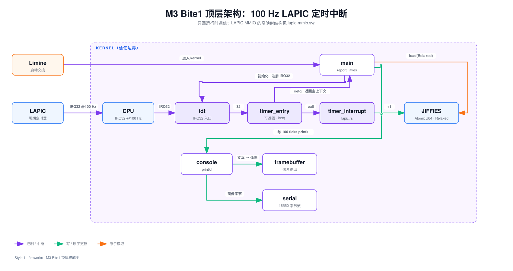

Lead: LAPIC 定时器以 100 Hz 投递向量 32。中断里只做原子计数加一和写 EOI，`iretq` 返回后主流程每 100 tick 打印一行。宿主时钟两次独立测量约 99.5–99.8 Hz。

## 问题

M2 结束时，内核只会主动打印。屏幕上是启动时那几行固定文本，没有任何东西随时间变化。

要看出 CPU 被打断后还能继续跑，需要两样东西：自己到来的中断源，以及中断返回后主流程还能读到的计数器。

M2 的异常入口帮不上忙。`exception_handler` 打印现场后 `hlt` 停机（`impl/kernel/src/idt.rs:311-347`），它假设异常不可返回。定时器中断必须返回：它可能打断任意一段普通内核代码，返回后那段代码要原样继续。

本课交付：

- LAPIC 定时器以 100 Hz 投递向量 32
- 向量 32 有独立的可返回入口
- 中断上下文只做最小工作
- 普通上下文每 100 tick 打印一行

## 背景

**谁产生 tick。** 8259 PIC 汇集传统外中断。LAPIC 是每颗 CPU 本地的中断控制器，自带定时器。IOAPIC 把外设 IRQ 路由到 LAPIC。本课的 100 Hz tick 由 LAPIC timer 直接产生，不经过 PIC 或 IOAPIC。

**IRQ 与向量号不是一回事。** IRQ 是外设侧线号；向量号是 CPU 查 IDT 的下标。0–31 留给 CPU 异常；本课把定时器写进向量 32。课文里的「IRQ32」指这条中断的向量号。

**屏蔽 PIC ≠ 停用 PIT。** PIC 是中断控制器；PIT 是可编程定时器。本课屏蔽两片 legacy PIC，避免旧路径抢向量；PIT channel 2 只当 10 ms 校准秒表，不负责运行期 tick。

更细的对照见 [PIC、LAPIC 与 IOAPIC](../concepts/apic-vs-pic.html)。

**LAPIC 基址来自 MSR。** 寄存器住在一段物理 MMIO（常见 `0xFEE00000`），地址由 MSR `IA32_APIC_BASE`（`0x1B`）告诉内核，只能用 `rdmsr` / `wrmsr` 读写。见 [x86 的 MSR](../concepts/x86-msr.html)。

**访问设备页要先有映射。** Limine 的 HHDM 覆盖 RAM，不保证覆盖 LAPIC 那一页。代码按需补一张 4 KiB 映射后再读写寄存器。HHDM 见 [HHDM](../concepts/hhdm.html)；补页过程见 [map_mmio_page](../concepts/mmio-page-mapping.html)。

## 设计



### 初始化顺序

```flow TB
[屏蔽 legacy PIC] -> [使能 APIC]
[使能 APIC] -> [映射 LAPIC MMIO 页]
[映射 LAPIC MMIO 页] -> [divider 16 且 LVT 屏蔽]
[divider 16 且 LVT 屏蔽] -> [PIT channel 2 给 10 ms 参照]: 参照
[PIT channel 2 给 10 ms 参照] -> [量出这 10 ms 的计数值]: 测量
[量出这 10 ms 的计数值] -> [LVT 改周期模式并写 INITIAL_COUNT]
[LVT 改周期模式并写 INITIAL_COUNT] -> [sti 开可屏蔽中断]
```

divider 先设成 16，LVT 先保持屏蔽。校准完成才改成周期模式并写 `INITIAL_COUNT`，最后 `sti`（`impl/kernel/src/lapic.rs:116`）。在此之前，IDT、LAPIC 地址和 handler 都必须就绪。

PIT channel 2 给出已知 10 ms 脉冲。校准让 LAPIC 从 `u32::MAX` 往下数，脉冲到达后用差值作为每个 jiffy 的 `INITIAL_COUNT`（`impl/kernel/src/lapic.rs:193-208`）。

### 一次 tick 怎么走

```sequence
participants: LAPIC, CPU, IDT, timer_entry, timer_interrupt, main
LAPIC -> CPU: 向量 32 每 10 ms 一次
CPU -> IDT: 按向量 32 查表
IDT -> timer_entry: 跳转
timer_entry -> timer_interrupt: call
timer_interrupt -> timer_interrupt: jiffies 原子加一
timer_interrupt -> LAPIC: 写 EOI
timer_interrupt --> timer_entry: 返回
timer_entry --> CPU: iretq
CPU --> main: 继续 report_jiffies
main -> main: 每 100 tick 打印一行
```

handler 加计数后必须写 EOI（End of Interrupt）。LAPIC 用 in-service 位记录「哪条正在处理」；不写 EOI，下一条就不会投递。

## 架构决定

### 决定一：中断上下文只做最小工作

[decisions/0001](../../decisions/0001-interrupt-context-minimal-work.md)

选了什么。IRQ32 的 handler 只做 `AtomicU64::fetch_add` 和写 LAPIC EOI，随后 `iretq`。主流程在普通上下文读计数，每 100 tick 打印一行。

为什么。M2 的 console 仍是无锁的 `static mut`。中断里再 `printk!` 会重入并破坏光标，还会拉长关中断窗口。键盘 Bite 要在中断里打印时，再收敛 D15。

失效边界。tick 内要做调度、睡眠唤醒或设备 I/O 时，不能再只做计数。

### 决定二：按需补 LAPIC MMIO 页映射

[decisions/0002](../../decisions/0002-lapic-mmio-mapping.md)


选了什么。沿用当前 CR3 与 HHDM，只为 LAPIC 那一页补缺失的页表项；已有大页就复用。三张静态页来自 `EXTRA_PAGE_TABLES`。

为什么。假设 HHDM 已覆盖全部 MMIO 在目标环境实测会 #PF。预建全物理地址 4 KiB 映射又会提前扩大 M5 范围。

失效边界。M5 自建页表后，这段静态补页要收敛到正式接口。

## 代码领读

**计数器是一个原子整数**（`impl/kernel/src/lapic.rs:120-129`）。

```rust src=impl/kernel/src/lapic.rs lines=120-129 hl=121,126
```

`static JIFFIES: AtomicU64` 是全局 64 位原子计数（`impl/kernel/src/lapic.rs:46`）。`fetch_add(1, Ordering::Relaxed)` 原子加一；这里只要求不丢计数，所以用最弱内存序。`pub extern "C" fn timer_interrupt()` 供汇编入口按 C 约定调用；函数体只有加计数和写 EOI，不碰 console。

**向量 32 的入口必须能返回**（`impl/kernel/src/idt.rs:242-283`）。

```rust src=impl/kernel/src/idt.rs lines=242-261
```

`#[unsafe(naked)]` 表示函数体只能写汇编，编译器不生成序言尾声。入口压栈保存 15 个通用寄存器，用 callee-saved 的 `rbx` 记住帧位置。

```rust src=impl/kernel/src/idt.rs lines=262-283 hl=280
```

`and rsp, -16` 满足 Rust ABI 的栈对齐，`call` handler 后还原寄存器，最后 `iretq` 弹出 `rip`/`cs`/`rflags`。异常入口末尾仍是 `hlt`（`impl/kernel/src/idt.rs:155-157`）；本课只让向量 32 可返回。

**打印发生在普通上下文**（`impl/kernel/src/main.rs:67-80`）。

```rust src=impl/kernel/src/main.rs lines=67-80 hl=72
```

`fn report_jiffies() -> !` 永不返回调用者。多数循环里计数还没到阈值，就走 else 执行 `hlt`。`hlt` 不是永久停机：CPU 停在这条指令上等待；可屏蔽中断到来后，先跑完 handler，`iretq` 回到 **`hlt` 的下一条指令**——相当于 `hlt` 执行完毕退出，外层 `loop` 进入下一轮再读 `jiffies()`。定时器每 10 ms 投递一次。这和 `halt()` 那种假定不再有有用工作的死循环不同——这里中断已打开，timer 一直在跑。

**两道使能开关**（`impl/kernel/src/lapic.rs:131-143`）。

```rust src=impl/kernel/src/lapic.rs lines=131-143 hl=132,141
```

MSR bit 11（`APIC_ENABLE`）是全局使能。映射 MMIO 后，还要写 Spurious Vector 寄存器（偏移 `0xF0`）：bit 8（`LAPIC_SOFTWARE_ENABLE`）是软件使能；低 8 位写成 `0xff` 作为伪中断向量。只开其一，定时器中断仍可能进不来。`rdmsr`/`wrmsr` 细节见 [x86 的 MSR](../concepts/x86-msr.html)。

**MMIO 只补一页**（`impl/kernel/src/lapic.rs:146-190`）。沿四级页表走 HHDM 可写的指针，缺哪级补哪级，最后一级带 `PWT|PCD` 指向 LAPIC 物理页，再 `invlpg`。逐步对照见 [map_mmio_page](../concepts/mmio-page-mapping.html)。

## 验收

在仓库根目录 `linux-0.11-from-scratch/` 的**宿主机**上操作。约定：编译与打 ISO 由 `make` 自动 `docker exec` 进构建容器 `linux011-rust-build` 完成；qemu 在宿主机跑。**不必**手动 `docker exec -it` 进容器敲命令。首次若镜像不存在，先在 `impl/` 执行一次 `make toolchain`。

**1. 构建 ISO**

```sh
make -C impl build
```

**2. 图形窗口观察（推荐）**

```sh
make -C impl run
```

启动后等约 6 秒，看屏幕（串口也会打到终端）：应陆续出现 `M3: jiffies=100`、`200`、`300`（约每秒一行）。看够后在 qemu 窗口退出即可。

**3. 需要串口日志文件时**

仍在宿主机、`impl/` 下启动（若 `qemu-system-x86_64` 不在 `PATH`，换成 `~/.local/bin/qemu-system-x86_64`）：

```sh
cd impl
rm -f build/serial.log build/m3-bite1.ppm
qemu-system-x86_64 -m 128M -boot d -display none -vga std -net none \
  -monitor stdio \
  -serial file:build/serial.log \
  -drive file=../upstream/hdc-0.11.img,format=raw,if=ide \
  -cdrom build/kernel.iso
```

等约 6 秒让 jiffies 打几行，再在 qemu monitor 提示符下依次输入：

```text
screendump build/m3-bite1.ppm
quit
```

然后查看日志：

```sh
cat build/serial.log
```

**预期**

- `M0: kernel alive` 恰好一次；保留 `M1` / `M2: gdt ok` / `M2: idt ok`
- 出现 `M3: LAPIC timer 100 Hz`
- 出现连续的 `M3: jiffies=100`、`200`、`300`
- 无 `PANIC:`；若做了 screendump，`build/m3-bite1.ppm` 存在且非空

自动验收封装见 `accept/m03-b01.sh`（内部即 `make -C impl check-m3-b1`）。独立 verifier 记录：`tutor/runs/m03-b01.txt`；宿主时钟两次测量约 99.77 Hz 与 99.49 Hz。

## 与原版差异与坑

- **D16 部分收敛。** 向量 32 现有可返回入口；向量 33–255 仍是空洞，CPU 异常仍打印后停机。见 [偏差簿](../../spec/deviations.md)。
- **D17 新登记。** LAPIC MMIO 用三张静态页表按需补一页，未经通用页表接口；M5 收敛。
- **D15 不变。** 全局 console 仍无锁；本课中断路径不碰 console，留给键盘 Bite。

M2 到 M3 Bite1 的模块改动见 [架构差异图](figures/arch-diff-b01.svg)。（同目录 `arch-diff.svg` 是 Bite1→Bite2 的变动图。）

```callout warn 第一次访问 LAPIC MMIO 就 #PF
Limine 的 HHDM 不保证覆盖设备 MMIO 页。目标环境启动页表没有映射 LAPIC 那一页，第一次读寄存器会缺页。修法是按需补这一页（决定二），写完末级描述符后再 `invlpg`。
```

## 自测

**1. 为什么 IRQ32 的 handler 不直接 `printk!`？**

- A. `printk!` 在中断里会重入全局 console，还会拉长关中断窗口
- B. `printk!` 只能在内核主流程里用
- C. 中断上下文没有栈可以格式化字符串
- D. LAPIC 要求 handler 必须在 100 条指令内结束

```html
<details><summary>第 1 题答案与解析</summary><p><strong>A</strong>。M2 的 console 是 static mut，无锁。handler 打印会重入并破坏光标状态，同时把关中断时间拉长。格式化本身在 handler 里做得到，所以 C 不成立。</p></details>
```

**2. 屏蔽两片 legacy PIC 之后，PIT channel 2 还能用来做 10 ms 参照吗？**

- A. 能。PIC 是中断控制器，PIT 是定时器，两者互相独立
- B. 不能。屏蔽 PIC 会连带停掉所有定时器
- C. 能，但只能读到粗略的时间段，不能给出确定长度
- D. 不能。PIT 的输出只对 PIC 有效

```html
<details><summary>第 2 题答案与解析</summary><p><strong>A</strong>。PIT channel 2 通过门控端口直接输出脉冲，不经过 PIC。屏蔽 PIC 断的是外设 IRQ 投递路径，与 PIT 输出无关。</p></details>
```

**3. 向量 32 的入口用 `iretq` 返回，异常入口却用 `hlt` 停机。这说明什么？**

- A. 异常返回路径还没实现，本课只让定时器中断可返回
- B. `iretq` 在异常上下文里非法
- C. 异常处理必须停机，这是硬件规定
- D. 两条入口保存的寄存器数量不同

```html
<details><summary>第 3 题答案与解析</summary><p><strong>A</strong>。iretq 用于中断返回，异常同理可返回，但异常现场恢复与缺页处理属于后续 Bite。本课的异常入口仍按 M2 的做法打印后停机。</p></details>
```

**4. 如果把 `timer_interrupt` 里的 EOI 写删掉，会看到什么现象？**

- A. 第一个 IRQ 之后不再有后续 IRQ，`jiffies` 停在 1
- B. `jiffies` 加倍
- C. 内核立刻 panic
- D. 屏幕出现 #PF

```html
<details><summary>第 4 题答案与解析</summary><p><strong>A</strong>。不写 EOI，LAPIC 的 in-service 位不清，控制器认为上一条还没处理完，不再投递下一条。计数停在 1，而且不会有 panic。</p></details>
```

**5. `report_jiffies` 里 else 分支的 `hlt` 会永久停机吗？**

- A. 不会。下一个定时器中断会唤醒 CPU，`loop` 继续
- B. 会。`hlt` 之后只有复位才能继续
- C. 会落到 `halt()`，不再打印
- D. 只有写了 EOI 才会唤醒；与 `hlt` 无关

```html
<details><summary>第 5 题答案与解析</summary><p><strong>A</strong>。可屏蔽中断会结束 hlt。LAPIC timer 已 sti 开启，每 10 ms 叫醒一次；iretq 回到 hlt 之后，外层 loop 再读 jiffies。D 说反了：EOI 影响下一条是否投递，hlt 唤醒靠的是中断本身到达 CPU。</p></details>
```
