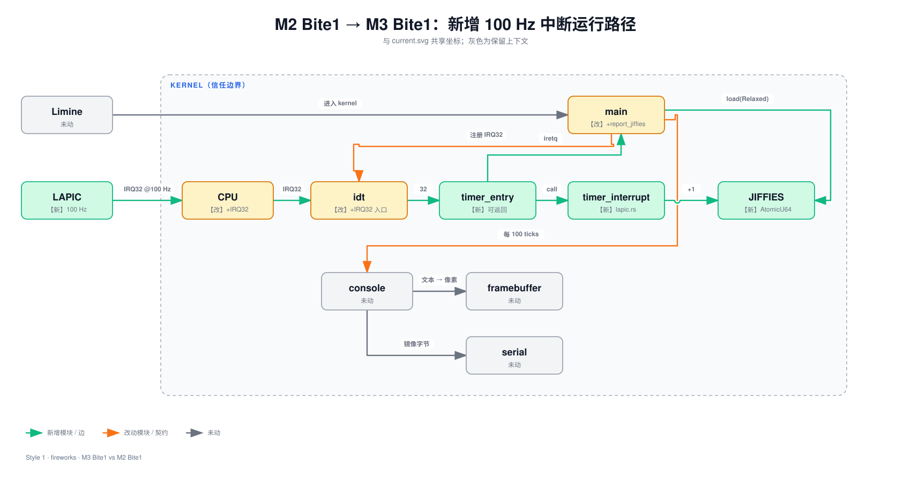

Lead: 键盘仍能回显 `hello`，但 IOAPIC 基址与 GSI 不再写死。内核从 Limine 拿到 RSDP，经 RSDT/XSDT 找到 MADT，再把 IOAPIC 项和 ISO 项交给原有路由代码。

## 问题

Bite2 只保证键盘在 QEMU 默认机上工作：`0xFEC00000` 和 GSI 1 来自这台虚拟机，并非 IOAPIC 规范规定的常量。LAPIC 可以从 MSR 读基址，IOAPIC 没有同样的入口。本课要从固件表查出这两个值，同时保持按键回显与定时器不变。

## 背景

**RSDP 是 ACPI 表的入口。** Limine 通过 `RsdpRequest` 把它的物理地址交给内核。RSDP 再指向 RSDT 或 XSDT；这两张根表列出其他 ACPI 表的物理地址。表里的地址加 HHDM 偏移后才能访问，未被覆盖的页仍由 `mmio::map_page` 补上。

**MADT 描述中断硬件。** 它包含一组带类型的变长条目。类型 1 是 IOAPIC，给出 MMIO 基址和 GSI 起点；类型 2 是 ISO，说明一条 ISA IRQ 实际接到哪个 GSI，以及极性和触发方式。IRQ1 没有 ISO 时才用 ISA 默认：GSI 1、高电平、边沿触发。详见 [ACPI MADT 硬件发现](../concepts/acpi-madt.html)。

## 设计


相对 Bite2，新增 `acpi`；`keyboard::init` 与 `ioapic::route` 改为接收运行时配置：



```flow LR
[Limine RSDP] -> [RSDT / XSDT]: revision 选择
[RSDT / XSDT] -> [MADT]: 找到 APIC 表
[MADT] -> [IOAPIC 项]: base + GSI start
[MADT] -> [ISO 项]: IRQ1 → GSI + flags
[IOAPIC 项] -> [KeyboardRoute]
[ISO 项] -> [KeyboardRoute]
[KeyboardRoute] -> [ioapic::route]: 写重定向表
```

解析失败就停止键盘初始化，不回退到旧常量。默认机实测仍得到 `0xFEC00000` / GSI 1，但这次数值来自固件表。

## 架构决定

### [从 ACPI MADT / ISO 发现键盘 IOAPIC 路由](../../decisions/0005-acpi-madt-ioapic-discovery.md)

## 代码领读

**主链只有三步**（`impl/kernel/src/acpi.rs:25-50`）：

```rust title="acpi.rs · sketch"
let rsdp = map_physical(RSDP_REQUEST.response()?.address as u64)?;
// 校验 RSDP；revision >= 2 用 XSDT，否则用 RSDT
let root = map_physical(root_physical)?;
let madt = find_madt(root, entry_size)?;
parse_madt(madt)
```

`map_physical` 把页内偏移保留下来（`acpi.rs:54-57`）。RSDP、根表和 MADT 所在物理页不一定已被 Limine 的 HHDM 覆盖，所以不能直接把物理地址当指针。

**MADT 按条目长度走，不信任固件声明**（`acpi.rs:85-136`）：

```rust title="acpi.rs · sketch"
while offset < length {
    if length - offset < 2 { return None; }
    let entry_len = madt.add(offset + 1).read() as usize;
    if entry_len < 2 || entry_len > length - offset { return None; }
    match entry_type {
        ENTRY_IOAPIC if entry_len >= 12 => { /* base + GSI start */ }
        ENTRY_ISO if entry_len >= 12 => { /* IRQ1 → GSI + flags */ }
        _ => {}
    }
    offset += entry_len;
}
```

零长度会死循环，截断条目会越界；两项都先拒绝。ISO flags 的位 0..1 是极性，位 2..3 是触发方式，保留编码 `0b10` 也拒绝。

**原有路由只改配置来源**（`impl/kernel/src/keyboard.rs:34-40`，`ioapic.rs:22-38`）：

```rust title="keyboard + ioapic · sketch"
let route = acpi::keyboard_route()?;
ioapic::route(route, KEYBOARD_VECTOR as u8, lapic::id())

// route：按 route.ioapic_base 映射页，按 route.gsi 选表项
// low = vector；按 ISO 设置 active-low / level-triggered 位
```

键盘 handler、公共入口、EOI 和 `IrqLock` 都没改。

## 验收

在仓库根目录 `linux-0.11-from-scratch/` 的**宿主机**上操作。编译与打 ISO 由 `make` 自动进构建容器，QEMU 在宿主机运行。

**1. 构建 ISO**

```sh
make -C impl build
```

**2. 图形窗口观察**

```sh
make -C impl run
```

先看到 `M3: MADT IOAPIC base=0xfec00000 IRQ1 -> GSI 1 polarity=high trigger=edge`。等 `jiffies=100` 后敲 `hello`，应看到回显，jiffies 继续增长。

**3. 自动验收**

```sh
bash accept/m03-b03.sh
```

脚本注入按键并检查 MADT 发现行、连续子串 `hello`、至少三行 jiffies、无 panic / 异常及非空 screendump。实测通过；Bite2 回归也通过。

## 与原版差异与坑

- **D18 已收敛。** IOAPIC 基址、GSI、极性与触发方式由 MADT / ISO 给出，无硬编码回退。
- **D17 仍待 M5。** ACPI 页也复用静态池按需映射，池上限从 4 扩到 8；通用页表接口尚未接管。
- **当前边界。** 只在 QEMU 默认机实测；跨页 ACPI 表、多 IOAPIC 的完整范围管理与其他设备留待实际需要时扩展。

## 自测

**1. 为什么 LAPIC 不必解析 MADT 才能找到 MMIO 基址，IOAPIC 却需要？**

- A. CPU 提供 `IA32_APIC_BASE` MSR；IOAPIC 没有对应的通用 MSR
- B. IOAPIC 没有物理地址
- C. LAPIC 不是 MMIO
- D. MADT 只描述键盘，不描述 IOAPIC

```html
<details><summary>第 1 题答案</summary><p><strong>A</strong>。两者都是 MMIO，但发现基址的机制不同。</p></details>
```

**2. MADT 没有 IRQ1 的 ISO 项，本课采用什么配置？**

- A. 初始化失败
- B. GSI 1、高电平、边沿触发
- C. GSI 0、低电平、电平触发
- D. 随机选一个空闲 GSI

```html
<details><summary>第 2 题答案</summary><p><strong>B</strong>。这是 ISA IRQ1 的默认接法；有 ISO 时必须以表项为准。</p></details>
```

**3. 为什么 `entry_len == 0` 必须在增加 `offset` 之前拒绝？**

- A. 防止下一次循环仍读同一条目，形成死循环
- B. 防止向量号变成 0
- C. 防止 HHDM 偏移改变
- D. 防止键盘产生断码

```html
<details><summary>第 3 题答案</summary><p><strong>A</strong>。条目长度还用于跳过未知类型，0 不能推进遍历。</p></details>
```

**4. 解析 MADT 失败时能否回退到 `0xFEC00000`？**

- A. 不能；那样会把“没发现硬件”伪装成已发现，并可能在错误地址上写 MMIO
- B. 能；所有机器都使用这个地址
- C. 能；只要键盘还能回显就正确
- D. 只有 ISO 存在时可以

```html
<details><summary>第 4 题答案</summary><p><strong>A</strong>。本课失败即停止键盘初始化，旧硬编码已删除。</p></details>
```
