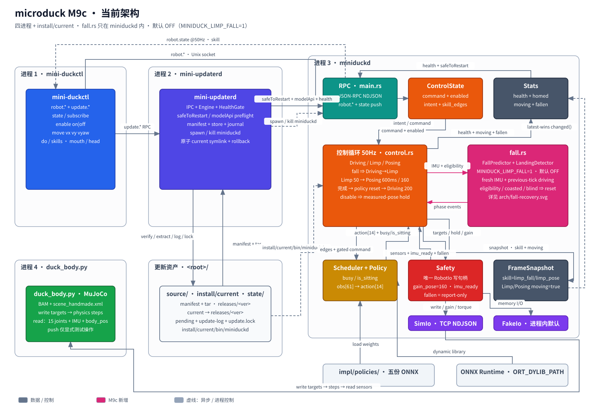

跌倒反射提前到 `fallen` 报告之前触发。`Limp` 负责落地，`Posing` 负责回 home，`Driving` 只在清理策略记忆后接管。

## 问题

机器人刚开始倾倒时，策略仍以 gain 200 驱动关节。等到 `fallen` 持续 200ms 才卸力，电机已经和地板对抗了一阵。

旧恢复段还把落地、回 home 和启动斜坡混在一起。一个直立样本就可能重走 2 秒 `RampUp`，让跌倒恢复背上启动阶段的时长与 `homed` 语义。

需要分开三个判断：是否快要倒、是否已经落地、何时交还策略。M9c 先在 CPU 侧消除这笔调度与安全债。

## 设计



预测器只从上一拍 `Driving` 接棒。新鲜且合格的 IMU 样本连续三拍满足倾倒条件，才进入 `Limp`。

```sequence num
participants: 控制循环, FallPredictor, LandingDetector, Safety, Scheduler
控制循环 -> FallPredictor: 新鲜 IMU + 资格
FallPredictor --> 控制循环: 第 3 拍触发一次
控制循环 -> Safety: Limp：实测关节 + gain 50
控制循环 -> LandingDetector: 新鲜 gyro
LandingDetector --> 控制循环: 静止 200ms
控制循环 -> Safety: Posing：实测姿态到 home + gain 160
控制循环 -> Scheduler: 清 recurrent 状态
控制循环 -> Safety: Driving + gain 200
```

`Limp` 还有 1500ms 硬上限。盲拍不会证明静止，也不会冻结上限计时。

恢复期间，`FrameSnapshot.skill` 依次报告 `limp_fall`、`limp_pose`、`walk`。`homed` 保持 true，`moving` 也保持 true。

聚焦模块见 [fall-recovery 子图](../arch/fall-recovery.svg)。也可查看[本课架构差分](figures/arch-diff.svg)。

## 架构决定

**独立 `fall.rs`：把传感判断留在控制循环外。** 预测器和落地检测器只消费样本并返回判断。它们不碰总线，也不拥有 `Phase`。因此，去抖和一次性触发可以脱离 ONNX 单测。

**独立 `Posing`：不复用 `RampUp`。** 两者虽然都插值到 home，但语义不同：

| | 启动 `RampUp` | 跌倒 `Posing` |
|---|---|---|
| 起点 | 使能时实测姿态 | 落地时实测姿态 |
| 时长 / 增益 | 2 秒 / 200 | 600ms / 160 |
| `homed` | false | 保持 true |

复用能少一个阶段，却会把启动语义带回跌倒恢复。继续由 `Safety.fallen` 直接触发虽更简单，也保留「已倒才反应」的延迟。

所有目标仍经 `Safety.apply` 写入。没有新增进程、RPC 或网络边。完整取舍见[决定 0006](../../decisions/0006-m9c-fall-recovery.md)。

默认 OFF 现已对齐上游。`MINIDUCK_LIMP_FALL=1` 是唯一临时开关，见 `impl/src/main.rs:132-153`。完整配置面仍归 D52/M10。

## 代码领读

### 预测的是趋势，不是当前姿势

$g$ 是躯干坐标系里的单位投影重力向量，直立时为 $[0,0,-1]$。它不是 $9.81\,\mathrm{m/s^2}$ 的加速度。$\omega$ 是陀螺测得的躯干角速度，单位为 rad/s。

世界重力恒定。旋转坐标系满足：

$$\left.\frac{dg}{dt}\right|_{\mathrm{world}}=\left.\frac{dg}{dt}\right|_{\mathrm{body}}+\omega\times g=0$$

<details>
<summary>证明：用旋转矩阵求导</summary>

令 $R(t)$ 把躯干坐标映到世界坐标。点号表示对时间求导。

**1. 为什么旋转矩阵的逆等于转置？**

旋转保持长度和角度，所以 $R$ 的各列是两两正交的单位向量。于是：

$$(R^TR)_{ij}=\text{column}_i\cdot\text{column}_j=\delta_{ij},\qquad R^TR=I$$

这里 $\delta_{ij}$ 在 $i=j$ 时为 1，否则为 0。逆矩阵唯一，所以 $R^{-1}=R^T$。

反射矩阵也有这种正交性。证明逆矩阵不需要 $\det R=+1$。因此：

$$g_{\mathrm{world}}=R(t)g_{\mathrm{body}},\qquad g_{\mathrm{body}}=R(t)^Tg_{\mathrm{world}}$$

**2. 为什么 $\dot{R}=R[\omega]_\times$？**

取向量 $b$，它固定在躯干上。世界位置 $r=Rb$ 随躯干旋转。一方面，直接求导得 $\dot{r}=\dot{R}b$。

另一方面，刚体旋转给出 $\dot{r}=\omega_{\mathrm{world}}\times r$。把角速度换到躯干坐标：$\omega=R^T\omega_{\mathrm{world}}$。于是：

$$\dot{r}=R(\omega\times b)=R[\omega]_\times b$$

$[\omega]_\times$ 就是实现叉乘的矩阵：$[\omega]_\times x=\omega\times x$。因为每个固定 $b$ 都成立，所以：

$$\dot{R}=R[\omega]_\times$$

这不是任意约定。反对称性 $[\omega]_\times^T=-[\omega]_\times$ 还会带来下一步的负号。

**3. 对投影重力求导**

世界重力 $g_{\mathrm{world}}$ 恒定。对 $g_{\mathrm{body}}=R^Tg_{\mathrm{world}}$ 求导：

$$\dot{g}_{\mathrm{body}}=\dot{R}^Tg_{\mathrm{world}}=[\omega]_\times^TR^Tg_{\mathrm{world}}=-[\omega]_\times R^Tg_{\mathrm{world}}=-\omega\times g_{\mathrm{body}}$$

结果就是 $\dot{g}_{\mathrm{body}}=-\omega\times g$，移项便得到上面的关系。

直观上，右边把向量分量的变化，与坐标轴旋转带来的变化分开。

</details>

因此，躯干坐标系里有 $dg/dt=-\omega\times g$。取 z 分量，就得到 `gravity_z_rate`：

$$\text{rate}=-(\text{gyro}_x\text{gravity}_y-\text{gyro}_y\text{gravity}_x)$$

取 z 是因为直立时 $g_z=-1$，倾倒会使它向 0 上升。`rate > 0` 表示倾斜恶化，`rate < 0` 表示正在恢复。

二维俯仰可直接求导验证。令 $g=[\sin\theta,0,-\cos\theta]$，$\omega=[0,\dot\theta,0]$。直接求导得 $dg_z/dt=\sin\theta\,\dot\theta$，与上式一致。$\theta=30^\circ$、$\dot\theta=1\,\mathrm{rad/s}$ 时，$\text{rate}=0.5/\mathrm{s}$。

再外推 0.3 秒：

$$\text{predicted}=\text{gravity}_z+\text{rate}\times0.3$$

这个关系描述刚体旋转下的投影重力，不描述原始线加速度。0.3 秒外推假设当前 `rate` 保持不变。它是启发式估计，不保证未来姿态。

触发要求三道门同时成立：`gravity_z > -0.90`、`rate > 0`、`predicted > -0.5`。倾斜但不再恶化不会触发；缓慢倾斜也不会触发。

```rust src=impl/src/fall.rs lines=25-56
```

50Hz 下，三拍去抖等于 60ms。`fired` 让持续跌倒只触发一次。条件断开或 reset 后，才重新武装。

这和 `Safety` 的 `fallen` 报告不同。后者看当前 `gravity_z`，持续 200ms 才置位，但不抢占写入，见 `impl/src/safety.rs:179-207`。

### 不合格拍会清零，不会暂停

资格包括功能开关、上一拍 `Driving`、新鲜样本、`imu_ready`、`!fallen`、`!busy`、`!sitting`，见 `impl/src/control.rs:380-390`。

```rust src=impl/src/control.rs lines=380-390
```

上一拍必须是 `Driving`。这样，`Limp` 和 `Posing` 的样本不会再次触发预测器。当前相位检查是第二道保护，见 `impl/src/control.rs:570-589`。

`busy` 或 `sitting` 会令资格失效。滑行拍因不新鲜而清零；真瞎拍也显式 reset。清零后必须重新累计三拍，不能接着旧计数。落地检测同理：移动、滑行和盲拍都会清静止计数，见 `impl/src/fall.rs:59-79`。

### 两个阶段，一次干净的交还

`Limp` 每拍把实测关节位置作为目标，增益为 50。新鲜陀螺模长小于 1rad/s 持续 200ms，才判定落地；1500ms 上限防止永远等待。

`Posing` 从落地实测姿态插值到 home，持续 600ms，增益为 160。完成后清所有策略槽的 recurrent 状态、`previous_targets` 和 `last_action`，再回 `Driving`。

```rust src=impl/src/control.rs lines=678-710
```

这样，旧 episode 的动作反馈不会污染新 episode。`Scheduler.reset` 的定义见 `impl/src/scheduler.rs:477-496`。

恢复途中 disable 会放弃反射，抱持当前实测姿态，不跳去 home，见 `impl/src/control.rs:550-565`。交还 `velstand` 也不承诺它能从躺平物理站起；验收只检查策略重新接管。

## 验收

在仓库根执行：

```bash
bash accept/m09c-b01.sh
```

预期以[验收脚本注释](../../accept/m09c-b01.sh)为准：单测与 M8 回归通过；默认 OFF 不抢占；显式 ON 完成两次独立仿真。

独立 verifier 的实测记录见 [tutor/runs/m09c-b01.txt](../../tutor/runs/m09c-b01.txt)：

| 项 | 实测 |
|---|---|
| Rust 单测 | ok 113 passed，0 failed |
| M8 全回归 | ok 全部通过 |
| 默认 OFF | `fallen` 照常报告；无 gain 50/160 或 limp 标签 |
| ON1 | 4.0m/s push；Limp 1301ms；Posing 620ms |
| ON2 | 4.0m/s push；Limp 1298ms；Posing 622ms |
| 两次 ON 顺序 | `limp_fall/gain50` → `limp_pose/gain160` → `walk/gain200` |
| 实际退出码 | ok 0 |

两次样本只证明这两条受测路径通过，不证明更广泛的统计可靠性。

## 与原版差异

本 Bite 收敛 [D23 与 D32](../../spec/deviations.md)：预测器替代直接由 `fallen` 触发，`busy`/`sitting` 改为门控预测器。

默认 OFF 从保留差异变为与上游一致。没有新登记偏差。

## 坑

最初的 1.5m/s push 太弱。策略在 200ms `fallen` 去抖前已经恢复，预测器也只保持两拍，未过三拍门限。

这首先说明扰动没有造出目标场景，不说明预测阈值错误。验收把 push 改为 4.0m/s，预测、落地和恢复阈值全部不变。

诊断顺序应是：先确认实验真的跨过机制门槛，再改机制。否则，调阈值只是在迁就一个无效输入。

## 自测

**1. 预测器已连续两拍满足条件，下一拍是滑行样本。之后重新出现合格样本，会怎样？**

- A. 第一个新鲜样本立即触发
- B. 旧计数暂停，再累计一拍触发
- C. 滑行拍清零，重新累计三拍
- D. 直接由 `Safety` 进入 `Posing`

<details>
<summary>答案</summary>

C。滑行样本不新鲜，预测去抖会清零，不是暂停。A/B 都保留了不应信任的旧计数；D 跳过预测与 `Limp`。
</details>

**2. 默认配置下机器人被推倒，`fallen=true`，但反射开关未设。控制层应怎样？**

- A. `Safety` 自动把 gain 改为 50
- B. 继续 `Driving`，同时如实报告 `fallen`
- C. 复用 `RampUp`，并把 `homed` 置 false
- D. 直接回 home，再清 recurrent 状态

<details>
<summary>答案</summary>

B。默认 OFF 与上游一致，`fallen` 是报告，不是写入门控。只有 `MINIDUCK_LIMP_FALL=1` 才允许预测反射。
</details>

**3. `Posing` 中途收到 disable，哪项最符合安全语义？**

- A. 继续插值到 home
- B. 重新进入 2 秒 `RampUp`
- C. 立即卸掉 torque
- D. 放弃恢复，抱持当前实测姿态

<details>
<summary>答案</summary>

D。中断反射不能突然跳去 home，也不由 enable 开关卸 torque。普通 `Driving` 的 disable 才直接命令 home。
</details>

**4. `Posing` 完成并显示 `walk/gain200` 后，可以断言什么？**

- A. 机器人一定已从躺平站起
- B. 旧 `last_action` 会继续喂给新 episode
- C. 策略已重新接管，旧 recurrent 状态与动作反馈已清
- D. `homed` 曾在整个恢复期间变为 false

<details>
<summary>答案</summary>

C。交还清 recurrent 状态、`previous_targets` 和 `last_action`。它不是物理站立保证；恢复期间 `homed` 始终为 true。
</details>
