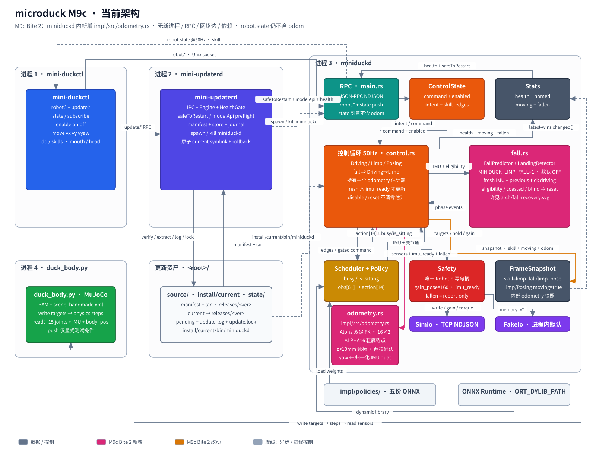

## 问题

仿真里能查 MuJoCo 的 `body_pos`，真机上没有任何测量。给一条向前走 10 秒的命令，策略是开环的：可能走成弧线，也可能偏出几十厘米。走完之后，除了看有没有摔倒，没有人能说偏了多少。

本课交付一个纯软件的相对里程计：每拍用双足几何估出「相对起点走了多远、转了多少度」。估计只进内部诊断；线上 `robot.state` 仍不含 odom（D50，M10）。通用 kinematics crate 也不在本课（D55，M10）。

## 背景

**FK** 是 Forward Kinematics，正向运动学：已知各关节角，算出脚（或某个 site）在空间里的位置与朝向。本课每拍用 FK 从关节角推出两只脚，再估躯干走了多远。

反过来：已知脚要到哪、求关节角，叫 IK（Inverse Kinematics）。本课估计器不用 IK。

**位置不靠积 IMU。** 加速度积成速度再积成位置，小偏差按 $t^2$ 长；hobby 级 IMU 偏置约 $0.05\,\mathrm{m/s}^2$ 时，十秒就能偏出数米。本课只向 IMU 要姿态（四元数）；水平位置来自腿。

**心智模型：鞋底上总有一点钉在地上。** 把该点叫锚点 $a$（落地瞬间冻结世界 XY，$z=0$）。关节角经 FK 给出躯干系下「躯干 → 接触点」向量 $c$；IMU 给出旋转 $R$。躯干位置是从锚点沿腿往回走：

$$p = a - R\,c$$

站着不动时关节不变，$c$ 不变，估计不漂。锚点只在另一鞋底点更低（迈步 / 脚掌滚动）时换。上游同款叙事与侧视动画见中译 [鸭子走到哪了？双足 + IMU 的里程计](odometry-blog-zh.html)（[英文原文](https://pollen-robotics.com/microduck/blog/microduck-odometry/)）。

## 设计



每拍做同一件事：

```flow TB
[新样本] -> [两脚 site 位姿]
两脚 site 位姿 -> [由当前锚点投影躯干]
由当前锚点投影躯干 -> [扫描 32 个鞋底点]
扫描 32 个鞋底点 -> {有候选低于 10mm}
{有候选低于 10mm} -> [清空 pending] : 没有
{有候选低于 10mm} -> [同脚加一拍] : 同脚
{有候选低于 10mm} -> [换脚重开候选] : 换脚
同脚加一拍 -> {连续两拍}
换脚重开候选 -> {连续两拍}
{连续两拍} -> [换锚并重投影] : 是
{连续两拍} -> [输出 position 与 yaw] : 否
换锚并重投影 -> [输出 position 与 yaw]
```

六个要点：

- **局部两足 FK（正向运动学）**：只实现估计要用的两条腿链。
- **ALPHA16 鞋底网格**：每脚 16 个点，共 32 点投到世界系。
- **竞标门限**：世界 z 低于 10mm 的最低点才有资格。
- **两拍确认**：同一脚连续两拍才换锚。
- **冻结首次候选**：pending 记住候选首次出现时的局部点与世界 XY。
- **没有 reset**：原点由首次更新的左脚 site 定死。

估计跨相位存活：滑行拍、盲拍、disable、scheduler reset、跌倒恢复都不清零。yaw 直接从归一化 IMU 四元数读出，不积分陀螺。估计进 `FrameSnapshot` 供集成测试读，RPC 载荷不变。

聚焦模块见 [odometry 子图](../arch/odometry.svg)。也可查看[本课架构差分](figures/arch-diff.svg)。

## 架构决定

完整取舍见[决定 0007](../../decisions/0007-m9c-odometry.md)。

**局部两足 FK（正向运动学），不拉通用 kinematics。** 选了只覆盖两个 foot site 的局部实现。依赖上游 `odometry` / `kinematics` 能复用已交叉验证的 FK，但本课就要处理 MJCF 解析与站点映射，等于提前兑现 D55。局部实现的代价是 D55 落地时要替换它，而不是长期维护两套几何。

**没有 reset，原点由首帧定死。** 首帧用左脚 site 建立相对原点，之后任何事件都不改。跌倒后重选原点，会让「从哪出发」在一次摔倒后失去意义。

**估计放内部诊断，线上字段留给 M10。** 集成测试读 `FrameSnapshot`；`robot.state` 保持原样，D50 仍挂 M10。

| 方案 | 放弃它会丢掉什么 | 结论 |
|---|---|---|
| 局部两足 FK + ALPHA16 | — | 采用 |
| 依赖上游 kinematics / odometry | 已验证的通用 FK | 不采用 |
| 等 M10 完整 kinematics 再移植 | 无临时抽象 | 不采用：M9c 会继续没有里程计 |

没有新增进程、RPC 方法、网络边或依赖。

## 代码领读

### 三件事对应到字段

| 符号 | 含义 | 代码 |
|---|---|---|
| $c$ | 躯干系下躯干 → 接触点 | `feet[anchor].point(anchor_local)` |
| $R$ | IMU 姿态 | `Quat::from_wxyz(quat_wxyz)` |
| $a$ | 锚点世界 XY | `anchor_xy` |

每拍 `update`：两脚 FK → `reproject`（算 $p=a-Rc$）→ 扫 ALPHA16 找更低点 → `update_pending`（两拍确认才换锚）→ yaw 读 IMU。

```rust src=impl/src/odometry.rs lines=315-328
```

### 鞋底最低点是接触代理

双足站姿里，可靠贴地的是鞋底。估计器不找接触力，找世界 z 最低的鞋底点。地面是平的，贴地点高度近似为 0；低于 10mm 就说明这一拍有脚落地。

```rust src=impl/src/odometry.rs lines=372-395
```

`lowest_z` 初值就是 10mm。没有任何点低于它，这一拍就没有候选。

ALPHA16 是每脚 $4\times4$ 网格。站立脚会从脚跟滚到脚尖，接触点在同一只鞋底上也会挪；不采样就会把滚动当成躯干漂移。

### 一拍不能抢锚，pending 冻结首次候选

换锚要连续两拍同一脚：FK 与 IMU 都带噪声，单拍最低点可能只是抖动。两拍约 40 ms（50 Hz），短于一步站立相、长于单帧毛刺。

pending 存的是候选**首次出现时**的局部点与世界 XY。确认时沿用这一份，换锚那一拍的躯干位置才和上一拍连续。

```rust src=impl/src/odometry.rs lines=331-360
```

同一脚才累加计数。换成另一只脚，计数从 1 重开。没有任何候选时，pending 直接清空。

### 投影：躯干位置由锚点反推

锚点钉在成为锚点那一刻的世界 XY。代码就是 $p = a - R\,c$：

```rust src=impl/src/odometry.rs lines=362-370
```

锚点不动时，脚在动，位置跟着动，因此永远连续。

### 一拍的数据要新

估计器只吃新鲜且 IMU 收敛的样本。滑行拍沿用旧样本，盲拍没有样本，两者都不推进估计。门控在控制循环里，不在估计器里。

```rust src=impl/src/control.rs lines=494-525
```

### 估计不随跌倒或 disable 清零

估计器在循环外创建一次。相位切换、scheduler reset、跌倒恢复都不重建它。

```rust src=impl/src/control.rs lines=440-452
```

跌倒恢复只清 scheduler 与策略记忆。估计器和锚点原封不动。

### yaw 是读出来的，不是积出来的

yaw 直接取归一化 IMU 四元数。IMU 已经把陀螺融进这个四元数，再积一次会二次积分并累积漂移。

## 验收

在仓库根目录 `microduck-from-scratch/` 操作。要看运动必须用宿主机原生 viewer；编译与数字回归在容器。权重与 ORT 需已就位（缺则先跑 `bash impl/scripts/fetch-m3.sh`）。宿主机 `.venv` 建法见 `tutor/dev-container.md`。

**1. 宿主机可视化：看它走（先做这一步）**

开三个终端。估计值在内部 `FrameSnapshot`，窗口看不到数字；这步确认被估计的那段运动真实发生。

终端 A（仓库根，起仿真窗口）：

```sh
.venv/bin/python impl/sim/duck_body.py --viewer --port 7801
```

应弹出 MuJoCo 窗口；鸭子站在 handmade 场景里。daemon 未连时物理冻结。

先编出二进制（容器）：

```sh
docker compose -f impl/docker-compose.yml up -d
```

```sh
docker compose -f impl/docker-compose.yml exec rust cargo build --bins
```

终端 B（进 `impl/`，起 daemon）：

```sh
cd impl
```

```sh
env ORT_DYLIB_PATH=third_party/onnxruntime/lib/libonnxruntime.so \
  ./target/debug/miniduckd --sim 127.0.0.1:7801
```

终端 C（仍在 `impl/`）：

```sh
./target/debug/mini-duckctl enable
```

等约 2 秒，窗口里鸭子应站稳。再发行走：

```sh
./target/debug/mini-duckctl move 0.8 0 0 --secs 10
```

观察窗口：约 10 秒内明显前移，保持 upright、不摔倒。再发转身：

```sh
./target/debug/mini-duckctl move 0 0 2.0 --secs 6
```

观察窗口：原地明显转体。看够后，终端 B/A 用 Ctrl+C 停掉即可。

**2. 容器单测（对拍与门控）**

```sh
docker compose -f impl/docker-compose.yml exec rust cargo test
```

观察：默认测试全绿；应有 `odometry::tests::*` 与门控相关 `control::tests::*`。`odometry_live` 默认 ignored，不会在这一步跑。

**3. 容器实时集成：3 次行走 + 3 次转身**

```sh
docker compose -f impl/docker-compose.yml exec rust \
  env SIM_PYTHON=/opt/sim-venv/bin/python \
      ORT_DYLIB_PATH=/work/impl/third_party/onnxruntime/lib/libonnxruntime.so \
  cargo test --test odometry_live -- --ignored --nocapture
```

等待约一两分钟。观察 stdout：每次行走真实前移 ≥ 2.0m 且 upright / `fallen=false`；每次转身 |yaw| ≥ 0.5 rad；每次终点水平误差 ≤ 0.12m，六次中位数 ≤ 0.07m；最大单拍跳动 < 0.02m。

门槛来自 handmade 本地回归，不是上游精度承诺。走约 2.7m 后残差可到约 0.10m。同一传感流上本地与上游逐位相同；残差来自上游算法在我们自建身体上的表现。

**4. M8 回归（确认本课未回退 RPC / 状态机）**

```sh
docker compose -f impl/docker-compose.yml exec rust bash /work/accept/m08-b01.sh
```

预期 FakeIo 断言全绿。

一键数字封装与门限注释见 `accept/m09c-b02.sh`；独立 verifier 记录见 `tutor/runs/m09c-b02.txt`。

## 与原版差异

本 Bite 收敛功能清单里的 odometry crate 行：纯软件接触里程计落在 `impl/src/odometry.rs`。

线上 `RobotState.odom` 仍归 [D50](../../spec/deviations.md)，挂 M10。通用 kinematics 仍归 [D55](../../spec/deviations.md)，挂 M10。没有新登记偏差编号。

## 坑

**1.5mm 的鞋底点抄写错误。** 手抄 ALPHA16 时有一处 z 抄错 1.5mm。以这份表为基准的单测查不出来；只有与上游逐位对拍才暴露。抄常数必须配一条跨实现的逐位比较。

**vyaw=0.8 转不动。** 早期转身用 vyaw=0.8，实际 yaw 只变约 0.07 rad，达不到 0.5 rad 门槛。改用 vyaw=2.0 后 |yaw| 约 3.04 rad。先确认实验跨过机制门槛，再动机制。

**六个样本只有四条不同轨迹。** handmade sim 近乎确定性，三个新进程会给出重复轨迹。中位数由更少的独立值决定，谈不上置信区间。

**yaw 误差为 0 是同义反复。** 估计的 yaw 就是同一份 IMU 四元数读出来的，测试又拿同一 IMU 真值比较，所以恒为 0。它只证明管线没写错，不是精度证据。

**误差门余量偏薄。** 门是 0.12m，实测最坏值可占八成以上。再收紧会不稳，放宽会掩盖真实漂移。

## 自测

**1. 某一拍出现一个更低的鞋底点，下一拍没有更低的点。锚点会怎样？**

- A. 立刻换到那个点
- B. 不换，pending 记下这个候选
- C. 估计清零
- D. 那个点成为新的世界原点

<details>
<summary>答案</summary>

B。换锚要同一脚连续两拍。第一拍只记候选，A 会让 FK 抖动直接搬走锚点。
</details>

**2. 确认换锚时沿用 pending 里冻结的世界 XY，有什么作用？**

- A. 让位置跳到新的足印
- B. 让换锚那一拍的位置保持连续
- C. 减少 FK 计算量
- D. 记录哪只脚在承重

<details>
<summary>答案</summary>

B。锚点被钉在它首次成为候选时的位置。若用确认那一刻的 XY，位置会在换锚瞬间跳一次。
</details>

**3. 控制循环读到滑行样本时，估计与 pending 会怎样？**

- A. 用旧样本继续更新
- B. 估计清零
- C. 两者都不动
- D. 重建估计器

<details>
<summary>答案</summary>

C。门控要求样本新鲜且 IMU 收敛。滑行拍不推进估计，也不推进 pending 计数。
</details>

**4. 机器人跌倒进入 Limp，之后回 Driving。里程计的原点会怎样？**

- A. 跌倒时清零
- B. 改用新的左脚位置
- C. 保持不变
- D. 随 scheduler reset 一起重建

<details>
<summary>答案</summary>

C。估计器在循环外创建一次，不随相位与调度器生命周期重建。跌倒恢复只清策略记忆。
</details>

**5. yaw 为什么直接读 IMU 四元数，不积分陀螺？**

- A. 陀螺在总线协议里没有字段
- B. 四元数已是 IMU 融合后的姿态，再积分会二次积分并漂移
- C. 四元数换算成角度更快
- D. 上游也这么写，没有别的选择

<details>
<summary>答案</summary>

B。上游的头向本来就是启动相对量，积分只会把漂移累加起来。D 是循环论证。
</details>
