先做一块可回改尺寸的校准板，再导出封闭 STL 并生成 MK4 的打印文件。本课只完成数字阶段。

实物打印与测量仍未验收。

## 问题

M11 要自己构建结构与外壳。直接画鸭子零件会把外形、配合和打印误差混在一起。

先用一块 40×30×5 mm 的板练完整路径。板上有三个通孔、外侧圆角和孔口倒角。它不是鸭子的任何部位，而是校准件。

最终要得到 `calibration-plate.stl`、`.3mf` 和 `.bgcode`。还要验证改板宽时，孔位保持不动。

## 背景

原项目使用 Onshape。本课也用它，在 Linux 浏览器中操作。Onshape Free 可用于非商业项目，但文档公开，不要放入私密设计。

| 名称 | 本课中的最小含义 |
|---|---|
| Document | 一个 CAD 项目的顶层容器，本课名为 `microduck-m11a-calibration` |
| Workspace | Document 中当前可编辑的工作区，保存建模历史与单位设置 |
| PartStudio | 在 Workspace 内创建和编辑零件的工作页 |
| Assembly | 把多个零件按位置与运动关系装起来的工作页，本课不用 |
| Sketch | 在平面或实体表面绘制的二维轮廓 |
| Feature | 对模型执行的一次操作，例如拉伸、圆角、倒角 |
| Part | Feature 生成的独立实体，本课只有 `Part 1` |

层级是 Document → Workspace → PartStudio 或 Assembly。PartStudio 内按顺序保存 Sketch 与 Feature，并生成 Part。Assembly 引用零件，不负责画出这块板。

草图工具分三类。几何工具画线、矩形和圆。

尺寸工具给长度与直径。

约束工具固定位置与几何关系。尺寸回答“多大”，约束回答“相对谁、保持什么关系”。

常见约束如下。

| 约束 | 作用 |
|---|---|
| Coincident | 让点重合，或让点落在曲线上 |
| Horizontal / Vertical | 让线保持水平或竖直 |
| Parallel / Perpendicular | 让两线平行或垂直 |
| Tangent | 让线与圆弧相切 |
| Equal | 让同类几何保持等长或等径 |
| Concentric | 让圆或圆弧共用圆心 |
| Midpoint / Symmetric | 固定中点，或让对象关于参照对称 |
| Fix | 固定对象的位置与转角，慎用，容易限制后续修改 |

后续实体工具也有明确分工。拉伸、旋转、扫掠和放样生成实体。

圆角与倒角处理细节。

阵列复制特征。

布尔工具合并、切除或保留交集。

基准面、基准轴和点提供参照。

Mate 等工具负责装配。

测量、质量属性与导出负责检查输出。

## 设计

```flow LR
参数化草图 -> 拉伸基体 -> 三孔草图 -> 一次切通 -> 圆角与倒角 -> 回改尺寸 -> 导出STL -> 切片
```

这条路径把外形尺寸留在草图里，把厚度与细节留在 Feature 里。回改尺寸时，Onshape 按历史重算模型。

### 校准件的结构

底板宽 40 mm、深 30 mm、厚 5 mm。矩形中心固定在 Origin，避免改宽时整体向一侧移动。

顶面有三个通孔。中间孔 Ø6 mm，圆心在 Origin。左孔 Ø4 mm，右孔 Ø5 mm，圆心距 Origin 都是 12 mm，并与 Origin 水平对齐。

四条外侧竖边做 2 mm 圆角。三个孔的顶部边缘做 0.5 mm 倒角。

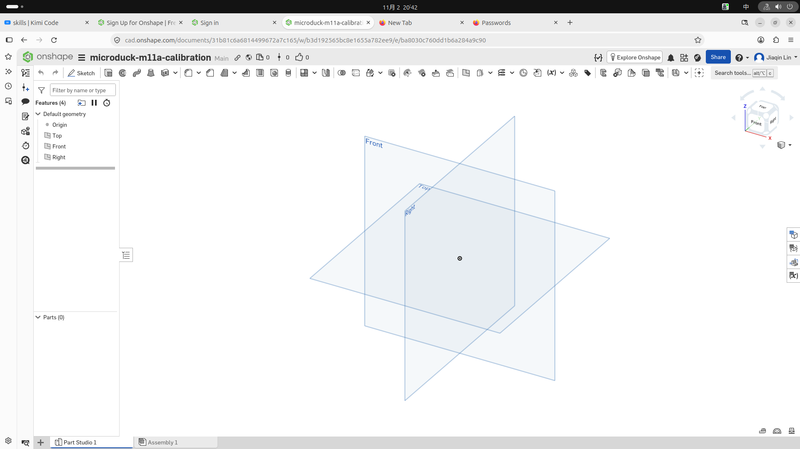

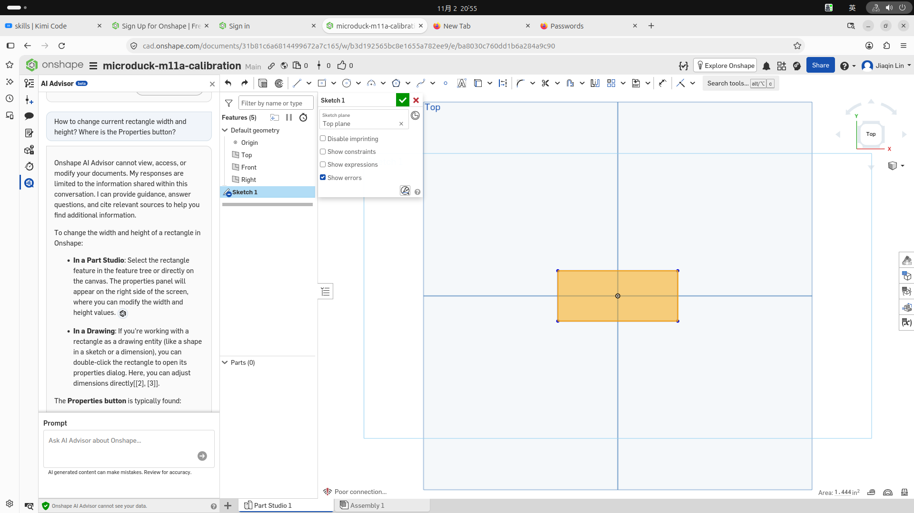

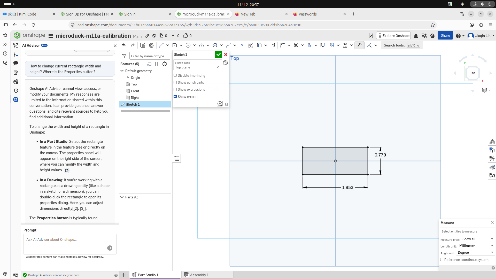

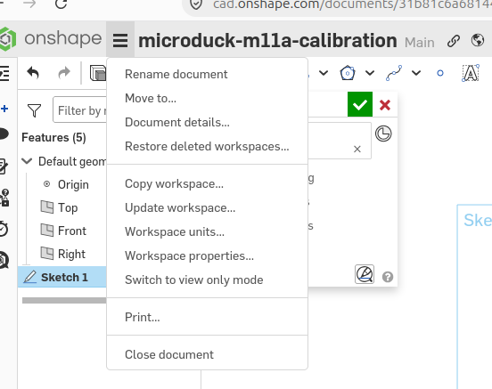

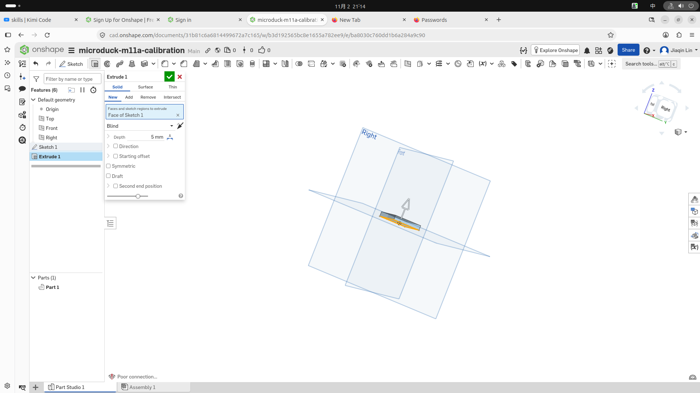

### Extrude 选项怎么选

Extrude 把封闭草图区域变成实体，或用它修改已有实体。本课基体选 Solid / New / Blind，切孔选 Solid / Remove / Through all。

| 选项组 | 选项 | 含义 |
|---|---|---|
| 生成类型 | Solid | 生成或修改实体 |
| 生成类型 | Surface | 只生成曲面，没有实体厚度 |
| 生成类型 | Thin | 把轮廓拉成指定壁厚的薄壁 |
| 实体关系 | New | 新建独立 Part |
| 实体关系 | Add | 并入已有实体 |
| 实体关系 | Remove | 从已有实体切除 |
| 实体关系 | Intersect | 只保留与已有实体的交集 |
| 终止方式 | Blind | 按指定 Depth 拉伸 |
| 终止方式 | Up to next | 到遇到的下一个实体面 |
| 终止方式 | Up to face | 到选定面 |
| 终止方式 | Up to part | 到选定 Part |
| 终止方式 | Up to vertex | 到选定点 |
| 终止方式 | Through all | 穿过整个已有实体 |

其他控件按需要出现。Depth 给距离。

Direction 反转方向。

Starting offset 让拉伸起点离开草图面。

Symmetric 向两侧对称拉伸。

Draft 加拔模斜度。

Second end 单独控制另一端。

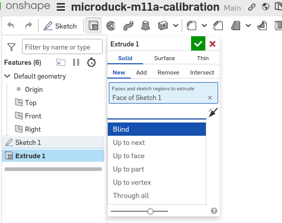

### 孔、细节与参数化检查

第二个草图建在底板顶面，不再画新的底板。三个圆属于同一 Sketch，因此一次 Extrude 就能切出三孔。

圆角和倒角放在切孔之后。这样选择边时，模型已经接近最终形状。

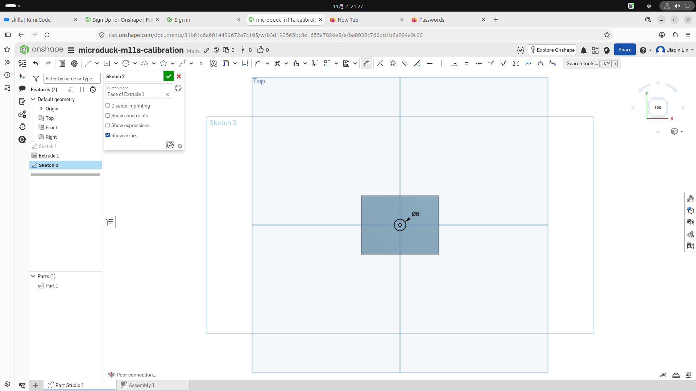

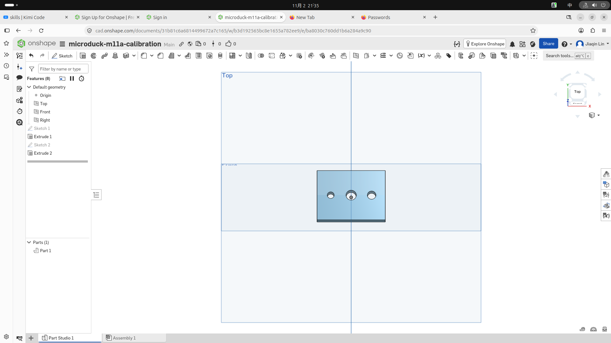

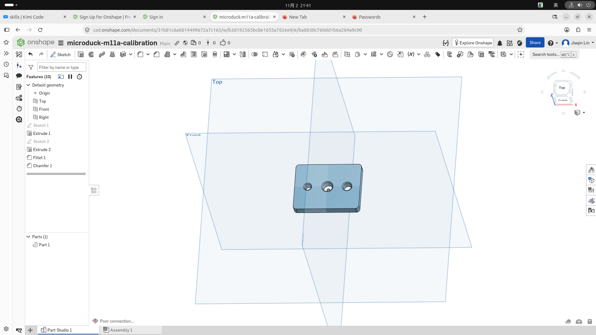

参数化检查不是另画一块板。把 Sketch 1 的宽度从 40 改成 45，再改回 40。预期三个孔的位置不变，Feature 树没有错误。

### 导出与切片

STL 用三角形描述实体表面，不保留草图、尺寸或 Feature 历史。导出时选 Binary STL、mm、Fine。

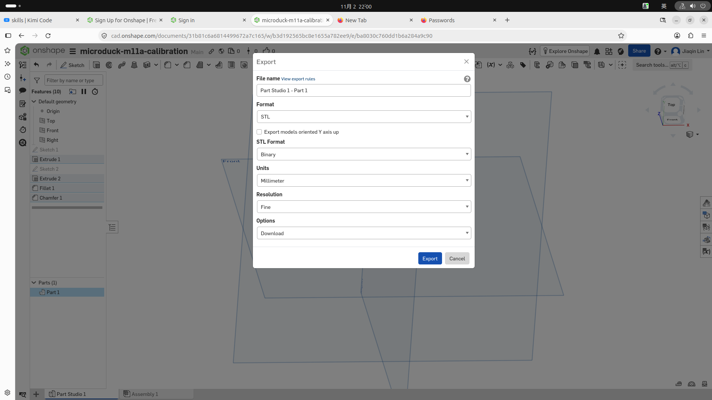

切片器把表面网格转成逐层路径，并按层高、壁数与填充率生成挤出动作。STL 是形状。

切片文件才是某台打印机的制造指令。

本课用 PrusaSlicer 2.7.2。配置是 Original Prusa MK4 Input Shaper 0.4 nozzle、Generic PLA、0.20 mm SPEED、20% infill。模型平放，scale 为 100%，不用 support 或 brim。

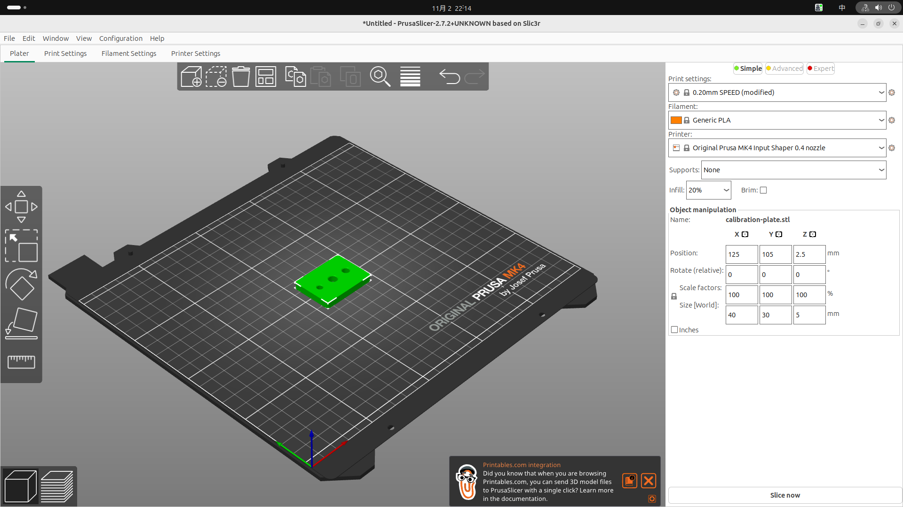

预期得到 25 层，约 10 min，耗材 4.18 g / 1.40 m。切片显示体积 3374.01 mm³，小于实体网格体积 5674.248 mm³，因为内部只有 20% 填充，壁与顶底实心层也不是整块实心。

保存 `.3mf` 以保留模型和切片配置。导出 `.bgcode` 供 MK4 使用。bgcode 是 MK4 默认的二进制 G-code，属于正常输出，不要把它当作其他打印机的通用文件。

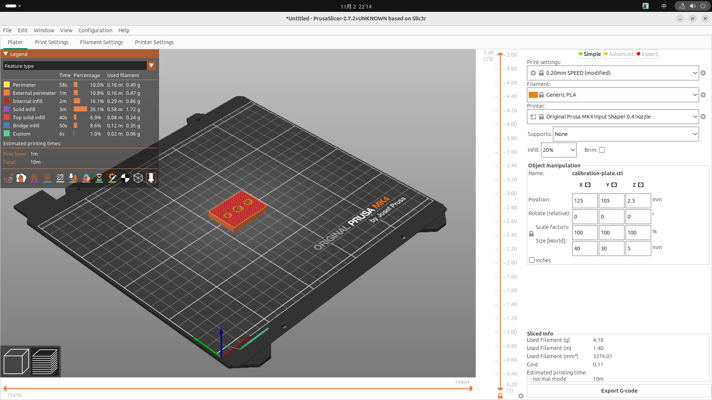

## 验收

在宿主机用 Linux 浏览器操作 Onshape。在宿主机用 PrusaSlicer 切片。最后在宿主机项目根运行自动断言。

这里只保存与检查数字文件，不宣称实物已通过。

### 1. 建文档并设置毫米

1. 登录 Onshape，创建 Public Document。
2. 输入名称 `microduck-m11a-calibration`。
3. 打开底部 `Part Studio 1`。
4. 确认左侧有 Origin、Top、Front、Right。
5. 点击左上角 Onshape 图标旁的三横线菜单。
6. 点击 `Workspace units`，不要用 `Measure`。

7. 把长度单位设为 `Millimeter`。
8. 关闭单位面板。

`Measure` 只改变测量结果的显示单位。`Workspace units` 才改变当前工作区的建模与输入单位。

### 2. 画 40×30 mm 底板草图

1. 点击 `Sketch`，选择 `Top` 平面。
2. 选择 `Center point rectangle`。
3. 点击 `Origin` 作为矩形中心。
4. 拖出矩形并点击对角点。
5. 用 `Dimension` 选择上下横边。
6. 输入 `40 mm` 并确认。

7. 用 `Dimension` 选择左右竖边。
8. 输入 `30 mm` 并确认。
9. 检查矩形中心仍在 Origin。
10. 点击绿色勾，完成 `Sketch 1`。

### 3. 拉伸 5 mm 基体

1. 点击 `Extrude`。
2. 选择 Sketch 1 的封闭区域。
3. 设置 `Solid`、`New`、`Blind`。
4. 输入 Depth `5 mm`。
5. 保持方向离开 Top 平面，形成正厚度。
6. 保持 Starting offset 为 0，关闭 Symmetric 与 Draft。

7. 点击绿色勾，得到 `Extrude 1` 和 `Part 1`。

### 4. 在顶面画三个圆

1. 点击 `Sketch`，选择底板顶面。
2. 用 `Center point circle` 在 Origin 画中间圆。
3. 用 `Dimension` 标注中间圆为 `Ø6 mm`。
4. 在中间圆左侧画第二个圆。
5. 标注左圆为 `Ø4 mm`。
6. 标注左圆心到 Origin 的水平距离为 `12 mm`。

7. 给左圆心与 Origin 添加 `Horizontal` 约束。
8. 在中间圆右侧画第三个圆。
9. 标注右圆为 `Ø5 mm`。
10. 标注右圆心到 Origin 的水平距离为 `12 mm`。
11. 给右圆心与 Origin 添加 `Horizontal` 约束。
12. 检查三个圆心共线，左右圆各距 Origin 12 mm。
13. 点击绿色勾，完成 `Sketch 2`。

### 5. 一次切出三个通孔

1. 点击 `Extrude`。
2. 框选三个圆的区域。
3. 设置 `Solid`、`Remove`、`Through all`。
4. 调整 Direction，使箭头指向底板内部。
5. 确认 Merge scope 为 `Part 1`。
6. 点击绿色勾，完成 `Extrude 2`。

7. 旋转视图，确认三个孔都贯穿 5 mm 底板。

### 6. 加圆角与倒角

1. 点击 `Fillet`。
2. 只选择四条外侧竖边。
3. 输入半径 `2 mm` 并确认。
4. 点击 `Chamfer`。
5. 选择三个孔的顶部圆边。
6. 选择等距倒角，输入 `0.5 mm`。

7. 确认不要选孔底边或外侧顶边。

### 7. 验证参数化回改

1. 在 Feature 树中编辑 `Sketch 1`。
2. 双击宽度 `40 mm`，改为 `45 mm`。
3. 等待模型重算。
4. 确认板宽变为 45 mm，孔位不动。
5. 确认 Feature 树没有红色错误。
6. 再把宽度从 `45 mm` 改回 `40 mm`。

7. 确认最终板宽为 40 mm。

### 8. 导出 STL

1. 在 Parts 列表右键 `Part 1`。
2. 点击 `Export`。
3. 格式选择 `STL`。
4. 选择 `Binary`，单位选择 `Millimeter`。
5. 分辨率选择 `Fine`。
6. 下载文件。

7. 在宿主机仓库根创建目标目录。

```sh
mkdir -p exercises/m11a-calibration
```

8. 把下载文件放到下面的路径，文件名必须一致。

```text
exercises/m11a-calibration/calibration-plate.stl
```

### 9. 配置 PrusaSlicer 并切片

1. 用 PrusaSlicer 2.7.2 导入该 STL。
2. Printer 选 `Original Prusa MK4 Input Shaper 0.4 nozzle`。
3. Filament 选 `Generic PLA`。
4. Print settings 选 `0.20mm SPEED`。
5. Infill 设为 `20%`。
6. Supports 设为 `None`。

7. 取消 `Brim`。
8. 保持模型平放，XYZ scale 均为 `100%`。
9. 点击 `Slice now`。
10. 检查预览显示 `25` 层。
11. 检查模型尺寸仍为 `40 × 30 × 5 mm`。
12. 预期耗时约 `10 min`。
13. 预期耗材约 `4.18 g / 1.40 m`。
14. 用 `Save project` 保存为下面的文件。

```text
exercises/m11a-calibration/calibration-plate.3mf
```

15. 点击 `Export G-code`，保存为下面的文件。

```text
exercises/m11a-calibration/calibration-plate.bgcode
```

看到 `.bgcode` 不需要改扩展名。它是这台 MK4 配置的正常输出。

### 10. 检查数字结果

本次实测 STL 有 3192 个三角形。包围尺寸是 40×30×5 mm，Z 范围是 0 到 5 mm。

边界边数为 0，非流形边数为 0。网格体积为 5674.248 mm³。切片显示体积为 3374.01 mm³，差异来自 20% 填充与路径生成。

在宿主机项目根运行自动验收：

```sh
bash accept/m11a-b01.sh
```

预期输出：

```text
M11a Bite 1 PASS: 40×30×5mm; 3192 triangles; watertight; STL/3MF/bgcode present
```

这只证明文件与封闭网格通过检查。没有打印机和卡尺时，不检查实际孔径、外形误差或配合。

## 坑

尺寸显示为英寸时，改 `Measure` 不会改工作区输入单位。应从左下角齿轮进入 `Workspace units`。

改宽后若孔跟着移动，先查草图参照。矩形中心应固定在 Origin，孔位也应相对 Origin 标注，不要相对矩形外边标注。

## 自测

**1. 要把后续输入尺寸统一成毫米，应改哪里？**

A. Measure 的 Length unit  
B. Workspace units  
C. STL 导出单位  

D. PrusaSlicer 的 scale

<details>
<summary>答案</summary>

B。Measure 只改测量显示。STL 单位和切片缩放也不能替代工作区单位。
</details>

**2. 一次切出三个贯穿孔，应选哪组 Extrude 设置？**

A. Surface / New / Blind  
B. Solid / Add / Up to next  
C. Solid / Remove / Through all  

D. Thin / Intersect / Up to face

<details>
<summary>答案</summary>

C。三个圆属于同一草图，可一次选择。Remove 负责切除，Through all 保证贯穿。
</details>

**3. 把板宽从 40 改为 45 时，怎样让孔位不动？**

A. 孔径改成相同值  
B. 以矩形外边标孔距  
C. 以 Origin 标孔位并固定矩形中心  

D. 先导出 STL 再改宽

<details>
<summary>答案</summary>

C。Origin 是稳定参照。相对外边标注会让孔随板边移动。
</details>

**4. 为什么切片体积会小于 STL 的实体网格体积？**

A. STL 导出时单位错了  
B. 20% 填充让内部大部分区域留空  
C. 25 层意味着模型变薄  

D. bgcode 删除了外壁

<details>
<summary>答案</summary>

B。切片按壁、顶底层和稀疏填充计算耗材，不再把内部当成完充实心体。
</details>

**5. 保存出的 `.bgcode` 应怎样处理？**

A. 改名成 `.stl`  
B. 当作通用文件交给任意打印机  
C. 保留，作为当前 MK4 的二进制 G-code  

D. 删除，只保留 `.3mf`

<details>
<summary>答案</summary>

C。bgcode 是 MK4 默认的二进制 G-code。`.3mf` 另用于保留项目与切片配置。
</details>
