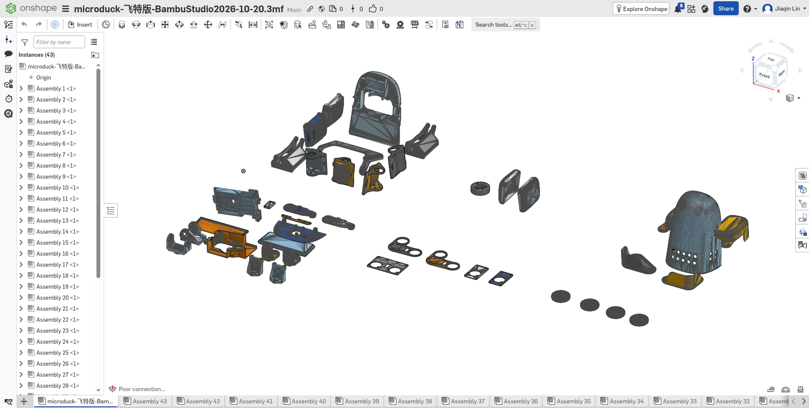
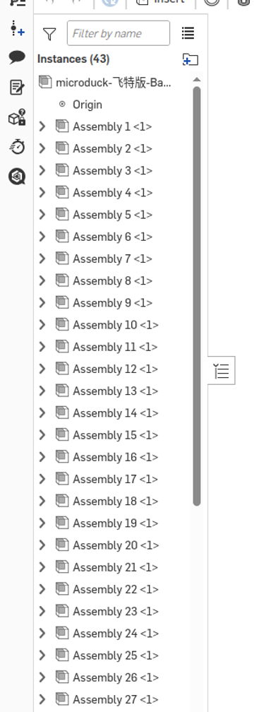

结论先说：整鸭复刻的尺寸基准不来自官方 CAD（打不开），而来自第三方**飞特 HD-1910 v2.2** 逆向模型。这一课把模型变成三样可核对的东西。零件清单有 43 件，关节表覆盖 15 颗舵机，参考文档能直接在 Onshape 打开。全程不打印。

## 问题

要复刻整只鸭子，第一步不是画零件，是回答：每个尺寸从哪来？

官方 Onshape 文档链接确实存在，`microduck_rl` 导出配置里就写着。但登录后打开，Assembly 和零件页都跳回 `Owned by me`——**当前账号没有这份文档的权限**。仓里剩下的 `.part` 文件只有身份信息，STL 是给仿真用的简化网格，看不出设计意图。

没有可读的参数化源模型，1:1 复刻就退化成"照着网格描"。所以这一课要解决的故障是：**尺寸来源不可用、不可核对**。

## 背景

CAD 文件格式各管一段，先分清：

| 格式 | 是什么 | 在本课的角色 |
|---|---|---|
| SolidWorks (`.SLDPRT` / `.SLDASM`) | 可编辑的参数化源文件，装配里带引用关系 | 权威来源，本课只做来源核查，不导入 |
| STEP (`.stp`) | 中性交换格式，几何精确、无特征历史 | 备用交换格式 |
| STL | 只有三角面片的形状，不带任何历史 | 可直接量尺寸，但丢掉设计意图 |
| 3MF | 打印工程格式，装的是切好的几何 + 摆放 | 本课拿它当"零件集"传进 Onshape |

三件事的约定：

- **水密网格**：每条边恰好被两个三角形共用，围成一个封闭体。开放壳体（有一圈"断边"）在 CAD 里算缺陷。
- **坐标系**：躯干系 **x 前、y 左、z 上**，和官方 MJCF 一致，后面所有装配都按它算。
- **零件清单要可追溯**：每件零件记名字、三角形数、包围盒，以及它来自哪个源包。

## 设计

```flow LR
(官方 Onshape 文档) --> {无权限}
(飞特 v2.2 SolidWorks 源包) -> (解包复核) -> (43 个零件网格)
(43 个零件网格) -> (Onshape 参考文档)
(官方 MJCF) -> (15 颗舵机关节表)
(43 个零件网格) & (15 颗舵机关节表) -> (*可核对的数字基线)
```

源头换成第三方逆向模型后，每一步都要留证据：

- **源包核查**：SHA-256 对上发布页，许可 CC BY-NC-SA 4.0，署名机械行者Robo。
- **解包复核**：发布页写"18 装配体 + 59 零件"，实际有效文件是 **17 装配体 + 56 零件 + 10 STEP**。差额来自 SolidWorks 的 `~$` 临时锁文件被算进了发布计数。核心装配是 00 总装 + 01–15 分组件共 16 个，另 1 个是轮滑组件。
- **拆成网格集**：把 43 个打印件从 Bambu 工程里拆成 STL，逐个检查封闭性。42 个水密，1 个开放（`unnamed-09`，包围盒 91.76×122.69×46.34 mm，头部上壳一类的开口壳体）。
- **进 Onshape**：3MF 传上去，得到可量尺寸的参考文档。





关节表不来自 CAD，来自官方 MJCF 导出：14 个策略关节加 1 个嘴舵机，正好 15 颗舵机，名字、轴、角度范围都写在 `exercises/m11b-ft-source/joint-layout.json` 里。

| 分组 | 关节 | 角度范围（rad） |
|---|---|---|
| 左腿 | hip_yaw / hip_roll / hip_pitch / knee / ankle | ±0.52 / ±0.38 / ±1.57 / ±1.57 / ±1.57 |
| 右腿 | 同名五项 | 镜像对称，yaw 区间左右互换 |
| 颈头 | neck_pitch / head_pitch / head_yaw / head_roll | −1.57…1.05 / ±1.57 / ±2.97 / ±0.44 |
| 嘴 | 独立控制，不进策略 | — |

### 怎么把它导进 Onshape

浏览器打开 <https://cad.onshape.com/documents>，左上角 `Create` → `Import files…`。文件选作者原始的 Bambu 工程（5.1 MB）：

```text
vendor/microduck-replica-cad/打印/microduck-飞特版-BambuStudio2026-10-20.3mf
```

模式选 **Import to a single document**，只勾 **Import appearances**。其余几项都不勾：material density 现在用不上；Y Axis Up 会把整个模型转 90°，破坏与源 CAD 的坐标对应；composite part 会把零件并成一体；join surfaces 会改动几何。

导入需要几分钟。完成后看两处：视口里 43 个零件按 5 个打印盘分开摆放、带颜色；底部标签栏有 43 个 PartStudio。

这份 3MF 会被拆成 43 个 PartStudio，**零件名丢失**（变成 `Assembly 1`…`Assembly 43`）。名字对照留在仓里：`vendor/microduck-ft-v2_2-mesh/mesh-inventory.json` 记着每个零件的名字、三角形数和包围盒。

源包本身也在仓里，需要时按件取：

```text
vendor/SolidWorks-FT2026-10-20.zip
```

SolidWorks 的特征树没有导入——整包 417 MB 上传太慢，而且它的装配引用关系存在二进制里提不出来。后面每一课按需单独导零件（单件 1–20 MB）更划算。

## 与原版差异

- [D72](../../spec/deviations.md)：结构基准从官方 XL330 CAD 换成第三方飞特 v2.2 逆向模型，许可 CC BY-NC-SA 4.0。

## 坑

- **官方 CAD 打得开不等于能读**。链接在 `microduck_rl` 的导出配置里，登录后打开仍会跳回 `Owned by me`——权限不在链接上。
- **zip 不是模型容器**。Onshape 不会把 zip 里的 STL 翻译成模型，报 `Translation is not supported for STL (.stl) files`；zip 里混进 JSON 更会直接报 JSON 不支持。要传就传单个 3MF。
- **3MF 少了 `<build>` 就转不动**。3MF 规范里，`<build>` 的 item 才是"把这个零件摆出来"的实例；只写 `<object>` 会报 `failed to translate`。
- **开放网格会让导入特征被标记异常**。43 件里有 1 件是开口壳体，Onshape 导入后提示 `Parts with faults have been imported`，特征树里 `Import 1` 显示 "did not regenerate properly"。这是网格缺陷，不是 Onshape 的 bug。
- **零件名有两处会丢**：3MF 拆成 43 个 PartStudio 时丢一次；3MF 元数据里没记名字的 12 件（`unnamed-01`…`unnamed-12`）丢一次。按包围盒看，它们多半是舵机本体、轴承、铜柱、PCB 这类参照件——**这是推断**，等后面跟 SolidWorks 源包逐件对照时确认。
