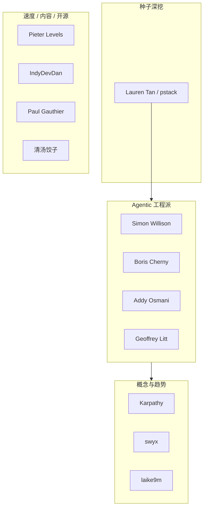

# 自称 AI 工作高效的国内外实践者调研报告

**日期**：2026-11-18  
**目录**：`research/ai-power-users-efficiency-practices/`  
**人选**：12 人（详见 [people/](./people/)）  
**引用**：正文用 `R##` 指向 [references.md](./references.md)

---

## 1. 执行摘要

2025–2026 年，「高效用 AI」的公开叙事已从「会写提示词」转向 **agentic engineering**：人负责规格、验证、架构与风险边界，agent 负责可循环的实现与维护。本报告对 12 位有公开出处的实践者/博主做横向拆解，回答用户指定的四个问题。

**核心结论（先读这五条）**：

1. **验证环 > 更强模型口号**。Boris Cherny 称给 Claude 可验证反馈可提质约 2–3×（R12）；土豆姐 pstack 把 prove-it-works / 真应用证据写成硬门禁（R02–R05）。  
2. **Claude Code / Cursor 之外，真正拉开差距的是「 harness」**：CLAUDE.md、slash commands、skills/playbooks、worktrees、hooks、浏览器验证、Showboat、Aider repo map、Notion 任务板等。  
3. **人机协同的老问题，解法高度同构**：幻觉→测试/真跑；上下文→外置记忆与新会话；review 成本→审证据而非只审散文；一致性→原则/规则升格；权限→白名单而非永久跳过；过度依赖→主/次任务分工与技能自觉。  
4. **RSI（本报告默认 Recursive Self-Improvement）** 的可观测形态是：纠错→固化为 skill/原则/CLAUDE.md→减少下次纠错；以及工具写工具（Aider）、loop 生成 loop（Cherny/swyx/Osmani）。**pstack 是最完整的公开「个人工程飞轮」样本**。  
5. **幸存者偏差严重**：Levels 式速度样本依赖受众；吞吐自述不可当对照组；国内「组合拳」教程可跟做但缺独立度量。

**RSI 词义说明**：下文默认 RSI = 用 AI/自动化改进自身工作流与能力的递归飞轮。若材料指 Research→Spec→Implement 式流程，会标 **RSI-流程** 以区分。

---

## 2. 人物图谱与分类

| 类型 | 人物 | 一句话定位 |
|---|---|---|
| 技能包 / 飞轮 | Lauren Tan | 把严谨工程做成可安装 playbook（pstack） |
| 验证与写作 | Simon Willison | TDD + demo 工具；命名 vibe engineering / agentic patterns |
| 产品创造者实践 | Boris Cherny | Claude Code 作者本人的并行 + 验证 + CLAUDE.md |
| 概念命名 | Karpathy | vibe coding → agentic engineering |
| 循环叙事 | swyx | Stop prompting, start building loops |
| 规范工作流 | Addy Osmani | spec→计划→RED/GREEN；Loop Engineering |
| 主次分工 | Geoffrey Litt | 外科医生模型：核心手做，次要过夜 agent |
| Indie 速度 | Pieter Levels | Cursor 三小时原型 × Build in Public |
| 教程化 Skills | IndyDevDan | 从零写 skill / subagent |
| 开源 RSI | Paul Gauthier | Aider 写 Aider |
| 中文趋势 | laike9m | Agent 指令中心观察 |
| 中文组合拳 | 清汤饺子 | Cursor 日常 + Claude Code 深度 |

每人短档案见 `people/`。张小珺等产业播客作背景引用（R35），不进主表。

---

## 3. 工具全景（强调 Claude Code / Cursor 之外）

下表汇总 **除 Claude Code、Cursor 外** 反复出现、且有公开用法说明的类别。Claude/Cursor 仍是多数人的主战场，但「高效差」往往在周边。

| 类别 | 代表工具 / 机制 | 谁在用 / 为何好用 | 关键功能或工作流 |
|---|---|---|---|
| 终端 Agent（非 Claude） | **Codex CLI**、**Gemini CLI**、**Aider** | Willison、Litt、Gauthier、部分国内博主 | 长时无人值守、git 提交环、repo map、多模型切换 |
| Agent 编排 / 原语 | Claude **goal / loop / routines**、Cursor **Task/subagent**、slash commands | Cherny、Osmani、Tan、swyx | 定时 triage、PR babysit、计划后 auto 实现 |
| 技能 / 规则层 | **pstack**、Agent Skills、`CLAUDE.md`、`.claude/commands/`、Cursor rules | Tan、Cherny、IndyDevDan、清汤饺子 | 路由 playbook、沉淀错误、统一风格 |
| 验证 / 演示 | 测试套件、Chrome 扩展测 UI、**Showboat+Rodney**、截图/录屏、benchmark checklist | Cherny、Willison、Tan | 「能证明」替代「声称完成」 |
| 隔离并行 | **独立 git checkout**、**git worktree** | Cherny、Osmani、Karpathy（强调） | 多 agent 不踩脚 |
| 任务外置记忆 | Markdown 状态文件、**Linear**、**Notion+MCP** | Osmani、Litt | 跨会话续跑；agent 举手等人 |
| 自动化钩子 | PostToolUse format、lint/test hooks | Cherny、Aider | 减 CI 失败与往返 |
| 浏览器 / 计算机使用 | Chrome 扩展、Rodney、control-app 类 skill | Cherny、Tan、Willison | 端到端 UX 验证 |
| 内容与分发（非编码） | X Build in Public、播客 | Levels、swyx、laike9m | 效率含获客与认知分发 |
| 沙箱执行 | ChatGPT Code Interpreter 等 | Willison | 安全试跑 |

**国内常见组合**（清汤饺子等，R33）：Cursor 负责短平快与 GUI；Claude Code 负责审查/重构/长对话；用项目文档对齐两边「记忆」。这与国外「IDE 内环 + CLI 外环」（swyx、Litt）同构。

**未证实 / 弱证据**：各类「提效 50×」营销文、未公开配置的私有 agent 农场——本报告不采信为可迁移实践。

---

## 4. 方法论模式归纳（6 种可复用模式）

### 模式 A：计划→一枪实现（Plan then one-shot）

Cherny：Plan mode 来回改到满意，再 auto-accept，常能一枪出 PR（R12）。Osmani：15 分钟共创 `spec.md` 再拆任务（R18）。  
**有效原因**：把歧义消耗在便宜的文本阶段，而不是贵的大 diff 阶段。

### 模式 B：验证闭环（Verification loop）

Tan：真实应用/截图/指标；Cherny：浏览器测到 UX 满意；Willison：pytest + Showboat demo。  
**有效原因**：关掉「agent 谎称完成」的主通道；人从保姆变为抽查证据。

### 模式 C：内外环分工（Inner / Outer loop）

本地高频：Cursor tab、人手设计（Litt、清汤饺子）。离开键盘：Claude Code/Codex 过夜、routines 盯 issue（Cherny、Litt、Osmani）。  
**有效原因**：匹配「要可见性的任务」与「要最终交付的任务」。

### 模式 D：多候选竞技（Arena / 多模型交叉评审）

pstack `/arena`：多模型出设计，异家族评审（R02–R04）。  
**有效原因**：对抗单一模型品味与幻觉；用一致性当信号。

### 模式 E：小 PR / 可验证单元

Tan、Osmani、Karpathy 早期「单步增量」：小变更、可回滚、可测。  
**有效原因**：降低 review 认知负荷；适配并行 agent。

### 模式 F：公开建造 × 极速原型（BIP + vibe）

Levels：自然语言 → 可玩原型 → 受众验证（R27–R29）。  
**有效原因**：优化的是「发现」而非「长期可维护性」；与模式 B/E 目标不同，勿混用成功标准。

---

## 5. 人机协同常见问题与对策对照表

| 痛点 | 典型表现 | 实践者对策（摘） |
|---|---|---|
| 幻觉 / 假完成 | 声称已测、编造 API | 强制跑测/真应用（Cherny、Tan、Willison）；TDD 先红后绿 |
| 上下文丢失 | 长会话漂移、中断恢复丢指令 | 新开子代理默认（pstack）；状态写磁盘（Osmani）；Notion 看板（Litt）；会话摘要 fork（IndyDevDan） |
| Review 成本爆炸 | 吞吐量上去后人成瓶颈 | 审证据（录屏/状态图）优先；实现与审查分模型；小 PR；先 plan 再码 |
| 一致性 / 风格漂移 | 多工具各写各的 | 单一真相源：`CLAUDE.md` ↔ Cursor rules（国内多文强调）；原则文件必须先读再引用（pstack） |
| 权限与安全 | 跳过权限导致破坏 | Cherny：白名单 `/permissions`，极少 skip；沙箱跑长任务；Karpathy：人仍对漏洞负责 |
| 过度依赖 / 技能萎缩 | 80% agent、手写萎缩（Karpathy 自述，R21） | 主任务保持人手与学习相（Litt、Karpathy tight leash）；区分 vibe 与 agentic |
| 并行冲突 | 多 agent 改同一树 | 独立 checkout / worktree |
| 工具切换税 | Cursor↔Claude 来回丢上下文 | 场景分工表 + 文档记忆（清汤饺子）；同阶段单一写者 |
| 上下文塞太多 | 「把全仓加进 chat」 | Aider FAQ 明确反对；用 repo map（R31） |

---

## 6. RSI 实践专题（含 pstack 深挖）

### 6.1 两种 RSI 口径

| 口径 | 含义 | 本报告中的样本 |
|---|---|---|
| **RSI-飞轮**（默认） | Recursive Self-Improvement：产出改进工具/规则，再改进下轮产出 | pstack、CLAUDE.md 回写、Aider 自写、loop 生成 loop |
| **RSI-流程** | Research → Spec → Implement（或同类阶段门） | Osmani spec→plan→build；部分国内「需求拆解→架构→实现」教程 |

二者常叠加：流程提供阶段，飞轮提供跨项目资产积累。

### 6.2 种子案例：土豆姐与 pstack

**是什么**：Lauren Tan（poteto）的个人 Agent 工程技能包，以 Cursor 插件公开发布（MIT），也兼容 Agent Skills 格式（R02–R05）。入口是 `/poteto-mode`：按任务匹配约 **23** 套 playbook，再调用 skills / 子代理；另有约 **24** 条原则文件。

**她解决的核心矛盾**：产量暴涨时如何不沦为 slop。AI Engineer CODE 2026 演讲的可迁移内核是——**信任来自环境约束，不是更多 prose**（仓内二次调研 R01）：代码/API 设计 → lint/类型/测试 → 运行时 verification → 最后才是 AGENTS.md/skills。

**工作流骨架**（综合 R02–R05）：

1. `/setup-pstack` 选预算与模型表  
2. 目标 + **明确验收条件** → `/poteto-mode`  
3. 理解：`/how`（机制）、`/why`（动机与历史证据）、`/teach`、`/recall`  
4. 设计：`/architect`、`/arena`（多候选）、原型 playbook  
5. 实现：子代理按角色选模型；实现与审查分离、异模型家族  
6. 验证：真实应用 / 截图 / 性能；prove-it-works  
7. 交付：小而可审的 PR；babysit / shipping 分 playbook  
8. 飞轮：`/correct` 与原则沉淀；她自述许多原则来自纠正 agent 的会话（R02）

**为何对她（及跟跑者）「很有帮助」**：

- 把隐性工程品味变成**可路由资产**，降低每次从零 prompt 的方差  
- **验证 skill** 让 agent 自洽，人从逐步盯梢变为抽查  
- **多模型竞技** 降低单模型独断  
- 公开插件形成社区镜像与二创文档（learn-pstack、V2EX 译文等），加速传播与反馈

**局限**：重度依赖 Cursor 编排能力；token/费用与复杂度高；吞吐量数字为自述；不宜无约束照搬「禁注释」等本地政策（R01）。

### 6.3 其他人的飞轮形态（对照）

| 人物 | 飞轮载体 | 一句话 |
|---|---|---|
| Cherny | `CLAUDE.md` + slash + routines | 每次 PR 教训写回仓库；loop 代替重复 prompt |
| Willison | 博客 patterns + Showboat | 公开模式库 + 自建验证工具 |
| Osmani | skills + 定时 automation + 状态文件 | Loop engineering |
| Gauthier | Aider 自举 | 工具改进自身的可度量闭环 |
| IndyDevDan | 教学→skill 模板 | 观众复用其 skill 结构 |
| Litt | overnight prep + Notion | 次日主任务被 agent 预热 |
| Levels | 受众 ×  freestyle 原型 | 商业飞轮强、工程飞轮弱 |
| 清汤饺子 | 项目记忆文档 | 轻量、国内易复制 |

产业侧「better AI makes better AI」（R35）描述的是**模型公司**飞轮，与个人工作流飞轮不同层，勿混淆。

---

## 7. 对读者的可行动建议

按投入从低到高：

1. **本周**：给主项目写一份 ≤3k token 的 `CLAUDE.md` / 等价规则（错误案例 + 如何跑测 + 禁止项）。  
2. **本周**：固定一句验收：「改完请运行 X，失败则修到通过；并给出 Y 证据。」  
3. **两周**：画一张工具分工表（内环 IDE / 外环 CLI），禁止同阶段双写者。  
4. **一月**：把重复成功的流程收成 **一个** skill 或 slash（先勿贪多）。  
5. **进阶**：试 worktree 双 agent；试「实现模型 ≠ 审查模型」。  
6. **研究 pstack**：先读官方 guide / 二创解剖，再决定是否安装；优先抄「验证 + 原则升格」，而非抄全部 23 playbook。  
7. **评估标准**：用「返工次数、revert 率、验证证据率」代替「生成了多少行」。

---

## 8. 局限与偏见

- **幸存者偏差**：公开「高效」者多为已有受众、已在顶尖团队、或靠内容变现的人。  
- **自述夸大**：PR 数、ARR、提效倍数缺独立审计。  
- **工具版本漂移**：2025 与 2026 模型/产品形态变化快，具体开关名可能过时，模式更稳。  
- **检索缺口**：XSearch 本环境不可用；小红书等平台抓取不完整，国内人选偏「长文/播客可核验」。  
- **语言与圈子**：英文工程博客密度高于中文可复现深文；中文侧多组合拳教程与产业播客。  
- **本报告不是**：工具评测排行榜，也不是「照抄即 10×」承诺。

---

## 附录：四人问题覆盖自检

| 问题 | 主要落点 |
|---|---|
| 1 工具栈 | §3；各 `people/*` 的 tool_stack |
| 2 公开看法与实践 | §2、§4；references 全表 |
| 3 人机协同 | §5 |
| 4 RSI（含 pstack） | §6 |

人物详情 → [people/](./people/)；金句 → [quotes/key-quotes.md](./quotes/key-quotes.md)；出处 → [references.md](./references.md)。
