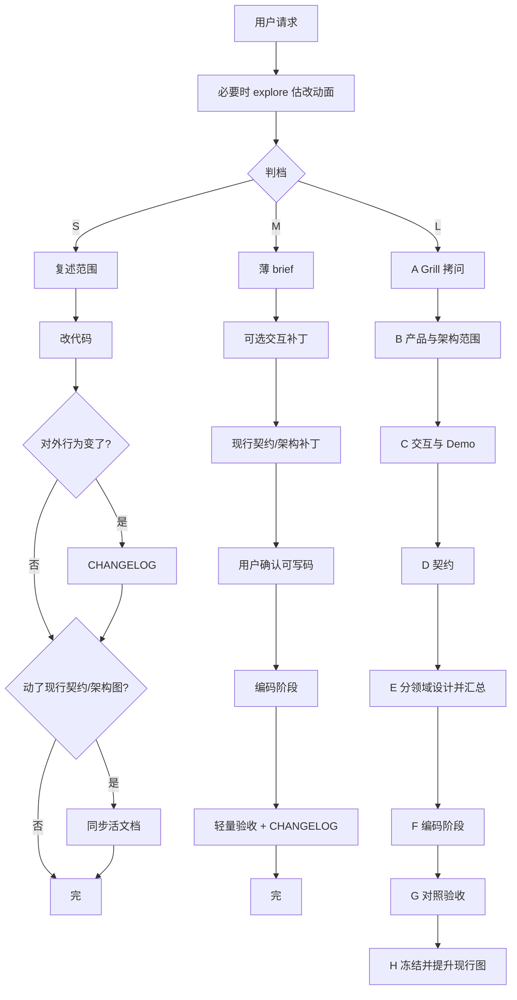
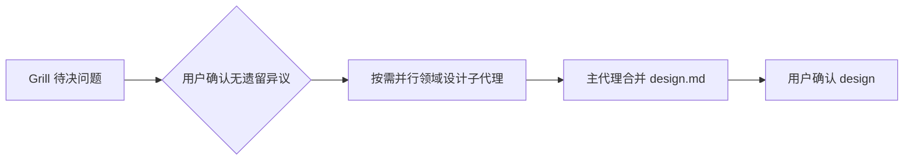

# 产品交付（Product Delivery）

管意图对齐、分档、文档寿命、确认闸门、验收与产品架构文档归属。不替代目标仓库 `AGENTS.md` 红线。

目标：

1. **做出来的是用户想要的**：靠闸门与可验收产物对齐。
2. **文档可读路径清晰**：产品 → `product/`；架构 → `architecture/`；现状 → 现行契约/代码；考古 → 冻结变更包。
3. **小改不拖垮流程**：一句话能说清的直接改；大改才走完整澄清。

## 怎么用（接到任务时）

1. **判档** S / M / L。吃不准时先估改动面（可派 explore 子代理），再定档；仍不准就问用户一句。细则与示例见下文；流程见 [`references/flows-S.md`](references/flows-S.md) / [`flows-M.md`](references/flows-M.md) / [`flows-L.md`](references/flows-L.md)。
2. 走到**下一个闸门**就停，等明确确认（「可以」「按这个来」「开始写码」）。闸门细则：[`references/gates.md`](references/gates.md)。
3. 确认可写码后进入编码：见「编码阶段」。
4. 按档完成 Definition of Done。

编排强度：见「编排强度（子代理）」——**L 默认派**长产出子流程；主会话只留决策与指针。红线：[`references/agent-rules.md`](references/agent-rules.md)。  
接入仓库目录树：[`templates/docs-layout.md`](templates/docs-layout.md)；AGENTS 段落：[`templates/AGENTS-snippet.md`](templates/AGENTS-snippet.md)。

## 核心信条

1. **先判档，再动手。** 看语义影响 × 改动面（代码 + 活文档/契约）。
2. **未确认不写业务码。** L/M 闸门通过前不 scaffold 业务、不扩大范围。环境/依赖除外（须用户知情）。
3. **对齐靠产物。** Grill 一问一答；Demo/操作清单；契约表对动作；分领域设计再汇总。
4. **变更包落地即冻结。** 禁止为后续小改回写正文。
5. **产品现状不从历史拼。** 读 `product/*` + `architecture/*` + 现行契约 + 代码。
6. **代码与活文档冲突 → 以代码为准修活文档**；历史包只加取代指针。
7. **Grill 一次一问**；复述确认后再问下一个。

## 真相分层

各层写什么、模板骨架：[`references/doc-model.md`](references/doc-model.md)。

| 层 | 典型路径 | 何时改 |
|---|---|---|
| 产品宪法 | `docs/product/`（VISION / MVP / CAPABILITIES…） | 定位、价值机制、能力分期、扩展点承诺 |
| 产品架构 | `docs/architecture/`（模块、关系、关键时序、spine、ADR） | 模块边界或协作关系变了 |
| 现行契约 | `docs/contracts/current/` 或由 schema 生成 | 跟代码一起改 |
| 行为流水 | `CHANGELOG.md` | S/M 对外行为变了写一行 |
| 历史变更包 | `docs/changes/NNNN-slug/` | 落地后冻结，只读 |
| 实现细节 | 代码 / shared schema | 控件与字段细节的最终真相 |

| 想知道 | 读 |
|---|---|
| 产品是干什么的、MVP 验证什么 | `product/*` |
| 有哪些模块、怎么协作、关键时序 | `architecture/*` |
| 现在协议/配置长什么样 | 现行契约或生成物 |
| 当时为什么那样定 | 对应冻结变更包 |
| UI 有没有某个控件 | **代码** |

```text
docs/
  product/
    VISION.md
    MVP.md
    CAPABILITIES.md
    GLOSSARY.md
  architecture/
    overview.md
    spine.md
    flows/
      review-approve.md
    adr/
  contracts/
    current/
  changes/
    0001-initial-mvp/
  conventions/
CHANGELOG.md
```

## 图放哪里（含 mermaid 序列图）

图跟真相寿命走；优先 Mermaid 嵌 Markdown。画图时可使用 **`draw-diagram`** skill 选型与产出，结果写入下表路径。

| 图在说什么 | 放哪 | 寿命 |
|---|---|---|
| 产品价值/阶段主流程 | `product/MVP.md` 或 `CAPABILITIES.md` 内嵌 | 随产品宪法 |
| 模块框、依赖方向、部署/进程关系 | `architecture/overview.md` | 现行 |
| 跨模块关键时序 | `architecture/flows/*.md` | 现行 |
| 本次变更讨论中的时序/状态 | 变更包 `interaction.md` / `design.md` | 验收后若成长期行为 → **提升**到 `architecture/flows/` |
| API/事件字段说明 | `contracts/current/` | 现行 |
| ADR 背景示意 | `architecture/adr/*` | 随 ADR |

禁止：Frozen 变更包当现行架构唯一出处；`product/` 里画实现级类图。

## 任务分档（S / M / L）

流程细则：[`flows-S`](references/flows-S.md) · [`flows-M`](references/flows-M.md) · [`flows-L`](references/flows-L.md)。

| 轴 | 问什么 |
|---|---|
| **语义影响** | 是否改价值机制、产品级扩展点、核心业务语义、对外承诺？ |
| **改动面** | 几处代码？是否必须改现行契约/架构文档/CHANGELOG？调用方多少？ |

| 档 | 判定 | 流程 |
|---|---|---|
| **S** | 语义基本不动；改动面小。可顺带改活文档——**有文档 diff ≠ 升档** | 快车道 |
| **M** | 对外行为或协议局部变化，或改动面中等、仍是既有能力修补 | 薄变更 |
| **L** | 新产品/MVP、新能力、改价值机制/产品级扩展点/主交互；或需要分领域设计与 Demo | 完整澄清 |

探索后再判：口头像 S、实际多调用点/多契约 → 升 M/L；口头像 M、实则一行 + 再生契约 → 可降 S。估错就停下改档。

复述：「定为 S/M/L …，语义上 …，改动面上 …。对吗？」

### 示例

| 请求 | 档 | 理由 |
|---|---|---|
| 加「复制 JSON」按钮 | **S** | 语义不动 |
| explore 后一行 + 再生 openapi | **S** | 改动面极小；活文档同步不升档 |
| 内部 rename，对外协议不变 | **S** | 行为不变 |
| **对外 API 字段改名** | **M** | 协议形状变；更新现行契约 + 实现；一般不必 L |
| 内部 DTO 改名，对外字段不变 | **S** | 对外无感 |
| API 新增多可选字段并展示 | **M** | 局部协议与可见行为 |
| 「自动跳过」→「必须确认」 | **M** 或 **L** | 单步钉死 → M；牵动主路径/多契约 → L |
| 从零 MVP / 同级新能力 / 重做确认模型 | **L** | 产品级 |

## 流程总览



### L：阶段职责与闸门

| 阶段 | 职责 | 未通过时 |
|---|---|---|
| **A Grill** | 一次一问；题库见 [`discovery.md`](references/discovery.md)；2～3 方案；复述确认 | 不落盘产品/架构、不写码 |
| **B 范围落盘** | 更新 `product/*`；需要时改 `architecture/overview` 模块意图；开变更包 `brief` | 不开交互细稿 |
| **C 交互与 Demo** | 主代理定操作清单/验收路径；**整页 Demo 默认派子代理**（见编排）；用户亲手走通。价值路径仍糊时可先用 **`processize`** | 不定稿契约 |
| **D 契约** | 事件/配置/API 从 Demo 反推；关键协作画 sequence（可先放变更包） | 不进入分领域详设 |
| **E 设计** | Grill 待决 → 确认 → 分领域设计 → 汇总 | 不调用实现 |
| **F 编码** | 见「编码阶段」；只实现已确认范围 | — |
| **G 验收** | 同一演示脚本跑真系统 | 不冻结 |
| **H 冻结** | 变更包 Frozen；现行契约同步；长期图提升到 `architecture/`；CHANGELOG | — |

### Grill → 分领域设计 → 汇总（阶段 A / E）

完整步骤见 [`flows-L.md`](references/flows-L.md)；拷问题库见 [`discovery.md`](references/discovery.md)。



1. **Grill（主代理）**：待决问题表（倾向 + 取舍）→ `design-decisions.md`。未确认前不派领域设计子代理。
2. **分领域设计（子代理，按需）**：只派用得上的（api / config / module / 数据…）→ 各自 `design-*.md`；可并行；禁止凑齐全派。
3. **画图**：时序、模块关系用 Mermaid（可用 **`draw-diagram`**）；先放变更包，确认后按「图放哪里」提升。
4. **汇总（主代理）**：合并为短 `design.md`（仅本期涉及领域）→ 再停等确认 → 才编码。

Grill Mind-set：能简单则简单；不为假想扩展预埋空框架；产品级扩展点只写边界承诺。

### M：薄变更

见 [`flows-M.md`](references/flows-M.md)。半页 brief → 可选交互补丁 → 现行契约/必要 architecture 补丁 → 确认 → 编码 → 轻量验收 → CHANGELOG。不改写历史变更包；不无故改 `product/MVP`。

### S：快车道

见 [`flows-S.md`](references/flows-S.md)。复述 → 改代码（+ 必要活文档）→ 该写的 CHANGELOG/现行契约写上。模块关系未变不改 architecture。禁止开完整澄清包、回写冻结包、静默改产品宪法。

## 产品架构文档（现行）

`docs/architecture/` = **现在系统长什么样**。

| 文件 | 内容 |
|---|---|
| `overview.md` | 模块/应用清单、一句话职责、关系 Mermaid |
| `spine.md` | 跨模块不能各写各的决策 |
| `flows/*.md` | 少数关键端到端时序；宁缺毋滥 |
| `adr/*` | 已接受决策 |

`product/` = 为什么存在、验证什么、能力分期。  
`architecture/` = 模块与协作怎么拼；**不要**在此重复代码分层细则（分层在编码阶段用 layered-codebase）。

## 对齐闸门

细则与反例：[`references/gates.md`](references/gates.md)。

| 闸门 | 用于 | 通过标准 |
|---|---|---|
| **意图闸** | L 必过；M 简过 | Grill 复述获认可 |
| **体验闸** | L 必过 | 用户按 Demo 独立走通主路径 |
| **契约闸** | L 必过；M 动协议则过 | 动作在契约表有对应行 |
| **验收闸** | L/M 必过；S 看 diff/真机 | 演示项在真系统成立 |

禁止把「嗯 / 看看 / 差不多」当实现授权。

## 变更包

```text
docs/changes/0001-initial-mvp/
  brief.md
  ops-inventory.md
  interaction.md
  design-decisions.md
  design-api.md
  design-module.md
  design.md
  prototypes/
    demo.html
    README.md
  contracts/
    events.md
  specs/
  plans/
    verification.md
```

按需创建，不预建空目录。生命周期：`Draft → Confirmed → Implementing → Frozen`。  
Frozen 后只改状态/取代指针。长期图在 H 提升到 `architecture/`。

## 编排强度（子代理）

### 尺度（先读这句）

主会话只保留 **决策与指针**（确认了什么、文件在哪、卡在哪道闸、下一句该问用户什么）。  
凡是**产出很长**、且对用户只需回「路径 + 怎么用」的，**默认派子代理**；子代理交回短报告 + 路径，主代理**不要**把整份 HTML/大 diff 念进主对话。

会污染「下一句该问用户什么」的内容，禁止堆在主会话。

### 按档位

| 场景 | 做法 |
|---|---|
| **S** / 改动面清晰 | 主代理独扛；不为编排而编排 |
| **M** | 需要时再派 explore 或单领域起草；小补丁主代理做 |
| **L** | 主代理只做：Grill、判档、闸门确认、合并结论；下表「默认派」的子流程**必须派**（除非命中例外） |

### L：默认派 vs 例外（避免「可派」歧义）

| 子流程 | L 默认 | 例外（可主代理做） |
|---|---|---|
| explore 估改动面 / 现状报告 | **派** | 改动面已一眼清晰、无需翻库 |
| **整页 / 多分支可点 Demo**（新建或按新意图重做） | **派** | — |
| 流程图/状态图大稿 | **派**（或 `draw-diagram` 子任务） | 改已有 Mermaid 两三行 |
| 起草 events/api/config 契约表 | **派** | 改已有表一两行 |
| 分领域 `design-*` | **派**（按需并行，禁止凑齐） | 用户确认只需一个极短领域且半页内 |
| 实现切片 | **派**（大项目） | 单文件级补丁 |
| 验收勾选跑脚本 | 可派 | 主代理主持「过/不过」对话 |
| 已有 Demo 上的**小补丁**（加一按钮、改文案、加一条已确认分支） | 主代理改即可 | 若补丁牵动整页结构 → 仍派 |

「可派」**不得**读成「爱派不派」。对 L 的 Demo/explore/领域设计/契约起草：表意是 **默认派；上表例外才留主会话**。

### 交接

- 主会话保留：档位、已确认结论、闸门状态、产物路径、对用户的短回复。
- 子代理 prompt 必须含：目标、约束、路径、已确认结论、禁止事项、交回格式（短报告 + 路径；勿要求子代理「向用户长篇解说」）。
- 不套娃：子代理是叶子；要再拆由主会话按回传再派。
- 反例：事事派（交接本身变 noise）；或 L 整页 Demo 堆主会话（上下文 noise，Grill/闸门易漂）。

## 编码阶段

**仅在用户确认可写码之后进入。**

1. **读取并遵循 [`layered-codebase`](../layered-codebase/SKILL.md)**：分层落位、测试归属、写码红线、该 skill 的 Definition of Done。
2. 只实现已确认范围；发现需求歧义 → **停回本 skill 闸门**，不在代码里定产品语义。
3. 实现中改了对外契约或模块边界 → 同步现行契约 / `architecture/`（仍属本 skill 活文档义务）。
4. 编码完成证据（测试命令与结果）按 layered-codebase 要求给出，再回到本 skill 做验收/冻结/CHANGELOG。

S/M 若动了代码，同样在改码期间遵循 layered-codebase。

## Agent 红线

摘要如下；展开见 [`references/agent-rules.md`](references/agent-rules.md)。流程/文档 review 用 [`references/review-checklist.md`](references/review-checklist.md)。

- 未判档（或该估改动面却没估）不改产品行为。
- 闸门未过不写业务实现、不「先跑一版」。
- 不把推测写成已确认；Grill 一次一问。
- 不回写 Frozen 变更包正文；不以历史包当现行说明。
- 对外契约变了却不更新现行契约 = 未完成。
- 长期行为图不提升到 `architecture/` = 活文档欠账。
- 未读 layered-codebase 就开始堆业务分层代码 = 违规。
- L/M 交付须有验收依据。

## Definition of Done

**S**：范围一致 → 不越界 → CHANGELOG/现行契约该写已写 → 若改码则满足 **layered-codebase** DoD。  

**M**：brief 确认 → 现行契约（及必要 architecture）已更新 → 轻量验收 → CHANGELOG → **layered-codebase** DoD。  

**L**：A–E 已确认 → Demo 脚本真系统通过 → 现行契约一致 → 长期图已入 `architecture/` → 变更包 Frozen → `product/*` 宏观已更新 → **layered-codebase** DoD。

## 参考文件

| 文件 | 内容 |
|---|---|
| [`references/doc-model.md`](references/doc-model.md) | 产品/架构/契约/变更包写什么、模板骨架 |
| [`references/flows-S.md`](references/flows-S.md) | S 快车道步骤与 CHANGELOG |
| [`references/flows-M.md`](references/flows-M.md) | M 薄变更步骤 |
| [`references/flows-L.md`](references/flows-L.md) | L 各阶段步骤与编排 |
| [`references/discovery.md`](references/discovery.md) | Grill 规则与题库、方案对比格式 |
| [`references/gates.md`](references/gates.md) | 四闸门细则与反例 |
| [`references/agent-rules.md`](references/agent-rules.md) | 本 skill 行为红线展开 |
| [`references/review-checklist.md`](references/review-checklist.md) | 流程/文档 review 清单 |
| [`references/sources.md`](references/sources.md) | 规范出处（给人看，运行时不必读） |
| [`templates/docs-layout.md`](templates/docs-layout.md) | 目标仓库文档目录树 |
| [`templates/AGENTS-snippet.md`](templates/AGENTS-snippet.md) | 可粘贴进 AGENTS.md 的段落 |
| [`../layered-codebase/SKILL.md`](../layered-codebase/SKILL.md) | 编码阶段必读 |
