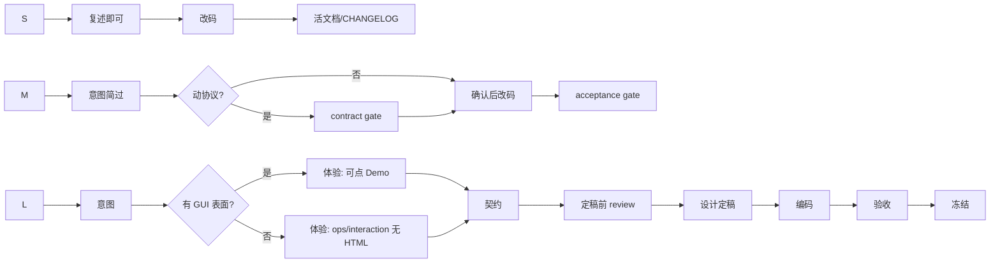

# 对齐 gate细则

gate是硬停点：未获用户明确确认，不得进入下一阶段写码或扩大范围。

## 确认用语

**算通过**：可以、按这个来、确认、同意、开始写码、无异议继续。  
**不算通过**：嗯、看看、差不多、先做着、随意、稍后看。

Agent 拿不准时再问一句：「是否确认进入下一步：…？」

## 五个 gate

### 1. intent gate

| 项 | 内容 |
|---|---|
| 何时 | L 必过；M 用简短复述即可；S 请求已无歧义可跳过 |
| 产物 | 一句意图。已拍板的写进决策清单，不把 brief 交给人 |
| 通过 | 用户认可这一句，以及相对旧品类的一句差异化心智 |
| 未过禁止 | 请人读 brief、落盘扩张后的 product 细稿、开详设、写码 |

反例：把「用户没反对」当成认可；一次抛十个问题。

### 2. experience gate

| 项 | 内容 |
|---|---|
| 何时 | L 必过；M 仅当主路径**人可感知操作**变了（GUI 点击路径或 CLI/API 主用法） |
| 先判表面 | 本期是否改/新增**可点 GUI**（Web/桌面等）。只动 CLI、配置、Provider、纯 API、无新页面控件 → **无 GUI 表面** |
| 产物 | **必有**：`ops-inventory` + `interaction`（阶段 × 动作 × 所见 × 反应）。**有 GUI 表面**才另加可点 HTML Demo + README。**无 GUI 表面禁止** `prototypes/demo.html` / 整页可点 HTML |
| 通过 | 有 GUI：人看 Demo 路径说「过」或改哪一步。无 GUI：人看操作清单 / 命令路径说「过」。不请人读长 README |
| 未过禁止 | 请人读 README、契约定稿当最终、写业务实现；把 Demo 当视觉规格或成品控件清单；把「仅演示」模拟控件当成品；**无 GUI 仍写/派 HTML Demo** |

有 GUI 时，Demo 只做这些：

- 确认交互与文案心智。可以丑。按钮可以是**模拟效果**。
- 交互只抽**原则**（如软跳、确认闸、反馈闭环）。成品视觉另开简规或设计向任务。
- 仅为演示方便的控件（例：主导航已能到达，仍加的「去某步」捷径；「模拟 Agent 写 batch」）在 README 标「仅演示」，**不得**默认带进实现。
- 用用户的**差异化句子**回检文案。禁止默认套竞品/旧品类模板与其默认按钮文案。

无 GUI 时：主代理（或 experience 只出文字）写清命令/配置主路径即可；**不要**派 `pd-experience` 去写 HTML，也**不要**为「显得规范」建空 `prototypes/`。

**体验闸要不要视频**（与验收闸分开；仅有 GUI Demo 时适用）：

- **默认不要**：带「仅演示」模拟控件的低保真可点 HTML，给人路径自己点即可。
- **例外要视频**：仅当 Demo 的 UI **刻意对齐成品**（控件位置/文案与最终一致），交互用 HTML/CSS/JS **动画模拟**、不是真实后端；此时用动画页直接出视频，**不要**派 agent-browser 去点网页。
- **验收闸**：写码后派 `roles/accept` 举证（已有 verify 脚本优先，否则有界面用 agent-browser），最终过/不过仍是人。

反例：CLI/API-only 的 L 仍拉起 `demo.html`；用 agent 点半天当体验通过；把 Demo 路径当验收通过。

### 3. contract gate

| 项 | 内容 |
|---|---|
| 何时 | L 必过；M 动了协议/配置形状则过 |
| 前置 | 角色已钉：谁改配置 / 谁执行对外或付费动作 / GUI 做什么。有 Agent 时先问清其宿主（CLI/会话）实际能力。未钉前**不写长协议** |
| 产物 | 与已确认交互原则对得上的**外部可感知**表（形状、错误码、HTTP/CLI/磁盘/WS/退出码）。写法见 [`doc-model.md`](doc-model.md) §3 |
| 通过 | 核对子代理无未决的外部可感知矛盾。有拍板点则一次一条问字母，人不读契约表 |
| 未过禁止 | 请人过目契约、分领域详设当最终、写码定字段名；用 Demo 控件清单填 API |

反例：与已确认动作对不上仍说「差不多」；`null` 键、无用 API、把 pid/port 写进配置、为以后扩展堆字段。

### 4. design gate （L）

| 项 | 内容 |
|---|---|
| 何时 | L 必过；紧接 design.md 合并之后、请用户「定稿」之前 |
| 产物 | 核对子代理的短报告（文档矛盾 / 可感知未决 / 写码歧义），必须交回。未决拍板点变成决策清单 |
| 通过 | 报告已消化；剩下的字母已回；用户说「开始写码」 |
| 未过禁止 | 进入编码；请人读 design；半页也不得跳过核对 |

对照范围：变更包 + `product/` + `architecture/` + 现行契约 + **相关存量代码**。

交回格式与步骤见 [`flows-L.md`](flows-L.md) E。精简文档后仍担心漏项：靠这次 review 抓缺口，不靠把文档写长。

反例：主代理自己扫一眼就请定稿；只读文档不碰代码；带着「待确认」项直接开写。

### 5. acceptance gate

| 项 | 内容 |
|---|---|
| 何时 | L/M 必过；S 以 diff/真机抽查 |
| 产物 | 派 `roles/accept`。有界面：已有 verify/control 优先，否则 **agent-browser** 点通主路径，交短证据（截图路径、settle 文案、命令/generation 状态、必要时 trace）。无界面：可复现脚本输出。付费边界另附 trace 的 request body，不把 body 念给人 |
| 通过 | 人根据证据与/或自己真机点验说「过」。效果不对就是不过。**agent 探路 ≠ 验收通过** |
| 通过后必须 | 指挥者自己做完：brief → Frozen；关联 CAP Next → Launch（若适用）；CHANGELOG。对人只报一行 |
| 未过禁止 | 标 Frozen、宣称完成、把 CAP 标成 Launch、说「待验收」；用探路代替人拍板 |

付费 API：

1. 默认 trace：在 Provider 边界拦截出站请求，保存 request body，不打到付费模型。探路证据须能说明触发动作和「请求已组好」。
2. 真调用只在目标仓库 `docs/conventions/project-rules.md` 写了允许条件时才发生。档位和次数以该文件为准。
3. 没有项目规则就禁止为验收发出付费请求。失败先改 trace 或决策。

反例：257 个测试全绿却无人拍板；agent 自己说「探路过了」就 Frozen；本 skill 替项目规定模型档位。

## gate与档位

