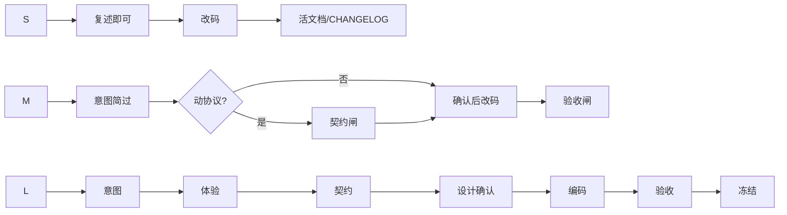

# 对齐闸门细则

闸门是硬停点：未获用户明确确认，不得进入下一阶段写码或扩大范围。

## 确认用语

**算通过**：可以、按这个来、确认、同意、开始写码、无异议继续。  
**不算通过**：嗯、看看、差不多、先做着、随意、稍后看。

Agent 拿不准时再问一句：「是否确认进入下一步：…？」

## 四闸门

### 1. 意图闸

| 项 | 内容 |
|---|---|
| 何时 | L 必过；M 用简短复述即可；S 请求已无歧义可跳过 |
| 产物 | Grill 复述 / `design-decisions` 或 brief 中的 In/Out |
| 通过 | 用户认可价值机制、范围边界，以及相对旧品类的一句差异化心智 |
| 未过禁止 | 落盘扩张后的 product 细稿、开详设、写码 |

反例：把「用户没反对」当成认可；一次抛十个问题。

### 2. 体验闸

| 项 | 内容 |
|---|---|
| 何时 | L 必过；M 仅当主路径交互变了 |
| 产物 | 两层：(1) **交互** Demo + 操作清单 / README（必有）(2) **视觉方向**（可选，另开，不从 Demo 抽） |
| 通过 | 用户按说明**自己**走通主路径；认可的是交互与文案心智 |
| 未过禁止 | 契约定稿当最终、写业务实现；把 Demo 当视觉规格或成品控件清单 |

Demo 只做这些：

- 确认交互与文案心智。可以丑。按钮可以是**模拟效果**。
- 交互只抽**原则**（如软跳、确认闸、反馈闭环）。成品视觉另开简规或设计向任务。
- 仅为演示方便的控件（例：主导航已能到达，仍加的「去某步」捷径）在 README 标「仅演示」，**不得**默认带进实现。
- 用用户的**差异化句子**回检文案。禁止默认套竞品/旧品类模板与其默认按钮文案。

反例：只截静态图无操作；agent 替用户「脑补已点过」；把演示专用捷径原样写进成品。

### 3. 契约闸

| 项 | 内容 |
|---|---|
| 何时 | L 必过；M 动了协议/配置形状则过 |
| 前置 | 角色已钉：谁改配置 / 谁执行对外或付费动作 / GUI 做什么。有 Agent 时先问清其宿主（CLI/会话）实际能力。未钉前**不写长协议** |
| 产物 | 与已确认交互原则对得上的**外部可感知**表（形状、错误码、HTTP/CLI/磁盘/WS/退出码）。写法见 [`doc-model.md`](doc-model.md) §3 |
| 通过 | 用户过目或明确「契约可以」 |
| 未过禁止 | 分领域详设当最终、写码定字段名；用 Demo 控件清单填 API |

design 确认后、写码前再审一轮，只查「写码会猜错的可感知项」。缺了补行。担心精简丢信息：派子代理只审缺口，不靠把文档写长。

反例：与已确认动作对不上仍说「差不多」；`null` 键、无用 API、把 pid/port 写进配置、为以后扩展堆字段。

### 4. 验收闸

| 项 | 内容 |
|---|---|
| 何时 | L/M 必过；S 以 diff/真机抽查 |
| 产物 | `verification.md` 勾选或 CHANGELOG 对应项 |
| 通过 | 演示脚本在真系统成立；「仅演示」控件没有变成产品控件 |
| 未过禁止 | 标 Frozen、宣称完成 |

反例：测试绿了但演示脚本没走过；用「应该没问题」代替证据。

## 闸门与档位

