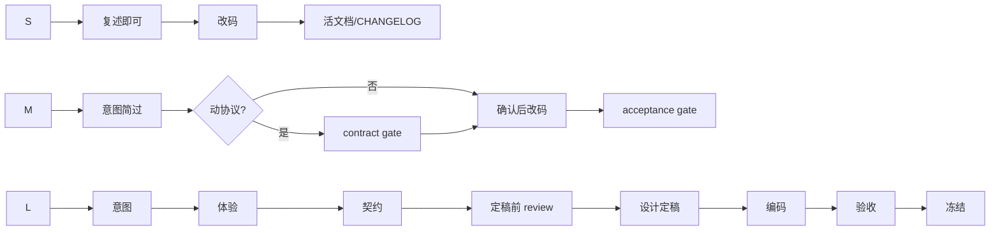

# 对齐 gate细则

gate是硬停点：未获用户明确确认，不得进入下一阶段写码或扩大范围。

## 确认用语

**算通过**：可以、按这个来、确认、同意、开始写码、无异议继续。  
**不算通过**：嗯、看看、差不多、先做着、随意、稍后看。

Agent 拿不准时再问一句：「是否确认进入下一步：…？」

## 五个 gate

### 1. intent gate

| 项 | 内容 |
|---|---|
| 何时 | L 必过；M 用简短复述即可；S 请求已无歧义可跳过 |
| 产物 | 一句意图。已拍板的写进决策清单，不把 brief 交给人 |
| 通过 | 用户认可这一句，以及相对旧品类的一句差异化心智 |
| 未过禁止 | 请人读 brief、落盘扩张后的 product 细稿、开详设、写码 |

反例：把「用户没反对」当成认可；一次抛十个问题。

### 2. experience gate

| 项 | 内容 |
|---|---|
| 何时 | L 必过；M 仅当主路径交互变了 |
| 产物 | 两层：(1) **交互** Demo + 操作清单 / README（必有）(2) **视觉方向**（可选，另开，不从 Demo 抽） |
| 通过 | 摄影子代理交一条主路径视频。人看效果说「过」或指出改哪一步。不要求人按 README 自己走 |
| 未过禁止 | 请人读 README、契约定稿当最终、写业务实现；把 Demo 当视觉规格或成品控件清单 |

Demo 只做这些：

- 确认交互与文案心智。可以丑。按钮可以是**模拟效果**。
- 交互只抽**原则**（如软跳、确认闸、反馈闭环）。成品视觉另开简规或设计向任务。
- 仅为演示方便的控件（例：主导航已能到达，仍加的「去某步」捷径）在 README 标「仅演示」，**不得**默认带进实现。
- 用用户的**差异化句子**回检文案。禁止默认套竞品/旧品类模板与其默认按钮文案。

反例：只截静态图无操作；agent 替用户「脑补已点过」；把演示专用捷径原样写进成品。

### 3. contract gate

| 项 | 内容 |
|---|---|
| 何时 | L 必过；M 动了协议/配置形状则过 |
| 前置 | 角色已钉：谁改配置 / 谁执行对外或付费动作 / GUI 做什么。有 Agent 时先问清其宿主（CLI/会话）实际能力。未钉前**不写长协议** |
| 产物 | 与已确认交互原则对得上的**外部可感知**表（形状、错误码、HTTP/CLI/磁盘/WS/退出码）。写法见 [`doc-model.md`](doc-model.md) §3 |
| 通过 | 核对子代理无未决的外部可感知矛盾。有拍板点则一次一条问字母，人不读契约表 |
| 未过禁止 | 请人过目契约、分领域详设当最终、写码定字段名；用 Demo 控件清单填 API |

反例：与已确认动作对不上仍说「差不多」；`null` 键、无用 API、把 pid/port 写进配置、为以后扩展堆字段。

### 4. design gate （L）

| 项 | 内容 |
|---|---|
| 何时 | L 必过；紧接 design.md 合并之后、请用户「定稿」之前 |
| 产物 | 核对子代理的短报告（文档矛盾 / 可感知未决 / 写码歧义），必须交回。未决拍板点变成决策清单 |
| 通过 | 报告已消化；剩下的字母已回；用户说「开始写码」 |
| 未过禁止 | 进入编码；请人读 design；半页也不得跳过核对 |

对照范围：变更包 + `product/` + `architecture/` + 现行契约 + **相关存量代码**。

交回格式与步骤见 [`flows-L.md`](flows-L.md) E。精简文档后仍担心漏项：靠这次 review 抓缺口，不靠把文档写长。

反例：主代理自己扫一眼就请定稿；只读文档不碰代码；带着「待确认」项直接开写。

### 5. acceptance gate

| 项 | 内容 |
|---|---|
| 何时 | L/M 必过；S 以 diff/真机抽查 |
| 产物 | 有界面：**一条效果视频**（先探路再录）。无界面：可复现脚本输出。付费边界另附 trace 的 request body，不把 body 念给人 |
| 通过 | 人看视频（或脚本输出）说「过」。效果不对就是不过 |
| 通过后必须 | 指挥者自己做完：brief → Frozen；关联 CAP Next → Launch（若适用）；CHANGELOG。对人只报一行 |
| 未过禁止 | 标 Frozen、宣称完成、把 CAP 标成 Launch、说「待验收」 |

付费 API：

1. 默认 trace：在 Provider 边界拦截出站请求，保存 request body，不打到付费模型。视频拍到触发动作和「请求已组好」。
2. 真调用只在目标仓库 `docs/conventions/project-rules.md` 写了允许条件时才发生。档位和次数以该文件为准。
3. 没有项目规则就禁止为验收发出付费请求。失败先改 trace 或决策。

反例：257 个测试全绿却没有视频；真机要人开口才跑；本 skill 替项目规定模型档位；用「应该没问题」代替视频。

## gate与档位

