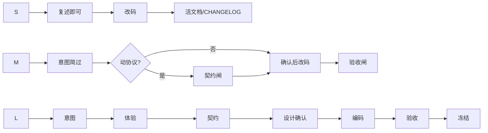

# 对齐闸门细则

闸门是硬停点：未获用户明确确认，不得进入下一阶段写码或扩大范围。

## 确认用语

**算通过**：可以、按这个来、确认、同意、开始写码、无异议继续。  
**不算通过**：嗯、看看、差不多、先做着、随意、稍后看。

Agent 拿不准时再问一句：「是否确认进入下一步：…？」

## 四闸门

### 1. 意图闸

| 项 | 内容 |
|---|---|
| 何时 | L 必过；M 用简短复述即可；S 请求已无歧义可跳过 |
| 产物 | Grill 复述 / `design-decisions` 或 brief 中的 In/Out |
| 通过 | 用户认可价值机制与范围边界 |
| 未过禁止 | 落盘扩张后的 product 细稿、开详设、写码 |

反例：把「用户没反对」当成认可；一次抛十个问题。

### 2. 体验闸

| 项 | 内容 |
|---|---|
| 何时 | L 必过；M 仅当主路径交互变了 |
| 产物 | `prototypes/` + 演示 README；或等价可点稿 |
| 通过 | 用户按说明**自己**走通主路径 |
| 未过禁止 | 契约定稿当最终、写业务实现 |

反例：只截静态图无操作；agent 替用户「脑补已点过」。

### 3. 契约闸

| 项 | 内容 |
|---|---|
| 何时 | L 必过；M 动了协议/配置形状则过 |
| 产物 | 事件/API/配置表；动作与表行可对上 |
| 通过 | 用户过目或明确「契约可以」 |
| 未过禁止 | 分领域详设当最终、写码定字段名 |

反例：契约与 Demo 动作对不上仍说「差不多」。

### 4. 验收闸

| 项 | 内容 |
|---|---|
| 何时 | L/M 必过；S 以 diff/真机抽查 |
| 产物 | `verification.md` 勾选或 CHANGELOG 对应项 |
| 通过 | 演示脚本在真系统成立 |
| 未过禁止 | 标 Frozen、宣称完成 |

反例：测试绿了但演示脚本没走过；用「应该没问题」代替证据。

## 闸门与档位

